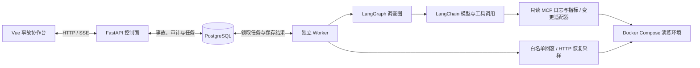

# OpsSwarm

**一个可恢复的多 Agent 事故响应实验室。** OpsSwarm 在本地模拟订单服务故障。收到告警后，系统根据证据动态分派日志、指标和变更调查任务，经独立审查与人工审批，执行一次受控回滚，再用订单 HTTP 请求确认服务是否恢复。如果回滚后订单仍然失败，系统会在原预算内调查一次新证据，并把结论与待处理事项交给工程师。

## 一起看一场故障

1. **订单接口返回 500。** 控制面创建事故，独立 Worker 领取调查。协调 Agent 决定先查哪些数据。审查 Agent 发现证据不足时，可以要求补查，例如验证错误率变化是否与某次发布重合。
2. **工程师补充上下文。** 等待期间，调查状态已持久化，Worker 可以处理其他任务。补充提交后，系统重新评估证据，为支持的回滚动作生成候选。审批与执行使用独立身份，审批绑定具体计划版本和核验依据。
3. **执行并验证结果。** 白名单执行器只修改本地演练服务的版本状态。重复请求复用原操作，执行在写入之后中断时，接手 Worker 查询原操作回执。正常场景通过连续三次订单 HTTP 200 验证恢复。若三次探针仍为 500，系统读取新时间窗口，完成独立复查并保存人工接管状态。

## 系统怎么跑



- **Agent 调查。** LangGraph 编排动态分派、并行调查、补查和独立审查。LangChain 接入模型、受限工具与结构化输出。每次调用记录所用材料，证据保留来源和时间窗口，各角色共享调用、Token、费用和时限预算。
- **状态可追溯。** PostgreSQL 保存事故、证据、任务、人工决定和执行结果。LangGraph checkpoint 保存图的恢复位置。协作台通过可重放 SSE 更新事故时间线。
- **执行受约束。** 模型提出调查任务和候选方案，确定性代码校验权限、预算、审批版本和执行条件。执行范围限于隔离的本地订单演练环境。

## 上手演示

准备 Python 3.12、[uv](https://docs.astral.sh/uv/) 和运行 Linux 容器的 Docker Compose v2（支持 `!reset` 和 `!override`）。在仓库根目录用 PowerShell 执行。演示使用脚本模型和独立数据卷，无需外部模型密钥。

```powershell
uv sync --locked
.\scripts\local-demo.ps1 -Action Start
.\scripts\local-demo.ps1 -Action Check
.\scripts\local-demo.ps1 -Action Run -Scenario handoff
.\scripts\local-demo.ps1 -Action Stop
```

启动后打开[事故协作台](http://127.0.0.1:35173)，也可访问[控制面健康检查](http://127.0.0.1:38080/health)。预检通过后可以运行下列场景，停止服务会保留演示数据。

| 场景参数 | 可以观察到的流程 |
| --- | --- |
| `handoff` | 使用冻结数据补查，重启后读回人工等待记录，补充信息后重评并进入候选评估 |
| `recovery` | 使用现场演练数据调查，经人工审批执行一次回滚，验证订单恢复并将事故标记为已解决 |
| `reflow` | 回滚后注入连接池故障，采集新的现场证据，经独立复查转交工程师 |

演示手册包含身份、报告和重启核对步骤，部署手册说明如何配置自己的模型。 [本地演示手册](docs/local-demo.md) · [标准部署手册](docs/local-release.md)

## 当前验收状态

- 动态调查、预算与 checkpoint 恢复已有真实 PostgreSQL 集成验证，使用脚本模型与模拟 MCP。[动态调查验收](docs/progress/live-dynamic-investigation.md)
- 正常恢复的代表性集成测试验证了回滚生效后中断、接手只读对账、三次 HTTP 200 和事故收敛。一次失败后重新取证、复查和持久接管已通过隔离 Compose 的代表场景。[恢复验收](docs/progress/local-demo-recovery-proof.md) · [失败回流验收](docs/progress/reflow-input-projection.md)
- 当前版本仍待在时钟稳定的环境完成正式 Compose 的三条场景与保留卷复验。近期 Windows／WSL 演练受容器与宿主时钟偏差阻断。脚本模型验证覆盖工程链路，模型推理质量由独立评测考察。[项目状态](docs/PROJECT_STATE.md) · [时钟诊断](docs/progress/local-demo-dispatch-clock.md)

## 从代码读起

| 想了解什么 | 入口 |
| --- | --- |
| 事故 API、持久任务与 SSE | [控制面](src/opsswarm/control_plane) · [系统架构](docs/architecture/02-system-architecture.md) |
| 动态分工、上下文与共享预算 | [Worker 装配](src/opsswarm/worker/dynamic_factory.py) · [调查模块](src/opsswarm/investigation) · [Agent 系统设计](docs/architecture/65-agent-system-design.md) |
| 审批、单次回滚和恢复采样 | [审批](src/opsswarm/approval) · [执行 Worker](src/opsswarm/execution/release_jobs/worker.py) · [恢复 Worker](src/opsswarm/verification/candidate/worker.py) |
| 人工操作与事故时间线 | [事故协作台](web/src/views/IncidentWorkroomView.vue) |
| 独立评测与历史验收 | [RCAEval RE2](evaluations/rcaeval-re2) · [开发记录](docs/progress/README.md) |
