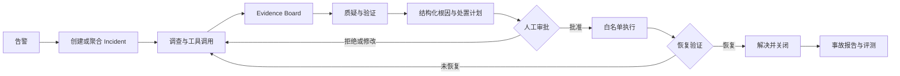

# OpsSwarm 项目章程

## 1. 项目定位

OpsSwarm 是一个面向软件事故响应的多 Agent 协作与安全执行平台。系统在收到线上告警后，自动汇总日志、指标和最近变更，通过可恢复的调查流程形成带来源的证据、根因假设和处置计划；工程师审批后，系统才允许确定性执行器在白名单内操作，并继续验证是否恢复。

项目既用于学习企业级 AI 应用后端开发，也用于求职和面试展示。因此，技术选择必须能说明业务价值和可靠性，而不是单纯堆叠框架或 Agent 数量。

MVP 已完成发布验收。下一阶段建设完整多 Agent 工程版，多 Agent 是既定架构方向，重点展示区别于 RAG 项目的任务分解、专业协作、共享记忆、上下文管理、多轮决策、人工介入和可恢复执行能力。交付顺序见 [完整多 Agent 工程版规划](64-full-multi-agent-roadmap.md)，运行层与协议边界见 [Agent 系统最终设计](65-agent-system-design.md)。第 64、65 步是文档决策，第 66～67 步将冻结 v2 固定图接入任务、专业结果、协作事件和恢复核对，第 68 步加入调用次数与总时限的持久预算；其余能力逐片验收，不把完整目标视为已交付。

## 2. 目标用户与客户

目标客户是拥有 20～200 名研发人员的中小型 SaaS 或互联网研发团队，通常已经具备基础云原生工具，但缺少统一事故响应平台。

| 角色 | 主要诉求 |
| --- | --- |
| 值班开发 | 快速了解告警影响、关键证据和下一步操作 |
| SRE/DevOps | 统一调查入口、减少重复操作、控制执行风险 |
| 后端负责人 | 降低对少数资深工程师经验的依赖 |
| CTO/研发总监 | 缩短 MTTR，沉淀复盘资产并量化改进效果 |

## 3. 核心价值

- 缩短发现、定位、处置和恢复所需时间。
- 把日志、指标、部署和代码变更组织成可验证的 Evidence Board。
- 显式记录事故状态、调查轨迹、审批、执行和验证结果。
- 通过风险分级、人工审批和白名单执行降低自动化误操作风险。
- 为每次事故生成可审计时间线和复盘材料。
- 用版本化场景验证多 Agent 协作质量、调查结果、资源约束与失败恢复能力。

## 4. 项目目标

### 4.1 MVP 目标

以下保留 MVP 阶段目标与历史建设顺序，实际验收见 [MVP 发布记录](../progress/63-mvp-compose-release.md)。

- 在本地 Docker Compose 环境稳定复现三类故障：版本引入大量 500、数据库连接池配置错误、Redis 不可用。
- 完成从告警接入到 Incident 关闭的显式状态流，并能够在进程重启后恢复重要状态。
- 建立单 Agent 调查基线，再增加并行调查与证据质疑流程。
- 所有根因、证据、计划、审批和执行结果都有结构化数据与审计记录。
- 只允许确定性执行器操作演练环境，所有有风险的动作都可审批、可重试、可追踪。
- 建立根因准确率、恢复成功率、调查耗时、工具调用、成本和安全违规等评测指标。

### 4.2 完整多 Agent 工程版目标（逐片建设）

- 根据事故上下文动态分解任务，各专业 Agent 在受限工具内开展多步调查。
- 持久化调查轮次、专业任务、报告与证据关系，通过独立审查和有界补查处理分歧。
- 使用 LangGraph、LangChain 与内部轻量 Harness 组织协作；支持跨专业补查和未知假设，执行资格仍由能力白名单与确定性规则控制。
- 区分工作记忆、事故事实、人工确认的跨事故经验和版本化调查手册，按任务组装可追溯且受预算约束的上下文。
- 通过本地只读 MCP 获取现场日志与指标，内部业务工具直接调用应用服务，当前不引入 A2A。
- 支持人工补充、暂停、取消和恢复，进程重启不丢失已提交业务事实。
- 在现有安全边界内增加候选方案规划、多步骤处置及验证失败后的有界重新调查。
- 通过跨服务、干扰变更和复合故障场景验证真实现场协作，展示任务过程与人工操作。
- 在经验审核前具备最小可信操作员身份，逐步交付角色权限、自动化验收、部署说明和可复现演示；具体顺序以完整工程版规划为准。

### 4.3 非目标

- MVP 与完整工程版均不连接真实生产集群，不承担生产事故自动处置责任。
- 完整工程版不建设通用 Kubernetes 管理平台或完整可观测性平台。
- 不以 RAG、企业知识库或文档问答作为核心能力。
- 不为了展示多 Agent 而拆分无价值的角色。
- 不在早期实现复杂多租户、企业 SSO、计费或插件市场。
- 首版不引入通用代码执行沙箱、递归子 Agent、向量经验库、知识图谱或独立记忆平台。

## 5. 成功标准

### 5.1 工程标准

- 相同外部告警可以幂等接收，不重复创建 Incident。
- 状态迁移、事件记录和关键业务写入保持事务一致。
- 长任务在 API 或 Worker 重启后能够从持久状态继续处理。
- SSE 断线后可以依据事件游标补发，而不是丢失时间线。
- 执行器拒绝未授权工具、非法参数、过期审批和重复危险操作。
- 每个功能切片都具备测试、进度文档和独立 Git 提交。

### 5.2 Agent 评测维度

| 指标 | 含义 |
| --- | --- |
| 根因 Top-1 准确率 | 首选根因是否与故障真值一致 |
| 恢复成功率 | 执行批准方案后系统是否通过恢复验证 |
| 调查耗时 | 从开始调查到产生可审批计划的时间 |
| 工具调用数 | 完成一次调查所需外部工具调用量 |
| Token 与成本 | 模型使用量和估算费用 |
| 安全违规率 | 是否提出或尝试未授权、高风险操作 |
| 证据覆盖率 | 结论是否有足够的日志、指标或变更证据支撑 |
| 协作质量 | 任务分派、分歧识别和定向补查是否符合场景预期 |
| 有界终止 | 无法继续时是否在预算内结束或转入人工处理 |
| 恢复正确性 | 节点失败、人工等待和进程重启后是否正确继续，重复命令是否幂等 |

单 Agent 基线、历史对照结果及其版本继续保留。自完整工程版规划起，不再把单、多 Agent 收益对比作为开发或保留多 Agent 的前提。新评测以协作、质量、安全和恢复验收为目标，不提前设定缺乏数据支撑的提升百分比；冻结真值评分与真实现场运行记录继续明确区分。

## 6. MVP 业务流程

## 7. 分阶段路线

下表保留最初 MVP 建设路线，不能据此认定所有规划机制均已实现。MVP 发布后的最终开发顺序以 [完整多 Agent 工程版规划](64-full-multi-agent-roadmap.md) 为准；第 65 步已统一上下文、MCP、身份与经验的依赖关系，实际完成情况见 [进度索引](../progress/README.md)。

| 阶段 | 可交付结果 |
| --- | --- |
| 0 | 项目章程、系统架构、技术栈、数据库设计和协作规范 |
| 1 | 版本 500 故障模拟、告警接入、Incident 状态机与时间线 |
| 2 | 单 Agent 只读调查基线与固定评测用例 |
| 3 | 协调节点及日志、指标、变更并行调查 |
| 4 | Evidence Board、假设质疑和结构化处置计划 |
| 5 | 审批、风险分级、白名单执行和幂等控制 |
| 6 | 恢复验证、暂停恢复、SSE 时间线和基础 UI |
| 7 | 单 Agent、多 Agent 对照评测与事故报告 |
| 8 | 真实 Prometheus、Docker、GitHub 或 MCP 适配器 |

## 8. 面试表达

> OpsSwarm 围绕事故响应组织多 Agent 协作。当前已交付固定并行调查、证据审查、持久任务、人工审批、受控执行和恢复验证；业务数据、Agent checkpoint 与执行权限分别管理。下一阶段将建设动态任务分解、专业工具循环和人工介入，通过版本化场景验证协作与恢复质量。只有完成对应验收后，才把新增能力写成已实现成果。
