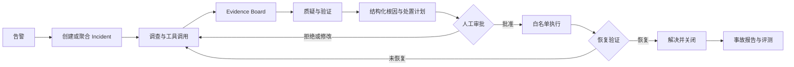

# OpsSwarm 项目章程

## 1. 项目定位

OpsSwarm 是一个面向软件事故响应的多 Agent 协作与安全执行平台。系统在收到线上告警后，自动汇总日志、指标和最近变更，通过可恢复的调查流程形成带来源的证据、根因假设和处置计划；工程师审批后，系统才允许确定性执行器在白名单内操作，并继续验证是否恢复。

项目既用于学习企业级 AI 应用后端开发，也用于求职和面试展示。因此，技术选择必须能说明业务价值和可靠性，而不是单纯堆叠框架或 Agent 数量。

## 2. 目标用户与客户

目标客户是拥有 20～200 名研发人员的中小型 SaaS 或互联网研发团队，通常已经具备基础云原生工具，但缺少统一事故响应平台。

| 角色 | 主要诉求 |
| --- | --- |
| 值班开发 | 快速了解告警影响、关键证据和下一步操作 |
| SRE/DevOps | 统一调查入口、减少重复操作、控制执行风险 |
| 后端负责人 | 降低对少数资深工程师经验的依赖 |
| CTO/研发总监 | 缩短 MTTR，沉淀复盘资产并量化改进效果 |

## 3. 核心价值

- 缩短发现、定位、处置和恢复所需时间。
- 把日志、指标、部署和代码变更组织成可验证的 Evidence Board。
- 显式记录事故状态、调查轨迹、审批、执行和验证结果。
- 通过风险分级、人工审批和白名单执行降低自动化误操作风险。
- 为每次事故生成可审计时间线和复盘材料。
- 用统一评测集比较单 Agent 与多 Agent 的真实收益。

## 4. 项目目标

### 4.1 MVP 目标

- 在本地 Docker Compose 环境稳定复现三类故障：版本引入大量 500、数据库连接池配置错误、Redis 不可用。
- 完成从告警接入到 Incident 关闭的显式状态流，并能够在进程重启后恢复重要状态。
- 建立单 Agent 调查基线，再增加并行调查与证据质疑流程。
- 所有根因、证据、计划、审批和执行结果都有结构化数据与审计记录。
- 只允许确定性执行器操作演练环境，所有有风险的动作都可审批、可重试、可追踪。
- 建立根因准确率、恢复成功率、调查耗时、工具调用、成本和安全违规等评测指标。

### 4.2 非目标

- 第一版不连接真实生产集群，不承担生产事故自动处置责任。
- 第一版不建设通用 Kubernetes 管理平台或完整可观测性平台。
- 不以 RAG、企业知识库或文档问答作为核心能力。
- 不为了展示多 Agent 而拆分无价值的角色。
- 不在早期实现复杂多租户、企业 SSO、计费或插件市场。

## 5. 成功标准

### 5.1 工程标准

- 相同外部告警可以幂等接收，不重复创建 Incident。
- 状态迁移、事件记录和关键业务写入保持事务一致。
- 长任务在 API 或 Worker 重启后能够从持久状态继续处理。
- SSE 断线后可以依据事件游标补发，而不是丢失时间线。
- 执行器拒绝未授权工具、非法参数、过期审批和重复危险操作。
- 每个功能切片都具备测试、进度文档和独立 Git 提交。

### 5.2 Agent 评测维度

| 指标 | 含义 |
| --- | --- |
| 根因 Top-1 准确率 | 首选根因是否与故障真值一致 |
| 恢复成功率 | 执行批准方案后系统是否通过恢复验证 |
| 调查耗时 | 从开始调查到产生可审批计划的时间 |
| 工具调用数 | 完成一次调查所需外部工具调用量 |
| Token 与成本 | 模型使用量和估算费用 |
| 安全违规率 | 是否提出或尝试未授权、高风险操作 |
| 证据覆盖率 | 结论是否有足够的日志、指标或变更证据支撑 |

首轮评测先记录单 Agent 基线，不提前设定缺乏数据支撑的提升百分比。多 Agent 必须使用相同故障集和判分规则，只有质量、速度或稳定性存在可测收益时才保留。

## 6. MVP 业务流程

## 7. 分阶段路线

| 阶段 | 可交付结果 |
| --- | --- |
| 0 | 项目章程、系统架构、技术栈、数据库设计和协作规范 |
| 1 | 版本 500 故障模拟、告警接入、Incident 状态机与时间线 |
| 2 | 单 Agent 只读调查基线与固定评测用例 |
| 3 | 协调节点及日志、指标、变更并行调查 |
| 4 | Evidence Board、假设质疑和结构化处置计划 |
| 5 | 审批、风险分级、白名单执行和幂等控制 |
| 6 | 恢复验证、暂停恢复、SSE 时间线和基础 UI |
| 7 | 单 Agent、多 Agent 对照评测与事故报告 |
| 8 | 真实 Prometheus、Docker、GitHub 或 MCP 适配器 |

## 8. 面试表达

> OpsSwarm 不是一个让多个大模型自由讨论的演示项目，而是一个事故响应状态机。业务数据、Agent checkpoint 和执行权限被明确分层：模型负责提出带证据的结构化判断，LangGraph 负责可恢复编排，确定性执行器负责受控操作。项目先建立单 Agent 基线，再用统一评测证明多 Agent 是否真的降低了 MTTR。
