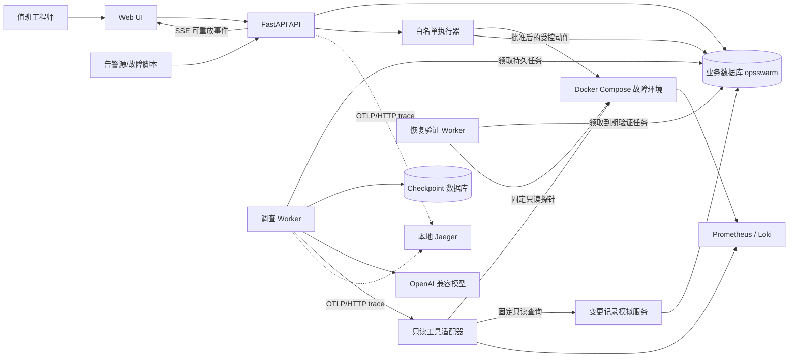
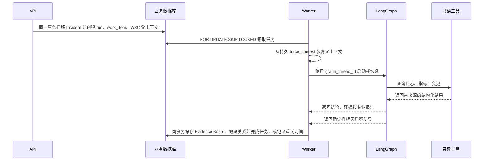

# OpsSwarm 系统架构

## 1. 架构原则

- **业务状态优先**：Incident、调查、证据、审批、执行和验证都有明确状态及持久化记录。
- **确定性边界优先**：LLM 负责分析和生成结构化计划，代码负责规则校验和执行。
- **先单体、后拆分**：控制面采用模块化单体，先保证边界和测试，再依据真实负载拆服务。
- **异步任务可恢复**：API 不承担长任务；Worker 使用持久任务、租约和幂等键处理至少一次投递。
- **事件可重放**：用户看到的进度先落数据库，再通过 SSE 投递。
- **演练环境隔离**：第一版执行目标仅限本地故障环境。

## 2. 总体架构

控制面和故障环境通过明确适配器交互。Agent 不能绕过适配器直接访问容器 Shell、业务数据库或宿主机。

## 3. 控制面模块

API 与 Worker 是两个独立进程，但共享同一个 Python 包中的领域模型和应用服务。

| 模块 | 职责 | 不负责 |
| --- | --- | --- |
| Incident | 告警幂等、事故聚合、状态机、时间线 | 模型推理和生产操作 |
| Investigation | 调查运行、任务拆分、Worker 调度和结构化材料校验 | 任意修改原始遥测数据 |
| Evidence | 证据、专业报告、引用关系；后续承载假设关系 | 模型 checkpoint 和处置执行 |
| Planning | 根因结论、处置计划、风险标记 | 直接执行计划 |
| Approval | 审批请求、决定、审批有效期 | 调用模型代替人工审批 |
| Execution | 白名单、参数校验、幂等执行、审计 | 任意 Shell 和未登记动作 |
| Verification | 恢复判据、持久调度、验证结果和失败回流 | 主观判定系统已恢复 |
| Evaluation | 故障真值、运行指标、单/多 Agent 对比 | 影响线上调查状态 |
| Platform | 配置、数据库、任务租约、事件与可观测性 | 承载领域决策 |
| Web UI | Incident 路由、只读快照、可重放时间线与人机交互 | 保存业务唯一事实或绕过 API 操作环境 |

模块之间通过应用服务和稳定数据类型交互，不允许跨模块直接修改对方的 ORM 对象。

## 4. 关键数据流

### 4.1 告警与 Incident

1. 告警源调用 `POST /api/v1/alerts`。
2. API 校验输入后，由 Incident 仓储根据 `(source, external_event_id)` 判断完全重复。
3. 新告警根据 `fingerprint` 查找未关闭 Incident；找到则聚合，找不到则创建。
4. 告警、Incident 变更和 `incident_events` 在同一事务提交。
5. API 返回 Incident 标识以及是否发生去重。

并发创建依赖数据库唯一约束兜底。发生唯一键竞争时，事务回滚并读取获胜的 Incident，不能依赖“先查询再插入”保证并发正确性。

### 4.2 调查任务

`work_items` 使用租约字段 `locked_by`、`locked_until` 和重试计数实现至少一次处理。业务写入和外部动作必须使用幂等键，Worker 崩溃后其他实例才能安全接管。

控制面开启 OpenTelemetry 后，FastAPI server span 的 W3C `traceparent` 与可选 `tracestate` 会随任务写入 `work_items.trace_context`。Worker 领取或重试时从该字段恢复远端父上下文，因此不同进程、不同尝试仍能在 Jaeger 中关联到原 API 请求。只传播 trace context，不传播 baggage；提示词、模型响应、密钥和原始证据不进入 span 属性。Jaeger 是本地、内存型诊断后端，不是业务事实或审计存储。

调查成功提交时，Worker 必须仍持有有效租约。`investigation_runs`、`work_items`、`evidence_items`、`specialist_reports`、`hypotheses` 及两类证据关联在同一事务更新。checkpoint 中的中间节点输出不会被 API 当作业务 Evidence Board 返回。

调查事实提交后，计划应用服务才允许读取 `supported` 假设和 Evidence Board。计划生成使用独立事务，因此缺少安全回滚目标不会撤销已确认的调查事实。相同假设版本的并发生成由 PostgreSQL 唯一约束收敛为同一份草案。

### 4.3 审批与执行

1. 候选计划只能生成经过 Pydantic 校验的 `ActionPlan`，每个步骤声明动作类型、目标、参数和验证方式；当前冻结场景先使用确定性模板。
2. 确定性规则引擎根据动作白名单重算风险和审批要求，不能采信模型自报等级。
3. 工程师通过 REST 提交批准或拒绝，超时使用独立系统终态；决定与操作者、原因和时间永久留痕。
4. 执行器重新校验当前计划版本、审批内容哈希、Incident 乐观锁版本、动作参数和幂等键，先持久化短租约再调用固定适配器。
5. 执行成功与 Incident 进入验证、执行失败与 Incident 返回调查分别在同一事务落库；成功操作随后创建唯一验证运行，按冻结规则逐次采样。
6. 健康样本数和观察窗口同时满足时，验证运行、最后样本、Incident `resolved` 与时间线原子提交；阈值或探针失败则原子返回调查。

审批不是一句聊天文本，而是绑定计划版本、动作集合、操作者和有效期的业务对象。决定是不可变终态；批准只进入 `mitigating`，执行接口还必须经过独立授权校验。当前适配器只会关闭 `order-service` 的 `release_500`，用比较并设置回滚 `database_pool_size`，或把固定 Redis 演练依赖从不可用恢复为可用；不接受任意命令、URL、配置键、依赖名或客户端动作参数。

### 4.4 逐次恢复验证

恢复规则随 `action_step` 生成，并在验证运行创建时再次冻结到业务库。`order-service` 暴露三个低基数 Gauge，项目内 Prometheus 每 2 秒抓取；验证 Worker 根据动作、目标和信号选择代码内固定查询。客户端只能提交样本幂等键，不能提交观测值或 PromQL。查询结果必须唯一、标签匹配、位于 `0～1` 且不超过 10 秒，否则作为探针错误处理。

验证不会让 API 请求等待完整观察窗口。验证运行与调度任务在同一事务创建，独立 Worker 使用租约在不同观察时点触发短采样，PostgreSQL 保存下一次到期时间和样本进度。至少 3 个健康样本且首末跨度达到 60 秒才通过；瞬时连续请求即使样本数足够，也保持 `running`。

## 5. LangChain 与 LangGraph 边界

### 5.1 LangChain

LangChain 1.x 用于：

- 统一 OpenAI 兼容模型接入。
- 定义带类型的只读工具。
- 生成 Pydantic 结构化结果。
- 快速构建单 Agent 工具调用基线。

它不参与 Incident 状态机、事务、审批有效性、风险分级和执行幂等。

### 5.2 LangGraph

LangGraph 1.x 用于：

- 把协调、日志调查、指标调查、变更调查、质疑和验证建模为显式节点。
- 并行运行彼此独立的调查节点并合并结果。
- 在证据不足或验证失败时循环调查。
- 通过 PostgreSQL checkpoint 在进程重启后恢复。
- 在高风险动作前暂停，等待外部审批后继续。

图状态只保存恢复工作流所需的可序列化数据和业务标识，不保存数据库 Session、网络客户端或未受控 Python 对象。Incident 与 `graph_thread_id` 的对应关系保存在业务库。

当前并行图已经接入持久 Worker。API 把 `single_agent` 或 `multi_agent` 作为业务模式、把 `frozen` 或 `live` 作为数据源模式共同落库，Worker 同时校验任务类型与自身数据源配置。多 Agent 运行使用 `investigation-run:{run_id}` 作为稳定 `thread_id`：如果 checkpoint 不存在则提交初始状态，存在则使用同一线程和空输入恢复。失败 superstep 中已经成功的并行节点保留 pending writes，恢复时只重新运行失败节点；恢复使用运行创建时已经冻结的数据源模式，不能因另一台 Worker 配置不同而切换证据来源。

单 Agent 与多 Agent 最终都提交工具实际返回的规范化证据；多 Agent 额外提交三类专业报告。持久化入口再次校验结果证据集合、结论引用和报告引用，避免只依赖提示词或图节点保护业务库。

多 Agent 综合节点之后运行不调用模型的 `challenge_hypothesis`；单 Agent 处理器复用同一领域函数。规则将证据标记为支持、反驳或上下文，只有至少两类独立证据支持且没有反驳时假设才通过。计划域生成独立持久化的 `draft` 草案；审批域锁定 Incident，并在同一事务中把计划和 Incident 迁移到 `awaiting_approval`、追加事件并创建绑定内容哈希的请求。批准、拒绝与本地白名单执行都由确定性应用服务处理，LangChain 和 LangGraph 不参与授权判断。

## 6. PostgreSQL 任务与 SSE

- 控制面不引入专用 Redis 队列，避免演练环境 Redis 故障影响控制面，也减少 MVP 基础设施。
- Worker 通过 `SELECT ... FOR UPDATE SKIP LOCKED` 原子领取可执行任务。
- 调查 Worker 按 `frozen` 与 `live` 分为两个 Compose 常驻工作池；停机时先停止新领取，再在宽限期内结算当前任务。
- 超过租约时间的任务可以重新领取；处理语义是至少一次，不承诺恰好一次。
- `incident_events.id` 是全局递增游标。SSE 将它写入 `id:`，客户端重连时使用 `Last-Event-ID`。
- API 先从数据库补发大于游标的事件，再进入短轮询或通知等待；数据库始终是时间线事实来源。
- SSE 仅负责服务端到客户端进度，审批和控制命令继续使用 REST，因此不需要 WebSocket 的双向会话复杂度。

## 7. 故障演练环境

最终演练环境包含：

- `gateway-service`：统一入口和请求转发。
- `order-service`：被调查业务服务。
- PostgreSQL：订单依赖和连接池故障目标。
- Redis：缓存依赖和不可用故障目标。
- Prometheus 与 Loki：指标、日志来源。
- 变更记录模拟器：以独立常驻服务保存发布、配置和依赖维护时间线。

当前故障实验室支持三类确定性故障：

- `release_500`：内部管理接口开启后，`GET /orders/{id}` 固定返回版本故障 500，关闭后恢复。
- `database_pool_size`：固定演练负载需要 10 个连接；容量低于 10 时订单固定返回 `database_pool_timeout`，容量恢复为 50 后饱和度为 `0.2` 且订单恢复。状态接口同时返回饱和度和等待数，为后续只读验证探针提供稳定信号。
- Redis 网络依赖：`order-service` 经固定 TCP 故障代理对独立 `lab-redis` 执行真实 `PING`；代理断开时订单固定返回 `redis_connection_unavailable`，通过 CAS 恢复连通后不可用比例变为 `0.0` 且订单恢复。

当前 Compose 还包含独立 Prometheus 3.13 LTS、Loki 3.7、Alloy 1.19 和 `change-service`：Prometheus 每 2 秒抓取订单服务的三个恢复 Gauge 与请求 Counter，验证 Worker 通过固定查询读取；订单服务把三种确定性失败写入项目 JSONL 卷，Alloy 不经 Docker Socket 采集到 Loki；变更服务把三种固定外部变更事实追加到业务 PostgreSQL。`LiveInvestigationDataSource` 按证据类型委托失败关闭的只读适配器，变更端口默认读取本地模拟器，也可显式补充固定 GitHub 仓库的 Commit 与已合并 Pull Request。现场与冻结调查由独立常驻工作池运行。OpenTelemetry 使 API、持久队列、Agent 节点和只读工具请求保持跨进程 trace 关联。

如果多个故障同时存在，固定按版本故障、连接池故障、Redis 故障排序，避免一次请求的错误类型受分支顺序或随机数影响。版本与连接池状态保存在订单服务进程，Redis 断连状态保存在单副本代理进程；服务重启后都回到安全默认值。故障状态不是 Incident、审批或执行审计的业务事实。管理接口只暴露在 Compose 内网或 localhost，不作为生产接口设计；执行器仍不能访问 Docker Socket，Redis 代理后端也不能在运行时改变。

## 8. 接口边界

当前已实现的控制面接口：

| 方法与路径 | 行为 |
| --- | --- |
| `POST /api/v1/alerts` | 幂等接收告警；新告警返回 `201`，完全重复返回 `200` |
| `GET /api/v1/incidents` | 按状态筛选，使用展示序号倒序游标分页 |
| `GET /api/v1/incidents/{id}` | 查询 Incident 详情和当前版本 |
| `GET /api/v1/incidents/{id}/workroom` | 用单条数据库查询读取最近调查及其处置链路摘要 |
| `POST /api/v1/incidents/{id}/actions/close` | 工程师以当前版本关闭已恢复事故 |
| `POST /api/v1/incidents/{id}/actions/start-investigation` | 原子开始调查并创建持久任务，必须提供 `expected_version`，可选择单/多 Agent 与冻结/现场数据 |
| `GET /api/v1/investigations/{run_id}` | 查询调查运行、结果、指标与错误 |
| `GET /api/v1/investigations/{run_id}/evidence-board` | 查询已提交的结论、规范化证据、专业报告和引用 |
| `POST /api/v1/investigations/{run_id}/action-plans` | 从已支持假设和证据生成版本化白名单计划 |
| `POST /api/v1/action-plans/{plan_id}/approval-requests` | 为当前计划精确版本创建限时审批请求 |
| `POST /api/v1/approval-requests/{request_id}/actions/approve` | 以不可变人工决定批准精确计划版本 |
| `POST /api/v1/approval-requests/{request_id}/actions/reject` | 拒绝计划并把 Incident 返回调查 |
| `POST /api/v1/action-steps/{step_id}/executions` | 使用幂等键执行已批准的固定本地白名单步骤 |
| `GET /api/v1/operation-executions/{execution_id}` | 查询持久执行状态、有限结果或失败摘要 |
| `POST /api/v1/operation-executions/{execution_id}/verification-runs` | 为成功操作创建唯一的持久恢复验证 |
| `GET /api/v1/verification-runs/{run_id}` | 查询冻结规则、验证进度、终态和样本 |
| `POST /api/v1/verification-runs/{run_id}/samples` | 使用幂等键触发一次与动作绑定的固定只读探针 |
| `GET /api/v1/verification-runs/{run_id}/work-item` | 只读查询自动采样的到期时间、租约状态和有限错误 |
| `GET /api/v1/incidents/{id}/events` | 按递增事件号查询时间线 |
| `GET /api/v1/incidents/{id}/stream` | 从 PostgreSQL 补发并持续推送 SSE 时间线 |
| `GET /api/v1/evaluation-runs` | 按全局运行序号倒序分页查询评测聚合历史 |
| `GET /api/v1/evaluation-runs/{run_id}` | 查询完整版本、逐场景结果和聚合对照报告 |
| `GET /orders/{id}` | 演练订单查询 |
| `PUT /__admin/faults/release-500` | 在演练环境启用或关闭确定性 500 故障 |
| `GET /__admin/configuration/database-pool` | 查询演练连接池容量、饱和度和等待数 |
| `PUT /__admin/configuration/database-pool` | 把演练连接池容量设置为严格整数 `1～1000` |
| `POST /__admin/changes` | 在独立模拟服务中幂等追加一种固定变更事实，不执行环境操作 |
| `GET /api/v1/changes` | 按固定服务和 1～24 小时窗口只读查询变更事实 |

非法状态迁移、过期版本或冲突操作统一返回 `409 Conflict`。请求校验错误返回 `422`。当前领域错误响应包含稳定错误码、中文消息和结构化详情；追踪开启时普通控制面响应通过 `X-Trace-ID` 关联本地 Jaeger。

## 9. 部署与安全边界

- 本地 MVP 单租户、无 JWT，仅绑定 localhost 和 Compose 私有网络，并明确标记不可用于生产。
- 审批阶段再引入操作员身份和角色；没有可信身份之前不能声称具备生产审批能力。
- 业务数据库 `opsswarm` 由 Alembic 管理；checkpoint 数据库 `opsswarm_checkpoints` 由 LangGraph 初始化流程管理。两者位于同一个本地 PostgreSQL 容器，但属于不同逻辑数据库。
- 变更记录服务只有 `control` 网络连接，代码仓储只暴露追加和读取，不连接故障实验室；执行器仍是唯一能受控修改被管环境的组件。当前本地 MVP 的业务进程仍共用一个数据库账号，生产化前必须拆分迁移、API、Worker 与变更服务角色，并用数据库权限落实最小授权。
- 外部模型、LangSmith 和真实平台集成都必须可关闭；离线测试不依赖它们。

## 10. 失败恢复策略

| 故障 | 恢复方式 |
| --- | --- |
| API 重启 | 业务状态已落 PostgreSQL，客户端重新查询或重连 SSE |
| Worker 崩溃 | 任务租约到期后由其他 Worker 重新领取 |
| Agent 节点失败 | 从最近 checkpoint 恢复，已完成并行节点不重复运行 |
| 模型超时或限流 | 记录可重试错误并使用退避，不修改 Incident 为已解决 |
| 执行请求重复 | 由操作幂等键返回原执行结果 |
| 执行进程在外部动作后崩溃 | 同一幂等键在 15 秒租约过期后接管并安全重放目标状态设置 |
| 迟到执行实例提交终态 | 租约令牌或到期时间不匹配时拒绝提交 |
| 审批过期或计划变化 | 拒绝执行并重新进入审批 |
| 恢复验证失败 | 保存验证证据并返回 `investigating` |
| API 在观察窗口中重启 | 已有运行与样本保存在 PostgreSQL，按新幂等键继续采样 |
| 相同样本命令重试 | 运行内幂等键返回原样本，不重复调用探针 |
| 验证 Worker 在样本落库后崩溃 | 租约到期后重领同一任务与同一调度幂等键，只结算一次样本 |
| 验证 Worker 内部失败 | 保存脱敏错误并指数退避，不伪造恢复失败结论 |
