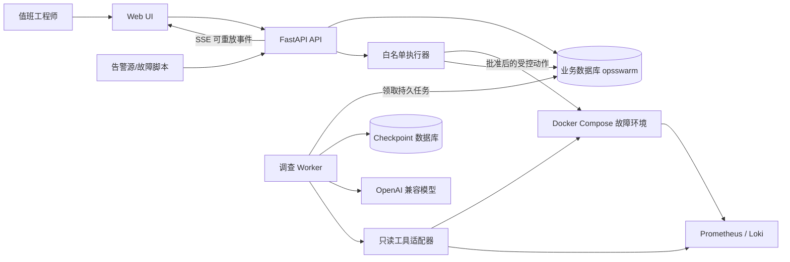
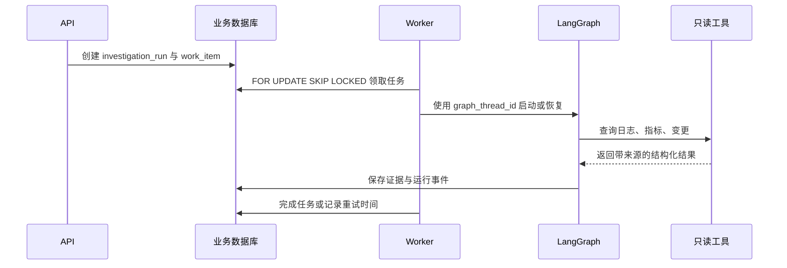

# OpsSwarm 系统架构

## 1. 架构原则

- **业务状态优先**：Incident、调查、证据、审批、执行和验证都有明确状态及持久化记录。
- **确定性边界优先**：LLM 负责分析和生成结构化计划，代码负责规则校验和执行。
- **先单体、后拆分**：控制面采用模块化单体，先保证边界和测试，再依据真实负载拆服务。
- **异步任务可恢复**：API 不承担长任务；Worker 使用持久任务、租约和幂等键处理至少一次投递。
- **事件可重放**：用户看到的进度先落数据库，再通过 SSE 投递。
- **演练环境隔离**：第一版执行目标仅限本地故障环境。

## 2. 总体架构

控制面和故障环境通过明确适配器交互。Agent 不能绕过适配器直接访问容器 Shell、业务数据库或宿主机。

## 3. 控制面模块

API 与 Worker 是两个独立进程，但共享同一个 Python 包中的领域模型和应用服务。

| 模块 | 职责 | 不负责 |
| --- | --- | --- |
| Incident | 告警幂等、事故聚合、状态机、时间线 | 模型推理和生产操作 |
| Investigation | 调查运行、任务拆分、Worker 调度 | 保存最终业务证据 |
| Evidence | 证据、假设、支持或反驳关系 | 任意修改原始遥测数据 |
| Planning | 根因结论、处置计划、风险标记 | 直接执行计划 |
| Approval | 审批请求、决定、审批有效期 | 调用模型代替人工审批 |
| Execution | 白名单、参数校验、幂等执行、审计 | 任意 Shell 和未登记动作 |
| Verification | 恢复判据、验证结果、失败回流 | 主观判定系统已恢复 |
| Evaluation | 故障真值、运行指标、单/多 Agent 对比 | 影响线上调查状态 |
| Platform | 配置、数据库、任务租约、事件与可观测性 | 承载领域决策 |

模块之间通过应用服务和稳定数据类型交互，不允许跨模块直接修改对方的 ORM 对象。

## 4. 关键数据流

### 4.1 告警与 Incident

1. 告警源调用 `POST /api/v1/alerts`。
2. API 校验输入后，由 Incident 仓储根据 `(source, external_event_id)` 判断完全重复。
3. 新告警根据 `fingerprint` 查找未关闭 Incident；找到则聚合，找不到则创建。
4. 告警、Incident 变更和 `incident_events` 在同一事务提交。
5. API 返回 Incident 标识以及是否发生去重。

并发创建依赖数据库唯一约束兜底。发生唯一键竞争时，事务回滚并读取获胜的 Incident，不能依赖“先查询再插入”保证并发正确性。

### 4.2 调查任务

`work_items` 使用租约字段 `locked_by`、`locked_until` 和重试计数实现至少一次处理。业务写入和外部动作必须使用幂等键，Worker 崩溃后其他实例才能安全接管。

### 4.3 审批与执行

1. Agent 只生成经过 Pydantic 校验的 `ActionPlan`，每个步骤声明动作类型、目标、参数、风险和验证方式。
2. 规则引擎根据动作白名单和风险策略创建审批请求。
3. 工程师通过 REST 提交批准、拒绝或修改决定，决定与操作者身份永久留痕。
4. 执行器重新校验计划版本、审批有效性、动作参数和幂等键。
5. 执行结果落库后进入确定性恢复验证；失败或未恢复时返回调查阶段。

审批不是一句聊天文本，而是绑定计划版本、动作集合、操作者和有效期的业务对象。

## 5. LangChain 与 LangGraph 边界

### 5.1 LangChain

LangChain 1.x 用于：

- 统一 OpenAI 兼容模型接入。
- 定义带类型的只读工具。
- 生成 Pydantic 结构化结果。
- 快速构建单 Agent 工具调用基线。

它不参与 Incident 状态机、事务、审批有效性、风险分级和执行幂等。

### 5.2 LangGraph

LangGraph 1.x 用于：

- 把协调、日志调查、指标调查、变更调查、质疑和验证建模为显式节点。
- 并行运行彼此独立的调查节点并合并结果。
- 在证据不足或验证失败时循环调查。
- 通过 PostgreSQL checkpoint 在进程重启后恢复。
- 在高风险动作前暂停，等待外部审批后继续。

图状态只保存恢复工作流所需的可序列化数据和业务标识，不保存数据库 Session、网络客户端或未受控 Python 对象。Incident 与 `graph_thread_id` 的对应关系保存在业务库。

## 6. PostgreSQL 任务与 SSE

- 控制面不引入专用 Redis 队列，避免演练环境 Redis 故障影响控制面，也减少 MVP 基础设施。
- Worker 通过 `SELECT ... FOR UPDATE SKIP LOCKED` 原子领取可执行任务。
- 超过租约时间的任务可以重新领取；处理语义是至少一次，不承诺恰好一次。
- `incident_events.id` 是全局递增游标。SSE 将它写入 `id:`，客户端重连时使用 `Last-Event-ID`。
- API 先从数据库补发大于游标的事件，再进入短轮询或通知等待；数据库始终是时间线事实来源。
- SSE 仅负责服务端到客户端进度，审批和控制命令继续使用 REST，因此不需要 WebSocket 的双向会话复杂度。

## 7. 故障演练环境

最终演练环境包含：

- `gateway-service`：统一入口和请求转发。
- `order-service`：被调查业务服务。
- PostgreSQL：订单依赖和连接池故障目标。
- Redis：缓存依赖和不可用故障目标。
- Prometheus 与 Loki：指标、日志来源。
- 变更记录模拟器：提供部署版本、提交和发布时间。

第一个故障是 `release_500`：内部管理接口开启后，`GET /orders/{id}` 确定性返回 500，并产生可验证日志、指标和版本信息；关闭后恢复正常。故障管理接口只暴露在 Compose 内网或 localhost，不作为生产接口设计。

## 8. 接口边界

当前已实现的控制面接口：

| 方法与路径 | 行为 |
| --- | --- |
| `POST /api/v1/alerts` | 幂等接收告警；新告警返回 `201`，完全重复返回 `200` |
| `GET /api/v1/incidents` | 按状态筛选，使用展示序号倒序游标分页 |
| `GET /api/v1/incidents/{id}` | 查询 Incident 详情和当前版本 |
| `POST /api/v1/incidents/{id}/actions/start-investigation` | 从 `open` 开始调查，必须提供 `expected_version` |
| `GET /api/v1/incidents/{id}/events` | 按递增事件号查询时间线 |
| `GET /api/v1/incidents/{id}/stream` | 后续阶段提供可重放 SSE |
| `GET /orders/{id}` | 演练订单查询 |
| `PUT /__admin/faults/release-500` | 在演练环境启用或关闭确定性 500 故障 |

非法状态迁移、过期版本或冲突操作统一返回 `409 Conflict`。请求校验错误返回 `422`。当前领域错误响应包含稳定错误码、中文消息和结构化详情；追踪标识将在可观测性切片统一加入。

## 9. 部署与安全边界

- 本地 MVP 单租户、无 JWT，仅绑定 localhost 和 Compose 私有网络，并明确标记不可用于生产。
- 审批阶段再引入操作员身份和角色；没有可信身份之前不能声称具备生产审批能力。
- 业务数据库 `opsswarm` 由 Alembic 管理；checkpoint 数据库 `opsswarm_checkpoints` 由 LangGraph 初始化流程管理。
- API、Worker、执行器和演练服务使用不同数据库或网络权限，执行器是唯一拥有受控写操作能力的组件。
- 外部模型、LangSmith 和真实平台集成都必须可关闭；离线测试不依赖它们。

## 10. 失败恢复策略

| 故障 | 恢复方式 |
| --- | --- |
| API 重启 | 业务状态已落 PostgreSQL，客户端重新查询或重连 SSE |
| Worker 崩溃 | 任务租约到期后由其他 Worker 重新领取 |
| Agent 节点失败 | 从最近 checkpoint 恢复，已完成并行节点不重复运行 |
| 模型超时或限流 | 记录可重试错误并使用退避，不修改 Incident 为已解决 |
| 执行请求重复 | 由操作幂等键返回原执行结果 |
| 审批过期或计划变化 | 拒绝执行并重新进入审批 |
| 恢复验证失败 | 保存验证证据并返回 `investigating` |
