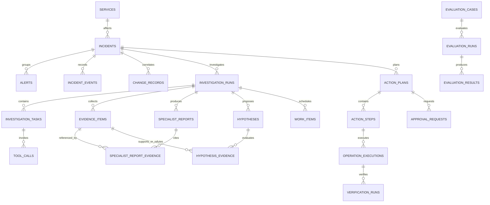
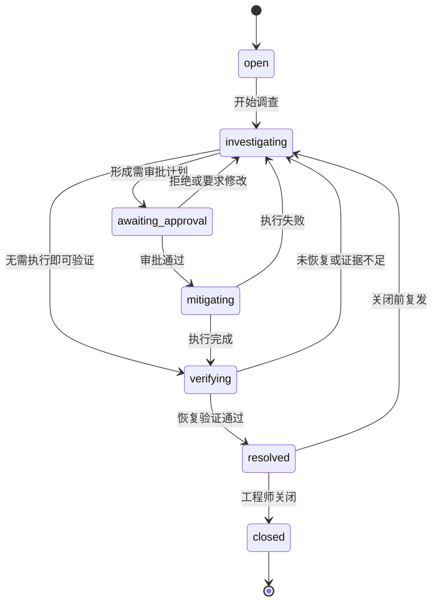
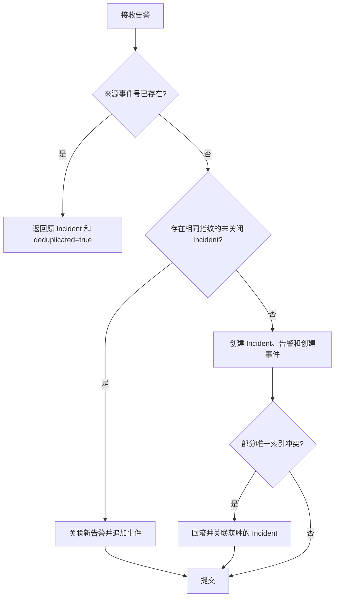

# OpsSwarm 数据库设计

## 1. 设计目标

- 让事故事实、证据、审批、执行和验证能够独立于 Agent 运行恢复。
- 通过数据库约束处理重复告警、并发聚合和重复操作。
- 保留完整时间线与审计，不用覆盖更新抹掉历史。
- 先建立全局逻辑模型，仅为当前切片确定物理字段。
- 明确区分业务数据、持久任务和 LangGraph checkpoint。

## 2. 数据库边界

同一个 PostgreSQL 17 实例包含两个数据库：

| 数据库 | 管理者 | 内容 |
| --- | --- | --- |
| `opsswarm` | Alembic | Incident、证据、审批、操作、评测、事件和任务 |
| `opsswarm_checkpoints` | LangGraph 初始化流程 | checkpoint、节点写入和恢复元数据 |

业务库中的 `investigation_runs.graph_thread_id` 保存 LangGraph `thread_id`。两个数据库不建立跨库外键；删除或清理 checkpoint 不得删除业务审计记录。

本地 Compose 使用一个 `ops-swarm-control-db-1` 容器和一个持久数据卷。`opsswarm_checkpoints` 是该 PostgreSQL 实例内的第二个逻辑数据库，因此 Docker Desktop 不会显示第二个数据库容器。全新数据卷由 `docker/postgres/init-checkpoint-db.sql` 创建数据库；`checkpoint_migrations`、`checkpoints`、`checkpoint_blobs` 和 `checkpoint_writes` 由 LangGraph 的幂等 `setup()` 管理，不进入 Alembic 元数据。

## 3. 全局逻辑模型

### 3.1 事故域

| 实体 | 核心职责 |
| --- | --- |
| `services` | 被管服务目录、环境和遥测标识 |
| `incidents` | 当前事故状态、严重级别、指纹和生命周期时间 |
| `alerts` | 原始告警及其外部幂等标识 |
| `incident_events` | 不可变事故时间线和 SSE 游标 |
| `change_records` | 部署、配置和代码变更证据 |

### 3.2 调查与证据域

| 实体 | 核心职责 |
| --- | --- |
| `investigation_runs` | 一次单 Agent 或多 Agent 调查及 `graph_thread_id` |
| `investigation_tasks` | 日志、指标、变更等调查子任务 |
| `tool_calls` | 工具输入摘要、状态、耗时、错误和成本 |
| `evidence_items` | 带来源、观察时间、内容摘要和哈希的规范化证据 |
| `specialist_reports` | 日志、指标和变更专业节点的结构化报告 |
| `specialist_report_evidence` | 保证报告只引用同一次调查的同类证据 |
| `hypotheses` | 根因假设、置信度和验证状态 |
| `hypothesis_evidence` | 证据对假设的支持或反驳关系 |

### 3.3 处置与评测域

| 实体 | 核心职责 |
| --- | --- |
| `action_plans` | 带版本的结构化处置计划 |
| `action_steps` | 白名单动作、参数、风险和验证规则 |
| `approval_requests` | 绑定计划版本的审批及决定 |
| `operation_executions` | 幂等执行请求、结果和审计 |
| `verification_runs` | 恢复判据、采样结果和结论 |
| `work_items` | Worker 租约、重试和至少一次处理 |
| `evaluation_cases` | 故障真值和期望行为 |
| `evaluation_runs` | 模式、模型、提示版本和运行汇总 |
| `evaluation_results` | 准确率、耗时、成本和安全等指标 |

## 4. 已实现的物理模型

当前已经创建 Incident 三表、调查运行与任务表，以及 Evidence Board 三表。`service_name` 暂时作为受校验字符串保存；服务目录在接入多服务时再迁移，避免为了一个演练服务提前引入管理功能。

### 4.1 incidents

| 字段 | PostgreSQL 类型 | 约束与说明 |
| --- | --- | --- |
| `id` | `UUID` | 主键，由应用生成 UUID4 |
| `display_number` | `BIGINT GENERATED ALWAYS AS IDENTITY` | 唯一、只读，用于显示 `INC-000001` |
| `service_name` | `VARCHAR(100)` | 非空，首切片为 `order-service` |
| `title` | `VARCHAR(200)` | 非空，事故摘要 |
| `severity` | `VARCHAR(2)` | 非空，检查约束限定 `p1`～`p4` |
| `status` | `VARCHAR(32)` | 非空，检查约束限定状态机值 |
| `fingerprint` | `VARCHAR(200)` | 非空，用于告警聚合 |
| `version` | `INTEGER` | 非空，默认 1，乐观锁版本 |
| `started_at` | `TIMESTAMPTZ` | 事故首次发生时间 |
| `resolved_at` | `TIMESTAMPTZ` | 可空，最近一次进入 `resolved` 的时间 |
| `closed_at` | `TIMESTAMPTZ` | 可空，进入终态的时间 |
| `created_at` | `TIMESTAMPTZ` | 非空，数据库写入时间 |
| `updated_at` | `TIMESTAMPTZ` | 非空，每次业务更新时修改 |

关键索引与约束：

- `display_number` 唯一索引。
- `fingerprint` 的部分唯一索引：仅当 `status <> 'closed'` 时生效，保证同一指纹最多存在一个未关闭 Incident。
- `(status, created_at DESC)` 支持列表过滤。
- 更新语句必须包含 `WHERE id = :id AND version = :expected_version`，成功时 `version = version + 1`。

### 4.2 alerts

| 字段 | PostgreSQL 类型 | 约束与说明 |
| --- | --- | --- |
| `id` | `UUID` | 主键，由应用生成 UUID4 |
| `incident_id` | `UUID` | 非空，外键到 `incidents.id`，禁止级联删除 |
| `source` | `VARCHAR(100)` | 非空，例如 `fault-simulator` |
| `external_event_id` | `VARCHAR(200)` | 非空，告警源事件号 |
| `fingerprint` | `VARCHAR(200)` | 非空，保留接收时的聚合指纹 |
| `service_name` | `VARCHAR(100)` | 非空 |
| `severity` | `VARCHAR(2)` | 非空，检查约束限定 `p1`～`p4` |
| `title` | `VARCHAR(200)` | 非空 |
| `payload` | `JSONB` | 非空对象，保存原始扩展字段，序列化后不超过 64 KiB |
| `occurred_at` | `TIMESTAMPTZ` | 非空，告警源发生时间 |
| `ingested_at` | `TIMESTAMPTZ` | 非空，控制面接收时间 |

关键索引与约束：

- `(source, external_event_id)` 唯一，保证完全重复告警幂等。
- `(incident_id, occurred_at)` 支持事故详情时间排序。
- 外键使用 `ON DELETE RESTRICT`，事故与告警均不提供物理删除接口。

### 4.3 incident_events

| 字段 | PostgreSQL 类型 | 约束与说明 |
| --- | --- | --- |
| `id` | `BIGINT GENERATED ALWAYS AS IDENTITY` | 主键，同时作为全局 SSE 游标 |
| `incident_id` | `UUID` | 非空，外键到 `incidents.id`，禁止级联删除 |
| `event_type` | `VARCHAR(100)` | 非空，当前限定创建、状态变化和告警聚合事件 |
| `actor_type` | `VARCHAR(20)` | 非空，限定 `system`、`human`、`agent`、`executor` |
| `actor_id` | `VARCHAR(100)` | 可空；系统事件可以为空 |
| `from_status` | `VARCHAR(32)` | 可空，创建事件没有前置状态 |
| `to_status` | `VARCHAR(32)` | 非空，记录事件发生时或迁移后的状态 |
| `reason` | `VARCHAR(500)` | 非空，记录触发事件的业务原因 |
| `incident_version` | `INTEGER` | 非空，事件对应的 Incident 乐观锁版本 |
| `payload` | `JSONB` | 非空，默认空对象，只放事件附加信息 |
| `occurred_at` | `TIMESTAMPTZ` | 非空，事件发生时间 |

关键索引与约束：

- `(incident_id, id)` 支持按 Incident 顺序读取和 SSE 补发。
- 创建和状态变化事件的 `(incident_id, incident_version)` 部分唯一索引，保证每个变更版本只有一条配套事件；告警聚合事件可以共享当前版本。
- 应用只允许 `INSERT` 和 `SELECT`，不提供更新、覆盖或删除方法。
- 事件 payload 不复制大型日志内容，只保存业务摘要和证据标识。

### 4.4 investigation_runs

| 字段组 | 说明 |
| --- | --- |
| 标识与关联 | UUID 主键、`incident_id` 外键；同一 Incident 最多一个 `queued` 或 `running` 运行 |
| 模式与版本 | `mode` 支持 `single_agent`、`multi_agent` 并保存对应 `prompt_version`；多 Agent 必须有 `graph_thread_id` 关联独立 checkpoint 数据库 |
| 状态 | `queued`、`running`、`succeeded`、`failed` |
| 结果 | 成功时保存经过 Pydantic 校验的 `result` 与可选 `metrics` JSONB |
| 错误 | 保存限制长度的最后错误摘要，不保存堆栈和任意模型输入 |
| 时间 | 创建、首次开始、完成和更新时间均使用 `TIMESTAMPTZ` |

成功状态必须有结果和完成时间，失败状态必须有错误和完成时间。排队或运行状态不能提前写完成时间。模型名在 Worker 实际成功执行后写入，避免排队配置与真实处理模型不一致。

### 4.5 work_items

| 字段组 | 说明 |
| --- | --- |
| 标识与幂等 | UUID、唯一 `investigation_run_id`、唯一 `idempotency_key` |
| 调度 | `pending`、`running`、`completed`、`failed`，以及 `available_at` |
| 租约 | `locked_by`、`locked_until`、每次领取生成的唯一 `lease_token` |
| 重试 | `attempt_count`、`max_attempts` 和有限 `last_error` |
| 时间 | 创建、更新和终态完成时间 |

领取查询同时选择已经可执行的 `pending` 任务和租约到期的 `running` 任务，使用 `FOR UPDATE SKIP LOCKED`。完成和失败写入必须匹配当前租约令牌且未超过到期时间。最后一次租约到期由后续领取操作收敛为终态失败，不能永久留在 `running`。

任务类型当前支持 `run_single_agent_investigation` 和 `run_multi_agent_investigation`。应用在创建任务时由 `mode` 确定类型，Worker 处理前再次校验两者一致，不能让模型或提示词选择执行路径。

### 4.6 evidence_items

| 字段组 | 说明 |
| --- | --- |
| 标识 | UUID 主键；`(investigation_run_id, evidence_key)` 唯一 |
| 分类与来源 | `kind` 限定日志、指标、变更；保存受限来源名称 |
| 内容 | 最多 500 字摘要和必须为对象、序列化后不超过 16 KiB 的 `attributes` JSONB，不保存无限制原始日志 |
| 完整性 | 保存规范化证据内容的 64 位 SHA-256 十六进制摘要 |
| 时间 | 证据观察时间与业务库创建时间均使用 `TIMESTAMPTZ` |

证据数据库 ID 使用 `run_id` 与 `evidence_key` 推导的 UUID5。内容哈希用于检测保存内容漂移，不代替外部来源签名或可信采集证明。

### 4.7 specialist_reports

每份报告关联一次调查，并以 `(investigation_run_id, specialist)` 保证每类专业节点最多一份。`findings` 必须是包含 1～20 项的 JSONB 数组，`confidence` 限定在 0～1。单 Agent 没有专业报告，但使用相同 `evidence_items` 物理模型。

### 4.8 specialist_report_evidence

关联表保存运行 ID、报告 ID 和证据 ID。报告和证据各自额外提供 `(investigation_run_id, id)` 唯一键，关联表通过两个复合外键强制三者属于同一次调查。应用层还会校验报告只能引用相同 `kind` 的证据。

调查完成时，当前租约校验、运行与任务终态更新、证据、专业报告和关联必须在同一事务提交。失败或重试中的 checkpoint 输出不提前进入业务表。

## 5. Incident 状态机

状态图中的迁移由以下稳定动作名驱动。API 命令、Worker 任务和未来 LangGraph 节点只能提交动作，不能直接指定目标状态：

| 当前状态 | 动作 | 目标状态 | 业务含义 |
| --- | --- | --- | --- |
| `open` | `start_investigation` | `investigating` | 接受事故并开始调查 |
| `investigating` | `request_approval` | `awaiting_approval` | 已形成需要人工审批的处置计划 |
| `investigating` | `start_verification` | `verifying` | 无需执行变更，直接验证是否已恢复 |
| `awaiting_approval` | `approve_plan` | `mitigating` | 工程师批准计划，允许进入受控执行 |
| `awaiting_approval` | `reject_plan` | `investigating` | 拒绝计划或要求补充调查 |
| `mitigating` | `complete_mitigation` | `verifying` | 白名单执行器完成操作，开始验证 |
| `mitigating` | `fail_mitigation` | `investigating` | 执行失败，带结果回到调查 |
| `verifying` | `confirm_recovery` | `resolved` | 恢复条件持续满足 |
| `verifying` | `fail_verification` | `investigating` | 未恢复或证据不足，继续调查 |
| `resolved` | `close` | `closed` | 工程师正式关闭事故 |
| `resolved` | `reopen` | `investigating` | 正式关闭前复发，重新调查 |

`closed` 是终态。关闭后收到相同指纹的新告警时创建新 Incident，不重新打开历史事故。

状态迁移必须：

1. 校验当前状态与目标动作是否合法。
2. 使用 `expected_version` 执行乐观锁更新。
3. 设置对应生命周期时间字段。
4. 在同一事务追加 `incident_events`。
5. 受影响行数为零时返回 `409 Conflict`，不能静默覆盖并发修改。

领域层使用不可变 Incident 快照表达当前版本，并把每次创建或迁移返回为 `IncidentMutation`：其中同时包含新快照和 `IncidentEvent`。领域层不依赖 ORM，也不直接提交事务；仓储层必须把二者原子持久化。事件中的 `actor_type`、`actor_id` 和 `reason` 只承担审计职责，身份认证、审批有效性和操作授权由应用层及后续处置域负责。

## 6. 告警幂等与并发聚合

- 完全重复是相同 `(source, external_event_id)`，返回 `200`。
- 新告警无论创建还是聚合都会新增 `alerts` 记录，首次接收返回 `201`。
- API 层预检查用于减少异常，数据库唯一约束才是并发正确性的最终保证。
- 并发命中外部事件唯一约束或未关闭指纹部分唯一索引时，当前事务整体回滚，仓储使用新会话重试并读取获胜记录。
- 聚合到现有事故时追加 `incident.alert_attached` 事件，但不改变 Incident 状态和版本。
- 原始 payload 仅用于审计和后续适配，不能直接决定状态迁移或执行参数。

## 7. 后续物理设计原则

- `work_items` 使用状态、可执行时间、租约、尝试次数和幂等键；领取使用 `FOR UPDATE SKIP LOCKED`。
- 接入真实工具后，`evidence_items` 增加受控来源 URI、查询时间范围和采集工具版本，不直接塞入无限制原始日志。
- `hypothesis_evidence` 明确关系是支持还是反驳，避免只保存 Agent 最终结论。
- `action_plans` 必须版本化；审批绑定精确版本，计划变化后旧审批失效。
- `operation_executions.idempotency_key` 唯一，重复调用返回已有结果。
- `tool_calls` 和评测表保存模型、提示、工具版本、延迟、Token 和错误分类，支持公平对比。
- 任何未来表进入物理模型前都要由对应可运行切片验证，不因逻辑 ER 图存在就提前创建。

## 8. 数据保留与安全

- MVP 不提供 Incident、Alert、Event、Approval 或 Execution 的物理删除 API。
- 未来归档使用保留策略和受控后台任务，不使用级联删除抹除审计链。
- 数据库应用账号不使用超级用户；迁移、运行和 checkpoint 账号分离。
- JSONB 写入前必须经过 Pydantic 校验并限制大小。
- 日志、事件和模型输入中的密钥、令牌及敏感字段必须脱敏。
