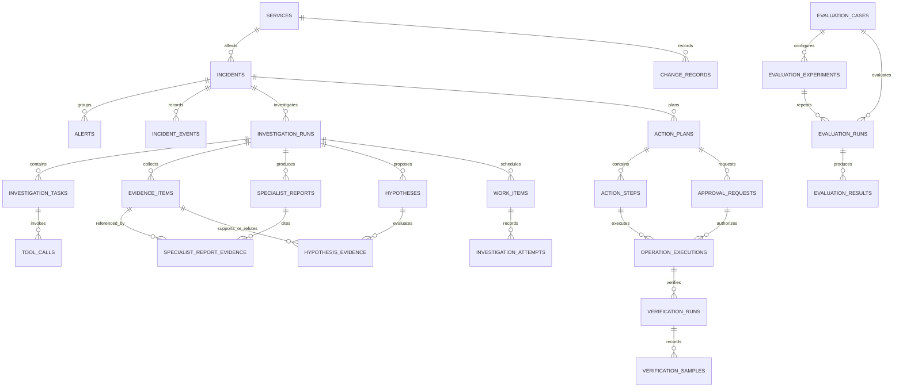
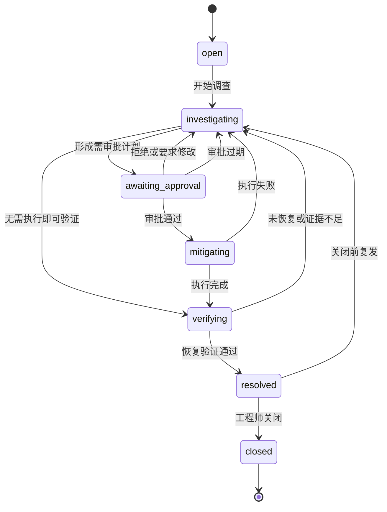
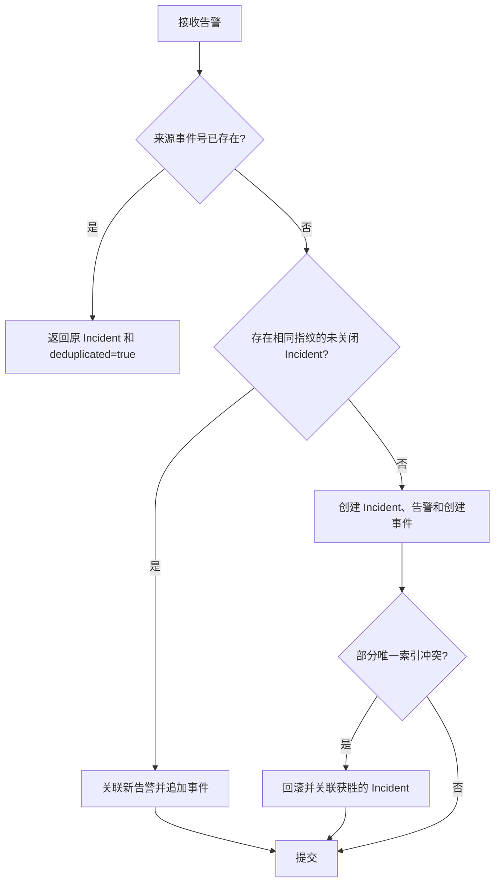

# OpsSwarm 数据库设计

## 1. 设计目标

- 让事故事实、证据、审批、执行和验证能够独立于 Agent 运行恢复。
- 通过数据库约束处理重复告警、并发聚合和重复操作。
- 保留完整时间线与审计，不用覆盖更新抹掉历史。
- 先建立全局逻辑模型，仅为当前切片确定物理字段。
- 明确区分业务数据、持久任务和 LangGraph checkpoint。

## 2. 数据库边界

同一个 PostgreSQL 17 实例包含两个数据库：

| 数据库 | 管理者 | 内容 |
| --- | --- | --- |
| `opsswarm` | Alembic | Incident、证据、审批、操作、评测、事件和任务 |
| `opsswarm_checkpoints` | LangGraph 初始化流程 | checkpoint、节点写入和恢复元数据 |

业务库中的 `investigation_runs.graph_thread_id` 保存 LangGraph `thread_id`。两个数据库不建立跨库外键；删除或清理 checkpoint 不得删除业务审计记录。

本地 Compose 使用一个 `ops-swarm-control-db-1` 容器和一个持久数据卷。`opsswarm_checkpoints` 是该 PostgreSQL 实例内的第二个逻辑数据库，因此 Docker Desktop 不会显示第二个数据库容器。全新数据卷由 `docker/postgres/init-checkpoint-db.sql` 创建数据库；`checkpoint_migrations`、`checkpoints`、`checkpoint_blobs` 和 `checkpoint_writes` 由 LangGraph 的幂等 `setup()` 管理，不进入 Alembic 元数据。

## 3. 全局逻辑模型

### 3.1 事故域

| 实体 | 核心职责 |
| --- | --- |
| `services` | 被管服务目录、环境和遥测标识 |
| `incidents` | 当前事故状态、严重级别、指纹和生命周期时间 |
| `alerts` | 原始告警及其外部幂等标识 |
| `incident_events` | 不可变事故时间线和 SSE 游标 |
| `change_records` | 独立于 Incident 的部署、配置和依赖维护事实；调查按服务与时间窗关联 |

### 3.2 调查与证据域

| 实体 | 核心职责 |
| --- | --- |
| `investigation_runs` | 一次单 Agent 或多 Agent 调查及 `graph_thread_id` |
| `investigation_tasks` | 日志、指标、变更等调查子任务 |
| `tool_calls` | 工具输入摘要、状态、耗时、错误和成本 |
| `evidence_items` | 带来源、观察时间、内容摘要和哈希的规范化证据 |
| `specialist_reports` | 日志、指标和变更专业节点的结构化报告 |
| `specialist_report_evidence` | 保证报告只引用同一次调查的同类证据 |
| `hypotheses` | 根因假设、置信度和验证状态 |
| `hypothesis_evidence` | 证据对假设的支持或反驳关系 |

### 3.3 处置与评测域

| 实体 | 核心职责 |
| --- | --- |
| `action_plans` | 带版本的结构化处置计划 |
| `action_steps` | 白名单动作、参数、风险和验证规则 |
| `approval_requests` | 绑定计划精确版本和内容哈希的限时审批请求 |
| `operation_executions` | 幂等执行请求、结果和审计 |
| `verification_runs` | 冻结恢复判据、汇总采样进度和结论 |
| `verification_samples` | 服务端探针取得的不可变数值或错误样本 |
| `verification_work_items` | 自动采样的到期时间、租约、重试和当前调度序号 |
| `work_items` | Worker 租约、重试和至少一次处理 |
| `investigation_attempts` | 每次租约领取的耗时、结果、错误、Token 与估算费用 |
| `evaluation_cases` | 故障真值和期望行为 |
| `evaluation_experiments` | 数据集、模型、参数哈希、运行器和提示版本组成的可比配置 |
| `evaluation_attempts` | 真实模型单场景、单模式调用的预算、运行中与成功/失败终态 |
| `evaluation_runs` | 完成报告、重复序号、聚合指标和模式级遥测 |
| `evaluation_results` | 逐场景准确率、耗时、证据和安全指标 |

## 4. 已实现的物理模型

当前已经创建 Incident 三表、追加式变更记录表、调查运行、任务与逐次尝试表、Evidence Board 三表、根因假设与证据关系两表、处置计划与步骤两表、审批请求表、操作执行表、恢复验证运行、样本与调度任务表，以及评测集、实验、尝试、运行和结果五表。`service_name` 暂时作为受校验字符串保存；服务目录在接入多服务时再迁移，避免为了一个演练服务提前引入管理功能。

### 4.1 incidents

| 字段 | PostgreSQL 类型 | 约束与说明 |
| --- | --- | --- |
| `id` | `UUID` | 主键，由应用生成 UUID4 |
| `display_number` | `BIGINT GENERATED ALWAYS AS IDENTITY` | 唯一、只读，用于显示 `INC-000001` |
| `service_name` | `VARCHAR(100)` | 非空，首切片为 `order-service` |
| `title` | `VARCHAR(200)` | 非空，事故摘要 |
| `severity` | `VARCHAR(2)` | 非空，检查约束限定 `p1`～`p4` |
| `status` | `VARCHAR(32)` | 非空，检查约束限定状态机值 |
| `fingerprint` | `VARCHAR(200)` | 非空，用于告警聚合 |
| `version` | `INTEGER` | 非空，默认 1，乐观锁版本 |
| `started_at` | `TIMESTAMPTZ` | 事故首次发生时间 |
| `resolved_at` | `TIMESTAMPTZ` | 可空，最近一次进入 `resolved` 的时间 |
| `closed_at` | `TIMESTAMPTZ` | 可空，进入终态的时间 |
| `created_at` | `TIMESTAMPTZ` | 非空，数据库写入时间 |
| `updated_at` | `TIMESTAMPTZ` | 非空，每次业务更新时修改 |

关键索引与约束：

- `display_number` 唯一索引。
- `fingerprint` 的部分唯一索引：仅当 `status <> 'closed'` 时生效，保证同一指纹最多存在一个未关闭 Incident。
- `(status, created_at DESC)` 支持列表过滤。
- 更新语句必须包含 `WHERE id = :id AND version = :expected_version`，成功时 `version = version + 1`。

### 4.2 alerts

| 字段 | PostgreSQL 类型 | 约束与说明 |
| --- | --- | --- |
| `id` | `UUID` | 主键，由应用生成 UUID4 |
| `incident_id` | `UUID` | 非空，外键到 `incidents.id`，禁止级联删除 |
| `source` | `VARCHAR(100)` | 非空，例如 `fault-simulator` |
| `external_event_id` | `VARCHAR(200)` | 非空，告警源事件号 |
| `fingerprint` | `VARCHAR(200)` | 非空，保留接收时的聚合指纹 |
| `service_name` | `VARCHAR(100)` | 非空 |
| `severity` | `VARCHAR(2)` | 非空，检查约束限定 `p1`～`p4` |
| `title` | `VARCHAR(200)` | 非空 |
| `payload` | `JSONB` | 非空对象，保存原始扩展字段，序列化后不超过 64 KiB |
| `occurred_at` | `TIMESTAMPTZ` | 非空，告警源发生时间 |
| `ingested_at` | `TIMESTAMPTZ` | 非空，控制面接收时间 |

关键索引与约束：

- `(source, external_event_id)` 唯一，保证完全重复告警幂等。
- `(incident_id, occurred_at)` 支持事故详情时间排序。
- 外键使用 `ON DELETE RESTRICT`，事故与告警均不提供物理删除接口。

### 4.3 incident_events

| 字段 | PostgreSQL 类型 | 约束与说明 |
| --- | --- | --- |
| `id` | `BIGINT GENERATED ALWAYS AS IDENTITY` | 主键，同时作为全局 SSE 游标 |
| `incident_id` | `UUID` | 非空，外键到 `incidents.id`，禁止级联删除 |
| `event_type` | `VARCHAR(100)` | 非空，当前限定创建、状态变化和告警聚合事件 |
| `actor_type` | `VARCHAR(20)` | 非空，限定 `system`、`human`、`agent`、`executor` |
| `actor_id` | `VARCHAR(100)` | 可空；系统事件可以为空 |
| `from_status` | `VARCHAR(32)` | 可空，创建事件没有前置状态 |
| `to_status` | `VARCHAR(32)` | 非空，记录事件发生时或迁移后的状态 |
| `reason` | `VARCHAR(500)` | 非空，记录触发事件的业务原因 |
| `incident_version` | `INTEGER` | 非空，事件对应的 Incident 乐观锁版本 |
| `payload` | `JSONB` | 非空，默认空对象，只放事件附加信息 |
| `occurred_at` | `TIMESTAMPTZ` | 非空，事件发生时间 |

关键索引与约束：

- `(incident_id, id)` 支持按 Incident 顺序读取和 SSE 补发。
- 创建和状态变化事件的 `(incident_id, incident_version)` 部分唯一索引，保证每个变更版本只有一条配套事件；告警聚合事件可以共享当前版本。
- 应用只允许 `INSERT` 和 `SELECT`，不提供更新、覆盖或删除方法。
- 事件 payload 不复制大型日志内容，只保存业务摘要和证据标识。

### 4.4 investigation_runs

| 字段组 | 说明 |
| --- | --- |
| 标识与关联 | UUID 主键、`incident_id` 外键；同一 Incident 最多一个 `queued` 或 `running` 运行 |
| 模式与版本 | `mode` 支持 `single_agent`、`multi_agent`；`data_source_mode` 支持 `frozen`、`live`；保存对应 `prompt_version`，多 Agent 必须有 `graph_thread_id` 关联独立 checkpoint 数据库 |
| 状态 | `queued`、`running`、`succeeded`、`failed` |
| 结果 | 成功时保存经过 Pydantic 校验的 `result` 与可选 `metrics` JSONB |
| 错误 | 保存限制长度的最后错误摘要，不保存堆栈和任意模型输入 |
| 时间 | 创建、首次开始、完成和更新时间均使用 `TIMESTAMPTZ` |

成功状态必须有结果和完成时间，失败状态必须有错误和完成时间。排队或运行状态不能提前写完成时间。模型名在 Worker 实际成功执行后写入，避免排队配置与真实处理模型不一致。历史运行迁移时回填 `data_source_mode=frozen`；字段没有服务端默认值，后续创建必须由应用显式写入。冻结运行成功时保存评测 `metrics`，现场运行没有固定真值，只保存 `result.tool_call_count` 并保持 `metrics` 为空。

### 4.5 work_items

| 字段组 | 说明 |
| --- | --- |
| 标识与幂等 | UUID、唯一 `investigation_run_id`、唯一 `idempotency_key` |
| 调度 | `pending`、`running`、`completed`、`failed`，以及 `available_at` |
| 租约 | `locked_by`、`locked_until`、每次领取生成的唯一 `lease_token` |
| 重试 | `attempt_count`、`max_attempts` 和有限 `last_error` |
| 追踪 | 可空 `trace_context` JSONB，只允许应用生成的 `traceparent` 与可选 `tracestate` |
| 时间 | 创建、更新和终态完成时间 |

领取查询同时选择已经可执行的 `pending` 任务和租约到期的 `running` 任务，连接 `investigation_runs` 并只领取与 Worker 数据源模式一致的行，再使用 `FOR UPDATE SKIP LOCKED`。完成和失败写入必须匹配当前租约令牌且未超过到期时间。最后一次租约到期由后续领取操作收敛为终态失败，不能永久留在 `running`。

任务类型当前支持 `run_single_agent_investigation` 和 `run_multi_agent_investigation`。应用在创建任务时由 `mode` 确定类型，Worker 处理前再次校验两者一致，不能让模型或提示词选择执行路径。

`trace_context` 只解决异步进程的观测关联，不参与领取顺序、幂等、租约或业务状态判断。历史任务和关闭追踪时允许为空；新任务只保存经过严格格式校验的 W3C `traceparent`/`tracestate`，不保存 baggage、请求头、提示词或原始业务载荷。每次重试从同一持久父上下文创建新的消费跨度，形成可区分的兄弟尝试。

### 4.6 evidence_items

| 字段组 | 说明 |
| --- | --- |
| 标识 | UUID 主键；`(investigation_run_id, evidence_key)` 唯一 |
| 分类与来源 | `kind` 限定日志、指标、变更；保存受限来源名称 |
| 内容 | 最多 500 字摘要和必须为对象、序列化后不超过 16 KiB 的 `attributes` JSONB，不保存无限制原始日志 |
| 完整性 | 保存规范化证据内容的 64 位 SHA-256 十六进制摘要 |
| 时间 | 证据观察时间与业务库创建时间均使用 `TIMESTAMPTZ` |

证据数据库 ID 使用 `run_id` 与 `evidence_key` 推导的 UUID5。内容哈希用于检测保存内容漂移，不代替外部来源签名或可信采集证明。

### 4.7 specialist_reports

每份报告关联一次调查，并以 `(investigation_run_id, specialist)` 保证每类专业节点最多一份。`findings` 必须是包含 1～20 项的 JSONB 数组，`confidence` 限定在 0～1。单 Agent 没有专业报告，但使用相同 `evidence_items` 物理模型。

### 4.8 specialist_report_evidence

关联表保存运行 ID、报告 ID 和证据 ID。报告和证据各自额外提供 `(investigation_run_id, id)` 唯一键，关联表通过两个复合外键强制三者属于同一次调查。应用层还会校验报告只能引用相同 `kind` 的证据。

调查完成时，当前租约校验、运行与任务终态更新、证据、专业报告和关联必须在同一事务提交。失败或重试中的 checkpoint 输出不提前进入业务表。

### 4.9 hypotheses

| 字段组 | 说明 |
| --- | --- |
| 标识与归属 | UUID 主键；`investigation_run_id` 外键且唯一，当前每次调查最多一个主假设 |
| 假设内容 | 根因枚举、结论陈述和 0～1 置信度 |
| 质疑结果 | `supported`、`contested`、`insufficient_evidence`，同时保存中文摘要与规则版本 |
| 时间 | 业务库创建时间使用 `TIMESTAMPTZ` |

假设数据库 ID 使用 `run_id` 和固定主假设名称推导 UUID5。状态不是模型自报结果；Worker 与仓储使用相同版本化规则重新计算后才允许保存。

### 4.10 hypothesis_evidence

关联表保存运行 ID、假设 ID、证据 ID、`supports`、`refutes` 或 `context` 关系，以及规则码、中文理由和创建时间。假设和证据各自提供 `(investigation_run_id, id)` 唯一键，关联表通过两个复合外键强制三者属于同一次调查。

应用层要求关系集合与 Evidence Board 的全部证据完全一致，避免只挑选支持结论的证据。调查成功时，租约校验、运行与任务终态、Evidence Board、主假设和全部质疑关系必须在同一事务提交。

### 4.11 action_plans

| 字段组 | 说明 |
| --- | --- |
| 标识与来源 | UUID 主键、调查运行 ID、主假设 ID；复合外键保证假设属于同一次调查 |
| 版本 | 正整数 `version`；`(hypothesis_id, version)` 唯一，当前生成版本 1 |
| 状态 | `draft`、`awaiting_approval`，以及不可变审批终态 `approved`、`rejected`、`expired` |
| 风险 | 计划最高风险、是否需要人工审批和 `risk_policy_version` |
| 内容与时间 | 中文摘要和 `TIMESTAMPTZ` 创建时间；不提供覆盖更新接口 |

计划 ID 由主假设 ID 和版本推导 UUID5。同一假设的并发重复创建使用 `INSERT ... ON CONFLICT DO NOTHING`，一个请求创建，其他请求读取获胜记录。`(id, version)` 唯一键供审批请求复合外键引用。未来修改计划必须新增版本，不能覆盖历史草案。

### 4.12 action_steps

每个步骤保存稳定 UUID、连续顺序、白名单动作、目标类型与名称、严格参数 JSONB、风险规则码与理由，以及结构化恢复验证 JSONB。动作约束允许 `rollback_release`、`rollback_configuration` 和 `restore_dependency`：前两者保存经过白名单校验的版本或连接池前后值，依赖恢复只允许 `dependency=redis` 与严格 `false → true` 状态。具体参数形状由 Pydantic 在写入和读取时重验；三个动作都保持高风险人工审批要求。

数据库检查约束保证 JSONB 为对象、顺序大于零，并禁止 `high` 或 `critical` 步骤及计划把 `requires_human_approval` 设为假。风险仍由应用策略重算；数据库约束是最后一道完整性保护，不承担业务推理。

### 4.13 approval_requests

| 字段组 | 说明 |
| --- | --- |
| 标识与对象 | UUID 主键；`action_plan_id` 与 `action_plan_version` 通过复合外键绑定精确计划版本 |
| 内容完整性 | `plan_content_hash` 是 64 位小写 SHA-256，覆盖计划来源、版本、风险策略和有序步骤，不覆盖生命周期状态 |
| 状态 | `pending`、`approved`、`rejected`、`expired`；三个终态不可相互覆盖 |
| 请求审计 | 当前只允许 `human` 类型，保存请求人标识和 1～500 字原因；它们不是身份认证凭据 |
| 有效期 | 保存 `created_at`、`expires_at`，并检查过期时间必须晚于创建时间；当前固定为 30 分钟 |
| 决定审计 | 可空的决定主体、主体 ID、原因和时间；终态组合由检查约束强制完整 |

每个计划 ID 最多一个请求，避免并发或网络重试重复迁移 Incident。创建仓储先锁定关联 Incident，随后在同一事务中执行乐观锁状态迁移、追加 `incident_events`、把计划改为 `awaiting_approval` 并插入请求。决定仓储使用相同锁顺序，取得锁后刷新请求以发现并发获胜者，再原子写入请求终态、计划终态、Incident 和事件。读取及决定前都重算风险策略与内容哈希；计划内容漂移会作为完整性冲突处理。

数据库约束要求：`pending` 的全部决定字段为空；`approved`、`rejected` 必须有 `human`、操作者 ID、原因和时间；`expired` 必须有无操作者 ID 的 `system`、原因和时间。决定时间不得早于请求创建时间。

### 4.14 operation_executions

| 字段组 | 说明 |
| --- | --- |
| 标识与幂等 | UUID 主键、8～100 字符的全局唯一 `idempotency_key` |
| 精确授权绑定 | Incident ID、审批请求 ID、计划 ID 与版本、步骤 ID；复合外键保证审批、计划版本和步骤归属一致 |
| 生命周期 | `running`、`succeeded`、`failed`，并保存固定 `executor_name` 与执行前 Incident 版本 |
| 租约与恢复 | `attempt_count`、运行态唯一 `lease_token`、`locked_until`、创建与更新时间 |
| 有限终态 | 成功保存最多 16 KiB 的结果对象；失败保存稳定错误码与最多 500 字摘要；两者都保存完成时间 |

`idempotency_key` 唯一约束保证一个逻辑请求只对应一条记录。`action_step_id` 上的两个部分唯一索引分别限制同一步骤最多一个 `running` 和一个 `succeeded` 记录；失败记录保留审计，但只有 Incident 再次经过合法调查与审批流程后才可能重试。

领取事务使用幂等键的 PostgreSQL 事务级咨询锁，并依次锁定步骤和 Incident。首次领取写入 15 秒租约；相同键在租约有效时只返回现有运行记录，租约过期后生成新令牌并增加尝试次数。完成事务要求令牌匹配且完成时刻仍早于租约到期，否则迟到实例不能写终态。

生命周期检查约束保证：运行态必须有租约且没有结果；成功态必须清理租约并只保存 JSON 对象结果；失败态必须清理租约并只保存完整错误。执行成功或失败与 Incident 状态迁移、乐观锁版本和 `incident_events` 在同一事务提交。Alembic 降级会在存在任何执行审计时主动拒绝删除表，避免无声丢失操作历史。

### 4.15 verification_runs

| 字段组 | 说明 |
| --- | --- |
| 精确来源 | UUID 主键；`operation_execution_id` 唯一，并与 Incident、步骤通过复合外键绑定同一成功操作 |
| 生命周期 | `running`、`passed`、`failed`，保存固定验证器名称与验证前 Incident 版本 |
| 冻结规则 | 信号、比较符、阈值、观察窗口秒数和所需成功样本数 |
| 进度 | 成功样本计数、首个成功时间、最后观察时间、创建与更新时间 |
| 终态 | 完成时间，以及失败时的稳定错误码和最多 500 字摘要 |

同一成功操作最多创建一个运行，网络重试返回原记录。数据库只允许 `http_5xx_ratio`、`database_pool_saturation` 或 `redis_unavailable_ratio` 使用 `less_than`。新运行分别使用 `prometheus_order_http_5xx_ratio_v1`、`prometheus_database_pool_saturation_v1` 与 `prometheus_redis_unavailable_ratio_v1`；历史 `local_*` 验证器名称继续合法且不重写。阈值限定 0～1，窗口 10～3600 秒，所需样本 1～100。

`passed` 必须同时满足成功样本数和 `last_observed_at - first_success_at >= observation_window_seconds`，数据库检查约束阻止应用绕过时间窗口。`failed` 必须有完整错误，`running` 不得提前写终态。最终样本、运行终态、Incident 迁移和时间线事件在同一事务提交。

### 4.16 verification_samples

恢复验证探针取得的只追加样本；同一运行内幂等键和序号分别唯一，状态、数值、HTTP 状态与错误字段由检查约束保持一致。

每个样本保存运行 ID、运行内幂等键、连续序号、`passed`、`failed` 或 `error` 判定、信号、冻结阈值、可空观测值、可空 HTTP 状态、有限错误和服务器 `observed_at`。`(verification_run_id, idempotency_key)` 与 `(verification_run_id, sequence)` 分别唯一。

数值样本必须包含 0～1 的观测值和 HTTP 状态，且数据库直接校验 `passed` 必须小于阈值、`failed` 必须大于等于阈值。`error` 样本不得伪造数值，必须保存错误码和摘要。应用只提供插入和读取，不更新或删除历史样本。探针读取发生在事务外，因为它是可安全重试的只读操作；写入时锁定验证运行并重新检查终态和幂等键。

### 4.17 verification_work_items

每个验证运行唯一绑定一个调度任务。`pending` 保存下一次 `available_at`；`running` 必须同时保存 Worker 标识、到期时间和不可公开的唯一租约令牌；验证运行进入终态后任务收敛为 `completed`。任务还保存下一调度样本序号、总领取次数、连续失败次数和有限错误摘要。

Worker 使用 `FOR UPDATE SKIP LOCKED` 跳过其他实例正在领取的行，也可以接管 `locked_until` 已过期的任务。调度样本幂等键由任务 UUID 和 `next_sample_sequence` 确定性生成；样本已经提交但 Worker 尚未结算时，重领实例会读取原样本而不是再次调用探针。成功健康样本后，同一事务递增调度序号并计算下一次到期时间；验证终态后，同一任务完成且不再投递。

调度自身异常只让任务返回 `pending` 并指数退避，不直接把验证运行标为 `failed`。这样数据库短暂不可用或 Worker 代码错误不会被误判成被管系统没有恢复。Alembic `0016_verification_work_items` 会为已有运行补齐任务；降级前若仍有未完成任务则拒绝删除恢复状态。

### 4.18 evaluation_cases

每行保存一个版本化数据集的规范化 JSONB 快照、稳定键、内容 SHA-256、评分规则版本和场景数。数据集键与哈希均唯一；仓储遇到同键不同内容时拒绝写入，防止历史真值被静默改写。

### 4.19 evaluation_experiments

每行保存一组重复运行共享的不可变配置：数据集、`fixture_contract` 或 `real_model` 类型、运行器、模型提供方与名称、参数 SHA-256 和两套提示版本。冻结契约不得声明模型身份，真实模型必须完整声明；同一 `experiment_key` 不允许静默改变配置。

### 4.20 evaluation_runs

每行保存一次完成的公平对照运行，使用 `BIGINT GENERATED ALWAYS AS IDENTITY` 的 `sequence` 提供稳定倒序分页。唯一幂等键绑定完整报告和业务元数据，`(experiment_id, repetition_index)` 唯一。运行还保存单 Agent、多 Agent 聚合指标、模型请求数、Token、美元估算成本和六类失败计数；`generated_at` 不得晚于 `created_at`。

### 4.21 evaluation_results

每行保存一个场景的完整对照 JSONB。`scenario_id` 和从 1 开始的 `position` 在同一运行内分别唯一，外键使用 `ON DELETE RESTRICT`。实验、运行、结果与数据集快照在同一事务中创建或复用，不会提交缺少场景明细的半份报告。完整字段、幂等与读取校验见 [评测结果持久化与只读查询](23-evaluation-persistence-and-query.md) 和 [评测实验身份、重复运行与遥测](25-evaluation-experiments-and-telemetry.md)。

### 4.22 evaluation_attempts

每行保存一个真实模型实验在某次重复、某个冻结场景和一种 Agent 模式下的独立尝试。`sequence` 用于稳定倒序分页，幂等键全局唯一，`(experiment_id, repetition_index, scenario_id, mode)` 防止同一实验槽位重复付费调用。

`running` 不允许结果、失败或完成时间；`succeeded` 必须保存结构化评分结果；`failed` 必须保存六类稳定失败之一和有限脱敏消息。预算与遥测均为经过 Pydantic 校验的 JSONB。终态只能由仓储从 `running` 条件更新一次，完整设计见 [真实模型单场景冒烟与尝试生命周期](26-real-model-smoke-attempts.md)。

### 4.23 change_records

| 字段组 | 说明 |
| --- | --- |
| 标识与幂等 | UUID 主键；`(source, external_change_id)` 唯一 |
| 固定归属 | 来源限定 `fault-lab-change-simulator`，服务限定 `order-service` |
| 类型与内容 | 类型限定发布、连接池配置或 Redis 依赖维护；`details` 必须为 JSONB 对象 |
| 内容完整性 | 64 位小写 SHA-256 覆盖规范化变更内容，用于识别外部编号内容漂移 |
| 时间 | `occurred_at` 与 `recorded_at` 使用 `TIMESTAMPTZ`，且发生时间不得晚于记录时间 |

表不建立 Incident 外键，因为变更事实通常早于告警和 Incident。`(service_name, occurred_at DESC, id DESC)` 索引支持调查按服务与时间窗关联。仓储只暴露追加和有界读取：首次编号插入，完全相同重放返回原记录，不同内容复用编号则冲突；没有更新或删除路径。

JSONB 的三种精确字段形状由 Pydantic 在写入和读取时双向校验，数据库同时限制来源、服务、类型、对象形状、摘要和时间顺序。业务 PostgreSQL 保存外部变更事实；调查把规范化副本写入 `evidence_items` 后，Evidence Board 才与具体 `investigation_run` 绑定。完整边界见 [持久变更记录模拟器与只读调查数据源](39-change-record-simulator-and-investigation.md)。

### 4.24 investigation_attempts

每次 `work_items` 租约领取都在同一事务插入一条 `running` 尝试，`(work_item_id, attempt_number)` 唯一。它保存 Worker 标识、模型名与可选价格快照、请求数、已观察 Token、完整性标记、估算费用、租约窗口、实际耗时、是否重试和有限错误。内部唯一 `lease_token` 用于精确结算，只读 API 不暴露。

状态为 `running`、`succeeded`、`failed` 或 `lease_expired`。成功、失败与当前任务结算在同一事务完成；过期尝试在新 Worker 接管前先收敛。终态只能从 `running` 结算一次，旧租约不能覆盖新尝试。

`usage_complete=false` 表示供应商未返回全部 usage：已观察 Token 仍保留，但 `estimated_cost_usd` 必须为空。仅当 usage 完整且输入/输出单价快照同时存在时记录费用；仓储用 Token 与单价重算到 6 位小数，拒绝伪造值。

## 5. Incident 状态机

状态图中的迁移由以下稳定动作名驱动。API 命令、Worker 任务和未来 LangGraph 节点只能提交动作，不能直接指定目标状态：

| 当前状态 | 动作 | 目标状态 | 业务含义 |
| --- | --- | --- | --- |
| `open` | `start_investigation` | `investigating` | 接受事故并开始调查 |
| `investigating` | `request_approval` | `awaiting_approval` | 已形成需要人工审批的处置计划 |
| `investigating` | `start_verification` | `verifying` | 无需执行变更，直接验证是否已恢复 |
| `awaiting_approval` | `approve_plan` | `mitigating` | 工程师批准计划，允许进入受控执行 |
| `awaiting_approval` | `reject_plan` | `investigating` | 拒绝计划或要求补充调查 |
| `awaiting_approval` | `expire_approval` | `investigating` | 请求超过有效期，由系统继续调查 |
| `mitigating` | `complete_mitigation` | `verifying` | 白名单执行器完成操作，开始验证 |
| `mitigating` | `fail_mitigation` | `investigating` | 执行失败，带结果回到调查 |
| `verifying` | `confirm_recovery` | `resolved` | 恢复条件持续满足 |
| `verifying` | `fail_verification` | `investigating` | 未恢复或证据不足，继续调查 |
| `resolved` | `close` | `closed` | 工程师正式关闭事故 |
| `resolved` | `reopen` | `investigating` | 正式关闭前复发，重新调查 |

`closed` 是终态。`resolved` 尚未关闭时收到相同指纹的新告警，接收事务先追加告警事件，再自动执行一次 `reopen` 回到 `investigating`；并发接收通过活动 Incident 行锁保证最多迁移一次。关闭后收到相同指纹的新告警时创建新 Incident，不重新打开历史事故。

状态迁移必须：

1. 校验当前状态与目标动作是否合法。
2. 使用 `expected_version` 执行乐观锁更新。
3. 设置对应生命周期时间字段。
4. 在同一事务追加 `incident_events`。
5. 受影响行数为零时返回 `409 Conflict`，不能静默覆盖并发修改。

领域层使用不可变 Incident 快照表达当前版本，并把每次创建或迁移返回为 `IncidentMutation`：其中同时包含新快照和 `IncidentEvent`。领域层不依赖 ORM，也不直接提交事务；仓储层必须把二者原子持久化。事件中的 `actor_type`、`actor_id` 和 `reason` 只承担审计职责，身份认证、审批有效性和操作授权由应用层及后续处置域负责。

## 6. 告警幂等与并发聚合

- 完全重复是相同 `(source, external_event_id)`，返回 `200`。
- 新告警无论创建还是聚合都会新增 `alerts` 记录，首次接收返回 `201`。
- API 层预检查用于减少异常，数据库唯一约束才是并发正确性的最终保证。
- 并发命中外部事件唯一约束或未关闭指纹部分唯一索引时，当前事务整体回滚，仓储使用新会话重试并读取获胜记录。
- 聚合到现有事故时追加 `incident.alert_attached` 事件，但不改变 Incident 状态和版本。
- 原始 payload 仅用于审计和后续适配，不能直接决定状态迁移或执行参数。

## 7. 后续物理设计原则

- `work_items` 使用状态、可执行时间、租约、尝试次数和幂等键；领取使用 `FOR UPDATE SKIP LOCKED`，每次领取追加可结算的 `investigation_attempts`。
- 接入真实工具后，`evidence_items` 增加受控来源 URI、查询时间范围和采集工具版本，不直接塞入无限制原始日志。
- 扩展候选假设时继续复用显式支持、反驳和上下文关系，不能退回只保存 Agent 最终结论。
- 审批必须绑定已实现的 `action_plans` 精确 ID 和版本；计划变化后旧审批失效。
- `tool_calls` 后续保存工具版本和调用明细；当前评测尝试与真实调查尝试已分别保存模型用量、成本和稳定失败分类。
- 任何未来表进入物理模型前都要由对应可运行切片验证，不因逻辑 ER 图存在就提前创建。

## 8. 数据保留与安全

- MVP 不提供 Incident、Alert、Event、Approval、Execution 或 Evaluation 的物理删除 API。
- 未来归档使用保留策略和受控后台任务，不使用级联删除抹除审计链。
- 数据库应用账号不使用超级用户；迁移、运行和 checkpoint 账号分离。
- JSONB 写入前必须经过 Pydantic 校验并限制大小。
- 日志、事件和模型输入中的密钥、令牌及敏感字段必须脱敏。
