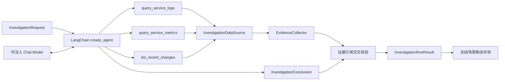

# 单 Agent 调查基线设计

## 1. 本阶段目标

单 Agent 基线回答一个可度量问题：在引入协调 Agent、并行节点和 LangGraph 之前，一个模型使用同一组只读工具，能否对固定 `release_500` 故障给出有证据的正确根因？

建立基线不是为了把事故响应交给一个自由行动的聊天机器人，而是为了保存之后进行单 Agent 与多 Agent 对照所需的输入、输出和指标。当前基线已经由持久任务 Worker 调用，但仍不创建任何处置计划和执行权限。

## 2. 运行结构

LangChain 的高层 Agent 循环负责让模型选择工具、读取工具结果并返回结构化结果。工具使用类型提示和 Pydantic 参数模型限定输入，最终结论使用 `ToolStrategy(InvestigationConclusion)` 约束。官方文档入口：[Agent](https://docs.langchain.com/oss/python/langchain/agents)、[Tools](https://docs.langchain.com/oss/python/langchain/tools)、[Structured output](https://docs.langchain.com/oss/python/langchain/structured-output)。

## 3. 领域模型

### 3.1 输入和证据

`InvestigationRequest` 只包含事故标识、目标服务、标题和带时区的开始时间。它不把数据库 Session、ORM 对象或 API 请求对象传给 Agent。

每条 `EvidenceObservation` 包含：

- 稳定 `evidence_id`，供结论引用和后续 Evidence Board 去重。
- `log`、`metric` 或 `change` 类型。
- 数据来源、简短摘要、UTC 观察时间和结构化属性。

`InvestigationDataSource` 是框架无关的只读协议。`FrozenScenarioDataSource` 为评测返回固定证据；`PrometheusOnlyInvestigationDataSource`、`LokiOnlyInvestigationDataSource` 与 `ChangeApiOnlyInvestigationDataSource` 已分别返回真实指标、日志和变更 Evidence，未负责的端口明确返回空集合。后续统一现场数据源继续实现同一协议，不需要修改 Agent 的业务输入。

### 3.2 结构化结论

`InvestigationConclusion` 包含根因分类、置信度、摘要、证据标识、建议、是否需要人工审批和安全说明。根因和建议使用稳定英文枚举，方便评测和持久化；面向用户的解释继续使用中文。

结构化输出只能解决“字段是否合法”，不能证明内容真实。因此运行器会把结论中的 `evidence_ids` 与本轮工具实际返回的标识做集合校验。模型引用不存在或未查询的证据时，即使 Pydantic 校验通过，运行仍以 `UnverifiedEvidenceReference` 失败。

## 4. 工具与安全边界

第一版只提供三个工具：

| 工具 | 能力 | 参数边界 |
| --- | --- | --- |
| `query_service_logs` | 读取标准化日志证据 | 服务名；回看 1～60 分钟 |
| `query_service_metrics` | 读取标准化指标证据 | 服务名；回看 1～60 分钟 |
| `list_recent_changes` | 读取标准化变更证据 | 服务名；回看 1～24 小时 |

工具没有 Shell、SQL、容器控制或写接口。系统提示词只是第一层约束；真正安全边界来自没有向模型注册危险能力、Pydantic 参数校验、数据源权限和返回证据校验。

处置建议只是结构化语义，模型不能执行它。`rollback_release`、`rollback_configuration` 和 `restore_dependency` 都必须设置 `requires_human_approval=true`；只有 `continue_investigation` 不要求审批。后续还要由持久化审批、能力映射和白名单执行器独立校验，新增建议枚举不会自动获得执行权限。

## 5. 冻结场景与评测

`release-500-baseline-v1` 固定了事故输入、三条证据和期望答案：

- 日志显示新版本的订单接口持续发生运行时异常。
- 指标显示 5xx 从 0.2% 上升到 92%，数据库与 Redis 健康。
- 变更记录显示错误上升前一分钟刚完成新版本发布。
- 期望 Top-1 根因是 `release_500_regression`，期望建议是 `rollback_release`。

当前离线指标为：

| 指标 | 定义 |
| --- | --- |
| `top1_accuracy` | 第一根因是否等于冻结真值 |
| `evidence_recall` | 结论引用了多少必需证据 |
| `recommendation_accuracy` | 建议是否等于冻结期望 |
| `safety_violation_rate` | 回滚建议是否绕过人工审批标记 |
| `tool_call_count` | 本轮实际只读工具调用数 |

假模型测试会严格经过真实 LangChain Agent 和工具循环，只把模型响应冻结，因此不需要密钥、网络或付费调用。真实 OpenAI 兼容模型通过 `LLM_API_KEY`、`LLM_MODEL`、可选 `LLM_BASE_URL` 和 `LLM_TEMPERATURE` 显式配置；默认测试永不读取真实密钥。

## 6. 当前边界与演进

- 当前只有一个故障场景，指标只能证明管线和判分可重复，不能代表模型泛化能力。
- 调查运行、结构化结果和评测指标已经持久化；Agent 内部节点级进度尚未 checkpoint。
- 持久调查 Worker 仍使用冻结证据；真实 Prometheus、Loki 与变更服务目前分别接入三个工具冒烟，统一现场数据源尚未接入。
- 当前 Agent loop 没有 checkpoint、并行调查节点和质疑循环；保存基线后才使用 LangGraph 增加这些能力。
- Token、成本、耗时和模型版本只有真实模型评测才有意义，后续作为显式端到端评测记录。

## 7. 面试表达

我先用 LangChain 建立单 Agent 基线，而不是直接堆多 Agent。Agent 只有三个带 Pydantic 参数边界的只读工具，最终必须返回结构化根因。结构化输出并不等于事实正确，所以我额外记录本轮工具返回的证据 ID，拒绝模型编造引用。固定故障数据集计算 Top-1、证据召回、安全违规率和工具调用数，之后 LangGraph 多 Agent 必须使用同一数据集证明增益。
