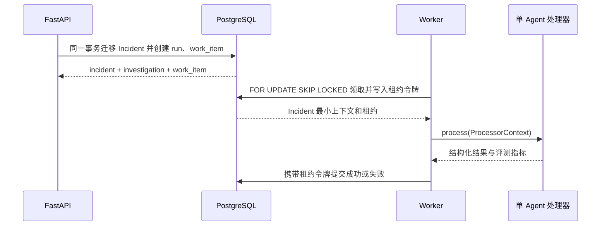

# 持久调查任务与独立 Worker 设计

## 1. 目标

单 Agent 基线已经证明工具循环和离线评测可以重复运行，但进程内调用无法抵抗 API 或 Worker 重启。本阶段把“开始调查”变成一个持久化业务动作：Incident 状态、调查运行和待处理任务在同一个 PostgreSQL 事务中创建，再由独立 Worker 领取。

初始切片只运行 `single_agent`；当前已经在相同任务租约边界内增加 `multi_agent` 模式和 checkpoint 恢复。常驻轮询、SSE 和真实观测平台仍未实现。

## 2. 事务与进程边界



API 只负责快速投递，不在请求进程中调用模型。Worker 和 API 共享领域模型及业务数据库，但分别创建、释放数据库连接池。`ProcessorContext` 同时携带请求、模式、持久任务类型和 `graph_thread_id`；确定性路由器选择 LangChain 单 Agent 或 LangGraph 多 Agent，测试仍可通过 `InvestigationProcessor` 协议注入假处理器。

## 3. 持久状态

### 3.1 investigation_runs

运行状态为：

```text
queued → running → succeeded
   ↑         ↓
   └──────── queued
             ↓
           failed
```

- `queued`：等待首次处理，或一次可重试失败后等待下一次处理。
- `running`：存在一个已领取该任务的 Worker 租约。
- `succeeded`：结构化调查结果已经落库。
- `failed`：重试次数耗尽，或最后一次租约到期且无法确认结果。

运行保存模式、提示版本、实际模型名、结果、离线指标、有限错误摘要和生命周期时间。单 Agent 的 `graph_thread_id` 默认为空；多 Agent 创建时必须原子写入确定性线程 ID。

### 3.2 work_items

任务状态为 `pending → running → completed`，处理失败且还有次数时从 `running` 返回 `pending`，耗尽后进入 `failed`。

每次领取都会：

1. 使用 `FOR UPDATE SKIP LOCKED` 跳过其他 Worker 正在锁定的候选行。
2. 增加 `attempt_count`。
3. 写入 `locked_by`、`locked_until` 和全新的 `lease_token`。
4. 同事务把调查运行标记为 `running`。

Worker 提交结果必须同时匹配任务状态、租约令牌和租约有效期。只比较 `worker_id` 不够，因为同一个 Worker 标识可能在超时后再次领取；唯一租约令牌可以拒绝旧执行尝试的迟到写入。

## 4. 失败恢复

| 场景 | 系统行为 |
| --- | --- |
| 多个 Worker 同时领取 | 行锁与 `SKIP LOCKED` 保证同一时刻只有一个领取者 |
| 处理器抛出异常 | 保存限制长度的错误码与消息，按指数退避重新进入 `pending` |
| Worker 崩溃 | `locked_until` 到期后其他 Worker 可以接管 |
| 旧 Worker 迟到提交 | 因租约令牌或有效期不匹配而拒绝 |
| 最后一次 Worker 崩溃 | 后续轮询把任务和运行关闭为 `failed`，避免永久卡在 `running` |
| Worker 重启 | 队列与运行都在 PostgreSQL，可继续领取，不依赖进程内内存 |

错误摘要不保存堆栈和任意模型输入，避免密钥或敏感遥测进入业务表。当前重试上限为 1～10 次，默认 3 次；租约允许 1 秒到 30 分钟。

## 5. API 契约

`POST /api/v1/incidents/{id}/actions/start-investigation` 仍要求 `expected_version`、`actor_id` 和原因，并允许可选 `mode`，响应同时包含：

- 迁移到 `investigating` 的 Incident 快照。
- 状态为 `queued` 的 Investigation 快照。
- 状态为 `pending` 的 `work_item_id`。

`GET /api/v1/investigations/{run_id}` 查询运行状态、结构化结果、指标和错误。任务租约不通过公共 HTTP 暴露，只允许 Worker 仓储访问。

## 6. 运行方式

业务库迁移后，控制面负责创建任务：

```powershell
uv run alembic upgrade head
uv run uvicorn opsswarm.control_plane.main:app --host 127.0.0.1 --port 8000
```

当前 Worker 每次启动至多处理一个任务，然后退出：

```powershell
$env:LLM_API_KEY = "本地模型服务密钥"
$env:LLM_MODEL = "模型名称"
$env:LLM_BASE_URL = "可选 OpenAI 兼容地址"
uv run python -m opsswarm.worker.main
```

未显式设置密钥和模型名时 Worker 拒绝启动，持续集成也不会调用真实模型。当前处理器读取冻结 `release_500` 演练证据，不得描述为真实监控平台接入。

## 7. 当前限制与下一步

- Worker 是单次命令，没有轮询间隔、信号处理、心跳或优雅停机。
- `investigation_runs.result` 暂以受 Pydantic 校验的 JSONB 保存；Evidence Board 还未拆分为独立证据表。
- 单 Agent 和多 Agent 处理器都仍使用冻结数据源，尚未接真实遥测平台。
- API 没有身份认证，开始调查的 `actor_id` 仍是不可信审计声明。
- 尚未通过 SSE 把运行状态推送给前端。

下一阶段把图返回的证据与专业报告拆入 Evidence Board 业务表。无论图内部怎样变化，API 投递、任务租约、checkpoint 和最终结果审计保持稳定边界。

## 8. 面试表达

我没有让 FastAPI 请求直接跑 Agent，而是在同一个 PostgreSQL 事务中完成 Incident 状态迁移、调查运行和任务投递。Worker 使用 `FOR UPDATE SKIP LOCKED` 并发领取，租约除了 Worker 标识还有每次唯一令牌，所以超时接管后旧 Worker 无法迟到覆盖结果。失败按退避重试，最后一次租约崩溃也会被后续轮询收敛到失败，避免任务永久卡住。
