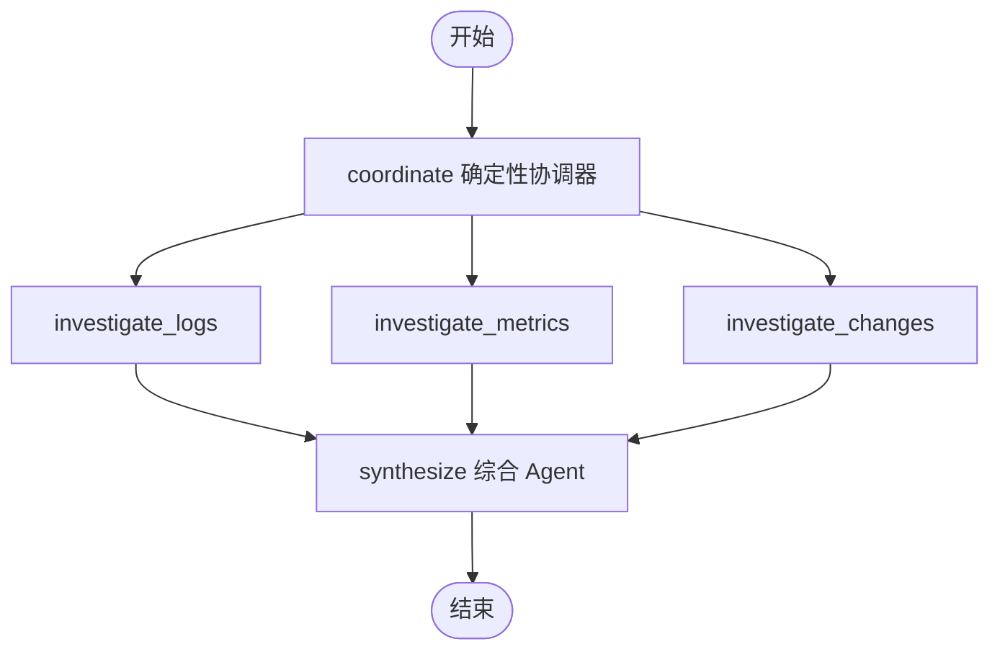

# LangGraph 并行调查基线设计

## 1. 目标与诚实边界

这一阶段验证 LangGraph 是否能把固定的日志、指标和变更调查建模为显式并行状态图，并使用与单 Agent 完全相同的冻结场景和评测函数输出对照结果。

当前只有一个场景，单 Agent 和并行图都得到满分。因此本阶段证明的是编排、并发和证据边界正确，不证明多 Agent 已提升准确率、速度或业务价值。真实增益必须在更大评测集上结合模型调用数、Token、成本和耗时判断。

## 2. 为什么使用 Graph API

该流程需要共享状态、固定扇出、并行执行和全部完成后的扇入。LangGraph 官方将 Graph API 定位于显式状态、复杂分支和并行处理场景；节点是读取状态并返回部分更新的函数，边定义执行顺序。[Graph API](https://docs.langchain.com/oss/python/langgraph/graph-api)、[API 选择](https://docs.langchain.com/oss/python/langgraph/choosing-apis)

当前任务类型固定为日志、指标和变更，因此协调器使用确定性代码生成三项计划，不额外消耗一次模型调用去“发现”已知任务。三个专业节点各自调用可注入分析 Agent，综合节点再使用结构化模型输出最终结论。

## 3. 实际状态图

LangGraph 使用同一上游节点连接多个下游节点进行扇出，并使用 `add_edge([logs, metrics, changes], synthesize)` 表示综合节点必须等待三个前驱全部完成。官方文档把这些节点称为同一 superstep 中的并行分支。[并行工作流](https://docs.langchain.com/oss/python/langgraph/workflows-agents)、[Graph API 使用指南](https://docs.langchain.com/oss/python/langgraph/use-graph-api)

## 4. 图状态与归并

共享状态包含：

| 字段 | 含义 | 更新方式 |
| --- | --- | --- |
| `request` | 事故最小上下文 | 输入后不修改 |
| `coordination_plan` | 三个专业类型 | 协调器覆盖写入 |
| `evidence` | 三个分支返回的标准化证据 | 列表 reducer 累加 |
| `reports` | 三份 `SpecialistReport` | 列表 reducer 累加 |
| `tool_call_count` | 实际数据源调用数 | 整数 reducer 相加 |
| `conclusion` | 最终 `InvestigationConclusion` | 综合节点写入 |

并行分支更新顺序不稳定，因此业务逻辑不能依赖 reducer 得到的列表顺序。进入综合节点和生成最终结果前，证据按 `evidence_id`、报告按专业类型排序。这样相同输入的提示和评测输出保持稳定。

## 5. 专业 Agent 与综合 Agent

`SpecialistAnalyst` 协议接收专业类型、事故输入和该分支证据，返回：

- `specialist`：日志、指标或变更。
- `summary` 与有限 `findings`。
- 只能引用本分支证据的 `evidence_ids`。
- 0～1 的置信度。

`ConclusionSynthesizer` 必须收到三种不同专业报告，使用全部标准化证据生成现有 `InvestigationConclusion`。LangChain 适配器通过 `with_structured_output` 调用可配置模型；测试通过协议注入假分析器和假综合器，不访问网络。

单个数据源暂时无数据不是图运行失败：对应专业报告可以返回空证据引用并明确说明缺失情况，综合节点仍等待三类报告后判断。最终结论仍必须引用至少一条全图真实证据，避免生成无依据根因。

## 6. 两层证据护栏

1. 每个专业节点完成后，把报告引用与该节点工具真实返回的证据集合比较。
2. 综合节点完成后，把最终结论引用与全图收集的证据集合比较。

任一层引用未知证据都会抛出 `UnverifiedEvidenceReference`，整次图运行失败。提示词要求不是安全边界，确定性集合校验才是。

## 7. 当前对照结果

固定 `release-500-baseline-v1` 的离线契约测试结果：

| 指标 | 单 Agent | LangGraph 并行基线 | 差值 |
| --- | ---: | ---: | ---: |
| 根因 Top-1 | 1 | 1 | 0 |
| 证据召回率 | 1 | 1 | 0 |
| 安全违规率 | 0 | 0 | 0 |
| 工具调用数 | 3 | 3 | 0 |

这些数值来自冻结响应，只验证同一判分协议和数据流，不代表真实模型准确率。并行测试额外记录三个分析协程的重叠执行数，实际最大并发为 3。

## 8. 当前限制与下一步

- 图尚未作为 `multi_agent` 模式接入 `investigation_runs` 和 Worker。
- 没有 PostgreSQL checkpointer，Worker 崩溃时仍从整张图重新运行。
- 三个数据源目前是同步冻结实现，真实遥测适配需要异步 I/O 和超时策略。
- 尚未保存单节点模型调用次数、Token、成本和耗时。
- 没有质疑节点、证据不足分支或调查循环。

下一切片建立独立 `opsswarm_checkpoints` 数据库，把图 `thread_id` 关联到业务库的 `graph_thread_id`，验证节点级 checkpoint 与进程重启恢复；随后再把多 Agent 模式接入 Worker。

## 9. 面试表达

我先保留单 Agent 基线，再用 LangGraph Graph API 显式扇出日志、指标和变更三个专业节点，并在三者全部完成后综合。并行 reducer 的写入顺序不稳定，所以综合前按稳定标识排序。每个分支和最终结论都做证据集合校验。当前单场景两种模式都是满分，我不会声称多 Agent 更好；只有扩充评测集并加入延迟和成本后才能判断是否值得。
