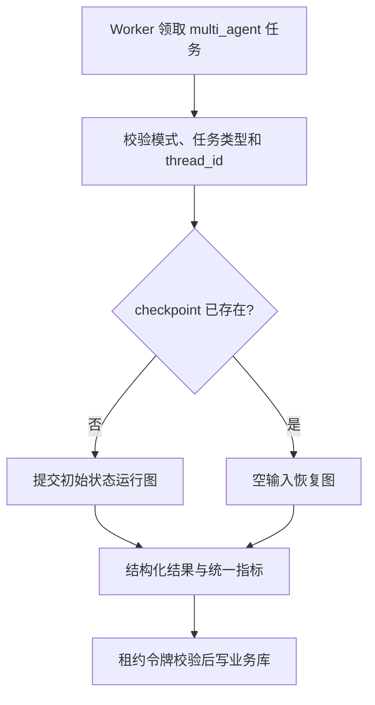

# 多 Agent 持久 Worker 路由设计

## 1. 目标与边界

本切片把已经独立验证的 LangGraph 并行图和 PostgreSQL checkpoint 接入现有业务任务链路，同时保留单 Agent 基线作为可选对照。

完整链路变为：

```text
API 选择模式 → 同事务保存运行和任务 → Worker 租约领取
→ 确定性模式路由 → 单 Agent 首次运行 / 多 Agent 首次运行或恢复
→ 统一评测 → 业务结果落库
```

本阶段不持久化专业报告和独立证据，不实现常驻 Worker 循环、SSE、审批或受控执行。

## 2. 为什么模式必须是业务字段

单 Agent 和多 Agent 是需要公平评测、审计和成本比较的产品模式，不能由模型临时决定。调用方只能提交枚举 `single_agent` 或 `multi_agent`，系统在同一事务中保存：

| 业务模式 | 持久任务类型 | `graph_thread_id` | 提示版本 |
| --- | --- | --- | --- |
| `single_agent` | `run_single_agent_investigation` | 默认空 | `single-agent-v1` |
| `multi_agent` | `run_multi_agent_investigation` | `investigation-run:{run_id}` | `multi-agent-parallel-v1` |

数据库检查约束允许两种模式和任务类型，并要求 `multi_agent` 必须关联图线程。Worker 处理前还会校验运行模式与任务类型是否匹配，防止数据库异常数据被错误路由。

## 3. API 兼容策略

`POST /api/v1/incidents/{id}/actions/start-investigation` 新增可选字段：

```json
{
  "expected_version": 1,
  "actor_id": "engineer-001",
  "reason": "使用并行调查模式",
  "mode": "multi_agent"
}
```

省略 `mode` 时仍使用 `single_agent`，因此现有客户端不需要立即修改。非法枚举返回结构化 `422`，调用方不能提交 `graph_thread_id`、任务类型或提示版本。

## 4. Worker 路由边界

Worker 领取任务后构造只读 `ProcessorContext`：

- `request`：事故最小上下文。
- `mode`：业务运行模式。
- `work_item_kind`：持久任务类型。
- `graph_thread_id`：多 Agent 恢复标识。

`ModeRoutingProcessor` 只根据枚举模式选择处理器；具体处理器再次检查任务类型。LangChain 单 Agent 处理器不接触 checkpoint。LangGraph 多 Agent 处理器必须获得线程 ID。

该路由不调用模型，也不读取提示词，因此模型无法把单 Agent 任务升级为更昂贵的多 Agent 流程。

## 5. 首次运行与恢复判定

不能只用 `attempt_count` 判断是否恢复：Worker 可能在第一个 checkpoint 写入前失败，也可能在图已经完成但业务结果提交前失败。

多 Agent 处理器直接查询当前 `thread_id`：



图 checkpoint 解决节点重复执行，业务任务租约解决 Worker 接管和迟到写入。这两层都存在，不能互相替代。

## 6. 数据库迁移

Alembic `0003_multi_agent_worker`：

- 扩展 `investigation_runs.mode` 检查约束。
- 增加“多 Agent 必须有线程 ID”约束。
- 扩展 `work_items.kind` 检查约束。

没有增加新表或可空占位字段。旧单 Agent 数据无需回填，API 默认行为保持不变。回退到旧 schema 前必须不存在多 Agent 历史数据；迁移不会偷偷删除或改写这些记录。

## 7. 端到端恢复验收

真实 PostgreSQL 17 测试覆盖：

1. API/仓储创建 `multi_agent` 运行、对应任务和稳定线程 ID。
2. 第一个 Worker 领取任务，日志节点失败，任务安全返回 `pending`。
3. 指标和变更节点的 pending writes 已进入独立 checkpoint 数据库。
4. 第二个 Worker 使用新 saver 和新图实例领取同一任务。
5. 处理器发现 checkpoint 后调用恢复，只重新查询日志。
6. 最终业务运行进入 `succeeded`，任务进入 `completed`，尝试次数为 2。

恢复 Worker 的数据源调用为日志 1 次、指标 0 次、变更 0 次；最终工具调用数仍为 3。

## 8. 当前限制与下一步

- 两种模式当前使用同一冻结场景，还不是实际监控平台数据。
- 本切片完成时专业报告只存在于图结果对象；后续切片已将其提升为业务事实。
- Worker 仍是单次命令，没有守护循环、心跳或优雅停机。
- 多 Agent 成本、Token 和节点耗时尚未持久化。
- checkpoint 已持久化，但没有容量和过期清理任务。

专业报告和证据只存在于图结果对象的限制，已由后续 [Evidence Board 持久化设计](11-evidence-board.md) 解决。下一阶段在已提交证据上建立根因假设、支持/反驳关系和质疑节点。

## 9. 面试表达

我把单 Agent 和多 Agent 设计成显式业务模式，而不是让模型自行选择。API、数据库约束、持久任务和 Worker 路由共同保证模式一致。多 Agent 重试不依赖尝试次数猜测，而是查询线程 checkpoint：存在就恢复，不存在才首次运行。端到端测试让第一个 Worker 的一个并行节点失败，第二个 Worker 只重跑失败节点并完成业务结果，证明任务租约和图 checkpoint 两层恢复真正衔接起来。
