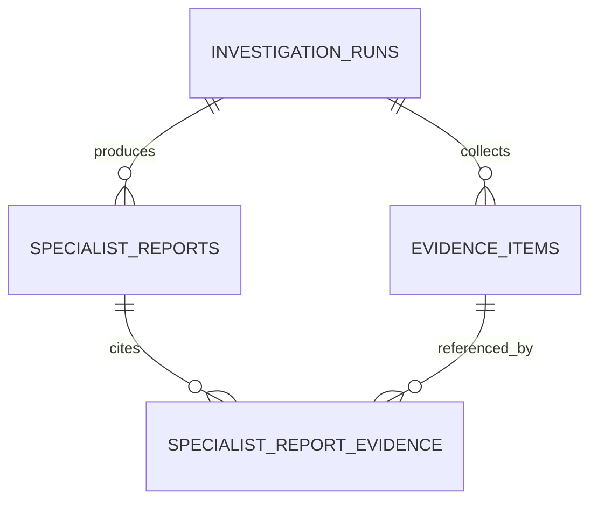
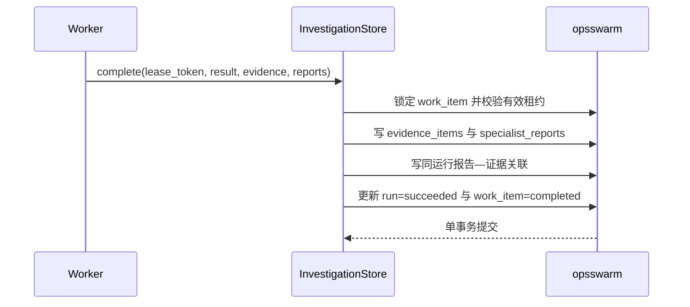

# Evidence Board 持久化设计

## 1. 目标与边界

本切片把调查工具返回的证据和多 Agent 专业报告从运行时对象提升为业务库中的可审查事实。工程师现在能够回答：

- 结论引用了哪些证据？
- 每条证据来自日志、指标还是变更工具？
- 哪份专业报告引用了哪条证据？
- Worker 重试后是否留下重复或半成品记录？

本阶段不保存无限制原始日志，不实现根因假设、支持/反驳关系、质疑节点、处置计划或审批。

## 2. 为什么不能只保存最终 JSON

`investigation_runs.result` 适合快速读取最终结论和评测数据，但不适合作为 Evidence Board：

- 证据无法被独立标识、排序和校验内容完整性。
- 专业报告与证据之间只有字符串约定，数据库不能阻止跨调查关联。
- 后续质疑节点难以表达“某证据支持或反驳某假设”。
- 工程师无法区分 checkpoint 恢复状态与已经提交的业务事实。

因此最终结果 JSON 继续保留为运行摘要，证据和专业报告同时进入规范化表。checkpoint 仍只负责图恢复，不参与 Evidence Board 查询。

## 3. 物理模型

### 3.1 `evidence_items`

- `evidence_key` 是只读工具返回的稳定业务标识，在一次调查内唯一。
- `kind` 只允许 `log`、`metric`、`change`。
- `source`、`summary`、`observed_at` 和受 Pydantic 限制的 `attributes` 保存规范化观察。
- `content_hash` 是规范化证据 JSON 的 SHA-256，用于发现内容漂移，不等同于来源真实性签名。
- 主键使用由 `run_id` 和 `evidence_key` 推导的 UUID5，使同一次调查的逻辑证据具有稳定数据库标识。

### 3.2 `specialist_reports`

- 同一次调查每种专业类型最多一份报告。
- 保存摘要、1～20 条结构化发现、置信度和创建时间。
- 单 Agent 运行没有专业报告，但仍保存工具实际返回的证据，保证单、多 Agent 使用相同审查边界。

### 3.3 `specialist_report_evidence`

关联表同时保存 `investigation_run_id`、报告 ID 和证据 ID。两个复合外键分别指向同一次运行下的报告和证据，因此即使绕过应用层，数据库也会拒绝跨运行关联。

## 4. 进入数据库前的确定性校验

`InvestigationArtifacts` 在 Worker 提交前强制校验：

1. 证据标识不能重复。
2. `returned_evidence_ids` 必须与实际证据集合完全一致，不能只保存部分工具结果。
3. 最终结论只能引用板内证据。
4. 同一专业不能返回重复报告。
5. 专业报告只能引用自身类型的证据，例如日志报告不能引用变更证据。

这些规则不交给提示词决定。LangGraph 节点已有的引用校验负责尽早失败，持久化边界再次校验负责保护业务库。

## 5. 原子提交与恢复语义

任何校验、外键或写入失败都会回滚整个事务，不会出现“运行成功但证据为空”或“证据存在但任务仍重试”的半成品。第一个 Worker 在 LangGraph 分支失败时只留下 checkpoint；业务 Evidence Board 仍为空。恢复 Worker 完成整张图后才提交一次完整板。

## 6. 查询接口

`GET /api/v1/investigations/{run_id}/evidence-board` 返回：

- 调查运行状态和最终结论；
- 按 `evidence_id` 稳定排序的证据；
- 按专业类型稳定排序的报告及其证据引用；
- 每条证据的内容哈希。

排队或重试中的调查返回当前状态和空板，而不是读取 checkpoint 中尚未成为业务事实的中间输出。不存在的运行返回稳定 `404`。

## 7. 安全与审计限制

- 不保存无限制日志正文，只保存最多 500 字的摘要和序列化后不超过 16 KiB 的 JSON 属性；专业报告每条发现最多 500 字。
- 内容哈希只能证明业务库读取内容与写入时的规范化内容一致，不能证明外部日志源没有被篡改。
- 当前没有删除和修改 Evidence Board 的 API；未来归档必须使用受控保留策略。
- `source` 目前是冻结数据源名称，接入 Loki、Prometheus 和 Git 平台时再增加受控来源 URI、查询时间窗和工具调用审计。

## 8. 当前限制与下一步

- 最终结论对证据的引用仍保存在结构化结果中，尚未建成假设关系表。
- 没有表达证据是支持、反驳还是仅提供上下文。
- 专业报告由单次并行调查产生，尚无报告版本或质疑状态。
- 当前只有冻结 `release_500` 场景，没有真实遥测来源。

下一切片增加根因假设、支持/反驳关系和确定性质疑节点。质疑节点只能消费已提交的 Evidence Board，并输出结构化验证结果；它不能修改已有证据。

## 9. 面试表达

我没有把 Agent 最终 JSON 当作唯一事实，而是把工具证据、专业报告和引用关系规范化保存。Worker 只有持有有效租约时，才能在同一 PostgreSQL 事务里提交运行成功、任务完成和整张 Evidence Board。关联表使用带 `run_id` 的复合外键，数据库层阻止跨调查引用；LangGraph 重试期间的中间状态只在 checkpoint，恢复成功后才成为业务事实。
