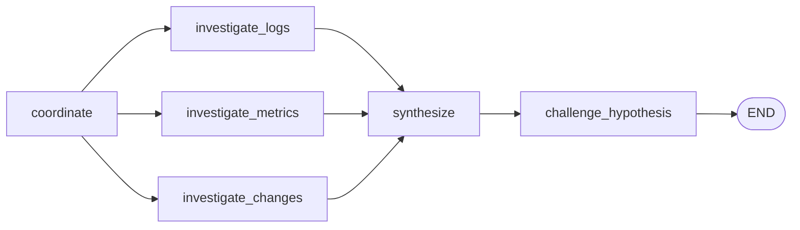
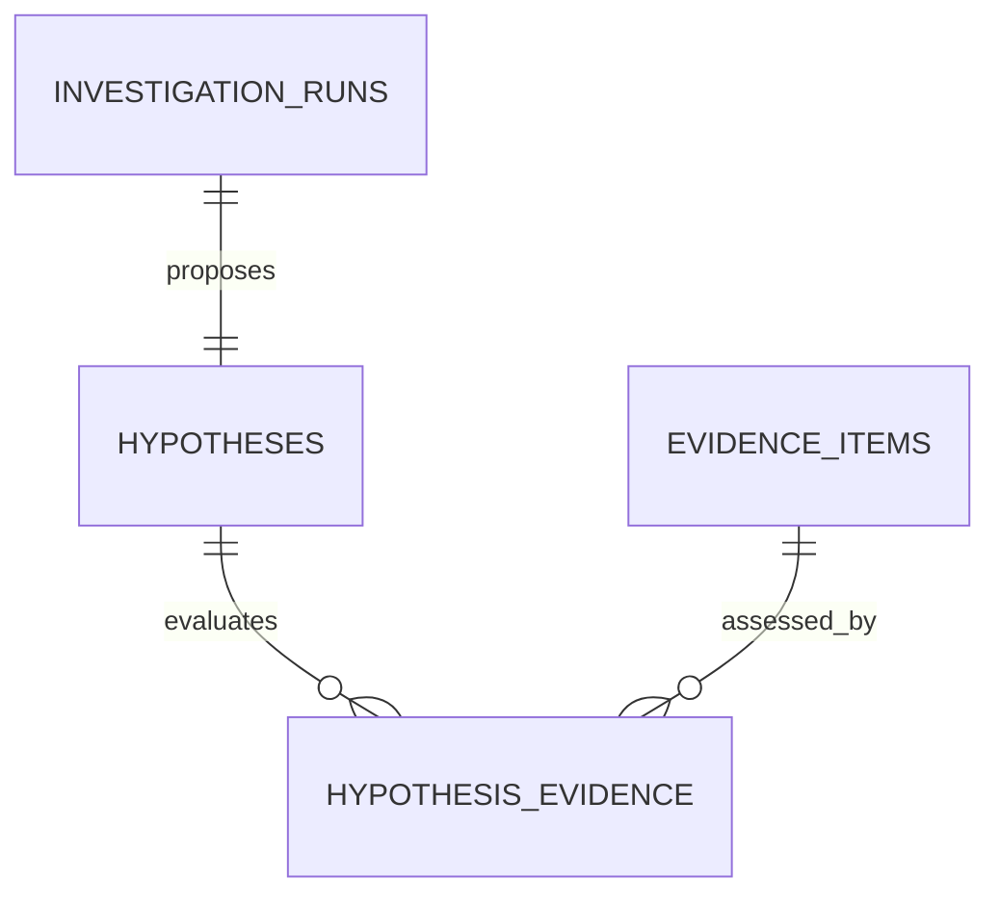

# 根因假设与确定性质疑设计

## 1. 目标与边界

本切片在 Evidence Board 上增加主根因假设、证据支持/反驳关系和确定性质疑节点。它解决的问题不是“让另一个 Agent 再评论一次”，而是用可版本化、可测试的规则阻止缺少独立证据或存在竞争性解释的结论直接进入处置阶段。

本阶段只审查调查结论，不生成处置计划，不迁移 Incident 到 `awaiting_approval`，也不自动重复调用外部工具。质疑未通过时 Incident 继续保持 `investigating`。

## 2. 业务状态与关系

每次成功调查当前只保存一个主根因假设，由最终结构化结论生成：

| 假设状态 | 判定规则 | 后续含义 |
| --- | --- | --- |
| `supported` | 没有反驳证据，且至少两类独立证据支持 | 后续切片才允许生成处置计划 |
| `contested` | 存在至少一条反驳证据 | 不能进入处置，需要调查竞争性解释 |
| `insufficient_evidence` | 没有反驳，但支持证据不足两类 | 保持调查状态并补充证据 |

每条 Evidence Board 证据必须形成且只能形成一种关系：

- `supports`：当前规则认为证据支持主根因。
- `refutes`：证据提供竞争性解释或与假设关键事实冲突。
- `context`：证据已被审查，但当前规则不能确认支持或反驳。

## 3. 为什么质疑节点不使用 LLM

如果让模型自行判断自己的结论是否可靠，容易出现置信度自我强化，也无法稳定复现安全门槛。当前质疑节点使用 `hypothesis-challenge-v1` 规则集：

- 输入是已经通过 Pydantic 校验的调查结果与规范化证据。
- 输出是 `HypothesisChallenge`，包含规则版本、状态以及每条证据的规则码和中文理由。
- Worker 和持久化仓储都会重新计算并比较结果，模型不能伪造 `supported`。
- 规则是纯 Python 领域函数，不依赖 LangChain、LangGraph、FastAPI 或数据库。

LangGraph 只负责把该函数放入可恢复执行序列；业务判断本身仍属于确定性领域层。

## 4. `release_500` 第一版规则

当前冻结场景使用以下可解释规则：

| 证据 | 支持条件 | 反驳条件 |
| --- | --- | --- |
| 变更 | 错误前存在已完成的部署 | 日志运行版本与发布目标版本不一致 |
| 日志 | 明确版本产生 5xx 运行时错误 | 日志运行版本与发布目标版本不一致 |
| 指标 | 5xx 比例显著上升，PostgreSQL 与 Redis 健康 | PostgreSQL 或 Redis 不健康，存在依赖故障竞争解释 |

数据库连接池和 Redis 根因已经预留最小规则；没有匹配规则的证据进入 `context`。新故障场景必须先补充冻结真值和单元测试，再扩展规则版本。

## 5. LangGraph 节点

`challenge_hypothesis` 不调用模型或外部工具。它进入 LangGraph checkpoint，因此 Worker 在综合完成后发生进程故障时可以恢复稳定质疑结果。单 Agent 不运行整张并行图，但处理器调用同一个领域函数，保证两种模式使用相同安全门槛。

## 6. 持久化模型

### 6.1 `hypotheses`

- 一次调查当前最多一个主假设。
- 保存根因枚举、原结论陈述与置信度、质疑状态、摘要、规则版本和创建时间。
- ID 由 `run_id` 和固定主假设名称生成 UUID5，保证同一次调查具有稳定标识。

### 6.2 `hypothesis_evidence`

- 为 Evidence Board 中每条证据保存关系、规则码、理由和创建时间。
- 复合外键同时带 `investigation_run_id`，数据库拒绝跨调查关联假设与证据。
- 应用层要求关系集合与 Evidence Board 证据集合完全一致。

调查结果、任务完成、Evidence Board、假设和全部关系仍在同一个有效租约事务中提交。失败 checkpoint 不产生业务假设。

## 7. API 读取

现有 `GET /api/v1/investigations/{run_id}/evidence-board` 增加 `hypotheses`：

- 排队或重试中的运行返回空数组。
- 成功运行返回主假设及按 `evidence_id` 排序的关系。
- API 暴露规则版本和理由，便于工程师解释系统为何通过或阻止结论。

没有提供修改质疑结果的 API。未来人工补充证据或提出新假设必须创建显式业务记录，不能覆盖原判断。

## 8. 失败路径

- 处理器输出与当前规则重算结果不一致：输出校验失败，任务进入现有 Worker 重试路径。
- 假设或关系违反复合外键：整个完成事务回滚，租约到期后可由其他 Worker 接管。
- `contested` 或 `insufficient_evidence`：调查任务可以完成并保留完整审计，但 Incident 仍是 `investigating`，不能进入计划或审批。
- 规则升级：创建新规则版本和对应评测，不能静默改写历史假设。

## 9. 当前限制与下一步

- 当前只保存最终主假设，没有候选假设排序。
- 规则仅覆盖 MVP 三类根因的最小特征，不是通用因果推断引擎。
- 质疑不自动发起第二轮工具查询，调查循环将在更多故障场景和任务模型稳定后实现。
- Incident 尚未根据 `supported` 自动迁移，避免在计划和审批模型完成前产生半条流程。

上述计划限制已由后续 [版本化处置计划与风险分级设计](13-action-plan-and-risk-policy.md) 解决。下一切片创建绑定精确计划版本的人工审批请求；不执行任何动作，也不提前实现审批通过。

## 10. 面试表达

我在多 Agent 综合结论后增加了一个不调用 LLM 的质疑节点。它把每条证据标为支持、反驳或上下文，只有至少两类独立证据支持且没有反驳时，主根因才是 `supported`。规则带版本，Worker 和仓储会重新计算防止伪造；假设与证据关系通过同运行复合外键和任务租约事务持久化。这样把“模型觉得自己对”变成了可测试、可审计的安全门槛。
