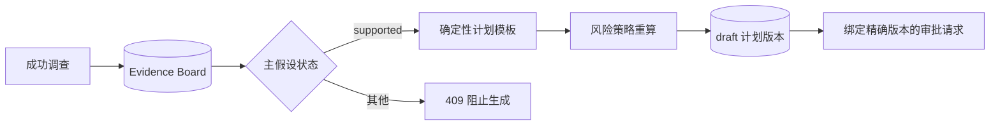
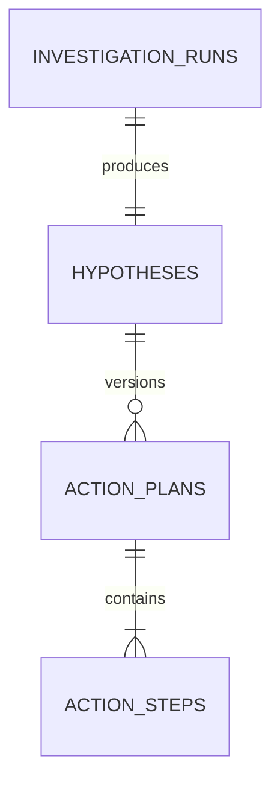

# 版本化处置计划与确定性风险分级设计

## 1. 目标与边界

本切片把已经通过质疑的根因转换为可持久化、可审查、可绑定审批版本的结构化处置计划。它解决“建议回滚”仍是一段文本、风险可以被模型随意填写、并发请求可能生成重复计划的问题。

当前只为 `release_500_regression` 提供 `rollback_release` 确定性模板。生成时计划为 `draft`；后续审批请求切片可以把它迁移到 `awaiting_approval`，但计划仍不调用故障开关，也不拥有 Shell、SQL 或 Docker 权限。

## 2. 为什么计划生成独立于调查事务

Evidence Board 和主假设是已经确认的调查事实；计划是基于事实形成的后续建议。如果回滚证据缺少目标版本，不能为了计划失败而撤销整次调查。

因此计划由独立 REST 命令触发并使用独立数据库事务。未来可以把命令放入持久任务或 LangGraph 分支，但仍必须先提交调查事实。

## 3. 结构化计划契约

`ActionPlan` 包含：

- 正整数版本、`draft` 状态和中文摘要。
- 计划最高风险、是否需要人工审批和风险策略版本。
- 1～20 个连续排序的 `ActionStep`。

每个步骤包含白名单动作、目标、严格参数、风险规则码与理由，以及结构化恢复判据。当前唯一动作是：

| 字段 | 当前值 |
| --- | --- |
| `action_type` | `rollback_release` |
| `target_type` | `service` |
| 参数 | `current_version`、`target_version`，且两者不能相同 |
| 验证信号 | `http_5xx_ratio` |
| 成功判据 | 60 秒观察窗口内至少 3 个成功样本，比例低于 1% |

版本参数从最新一条已完成部署证据的 `to_version` 和 `from_version` 提取，客户端和模型不能直接覆盖。

## 4. 风险策略

`action-risk-v1` 把版本回滚固定判定为：

- `risk_level=high`；
- `requires_human_approval=true`；
- 规则码 `rollback_changes_running_version`。

安全边界分三层：

1. Pydantic 拒绝未知动作、未知参数、空目标、无效验证规则和不连续步骤。
2. 纯 Python 风险策略在持久化前和读取时重新计算，拒绝把高风险伪装成低风险或免审批。
3. PostgreSQL 检查约束禁止 `high`、`critical` 计划或步骤关闭人工审批。

未来 LangChain 可以输出同一契约的候选计划，但风险等级、审批要求和执行授权仍只能由确定性代码决定。

## 5. 持久化与版本语义

- `action_plans` 通过 `(investigation_run_id, hypothesis_id)` 复合外键保证来源假设属于同一次调查。
- `(hypothesis_id, version)` 唯一；当前模板只生成版本 1。
- 计划 ID 和步骤 ID 使用 UUID5 从假设、版本和步骤序号确定性生成。
- 相同假设的并发 POST 使用 PostgreSQL `ON CONFLICT DO NOTHING`，一个请求返回 `201 created=true`，其余返回 `200 created=false` 和同一计划。
- 计划不提供修改或删除 API。未来修订创建新版本，审批通过计划 ID、版本和内容哈希绑定原内容。

## 6. API

| 方法与路径 | 语义 |
| --- | --- |
| `POST /api/v1/investigations/{run_id}/action-plans` | 从已提交事实幂等生成计划草案 |
| `GET /api/v1/investigations/{run_id}/action-plans/current` | 返回当前最高版本 |

调查未成功、假设缺失、假设未通过、根因无模板或回滚目标不明确都返回结构化失败。计划生成成功后 Incident 仍是 `investigating`，版本也不变化。

## 7. 当前限制与下一步

- 只有 `release_500` 确定性模板，数据库连接池和 Redis 计划将在各自故障演练切片加入。
- 当前没有模型生成候选计划，先以安全模板建立评测基线。
- 只生成版本 1，尚无人工修改和新版本命令。
- 已有审批请求和固定有效期，但没有可信审批身份、批准/拒绝决定或执行权限。

审批请求设计见 [精确版本审批请求与原子状态迁移](14-approval-request.md)，终态规则见 [审批决定、过期收敛与审计](15-approval-decision.md)。批准仍不执行计划；下一切片由确定性白名单执行器消费有效批准。

## 8. 面试表达

我把“建议回滚”建模成不可变版本化计划，而不是一段 Prompt 文本。动作参数只能从已经提交的变更证据中提取，风险由版本化规则重算，数据库再禁止高风险绕过审批。计划生成与调查事务分开，避免计划失败丢失调查事实；并发重复请求通过唯一约束返回同一个版本。这样后续审批可以绑定精确计划，而不是批准一段可能已经变化的文本。
