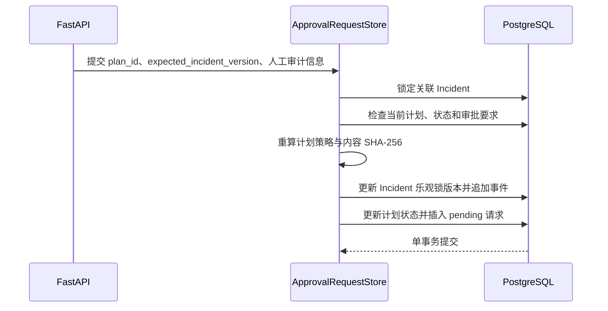

# 精确版本审批请求与原子状态迁移设计

## 1. 目标与边界

本切片把高风险 `draft` 计划提交为可恢复、可审计的 `pending` 审批请求。审批对象同时绑定计划 ID、版本和内容 SHA-256，防止工程师看到的内容与后续决定针对的内容不一致。

审批请求创建和查询仍不调用故障开关，也不授予任何执行权限。后续切片已经增加批准、拒绝和过期终态，设计见 [审批决定、过期收敛与审计](15-approval-decision.md)。请求与决定中的 `actor_id` 都只是本地演练的审计声明；在身份认证和角色授权实现前，不能把它视为可信审批身份。

## 2. 为什么创建请求必须是一个事务

创建审批不是单纯插入一行数据，它同时表达三个一致事实：

1. 一个精确计划版本正在等待工程师决定；
2. 计划从 `draft` 进入 `awaiting_approval`；
3. Incident 从 `investigating` 进入 `awaiting_approval`，版本递增并追加时间线事件。

任何一步失败都会整体回滚。这样不会出现“页面显示待审批但 Incident 仍在调查”，也不会出现 Incident 已迁移却没有审批记录的半完成状态。

## 3. 精确审批对象

`approval_requests` 保存：

- `action_plan_id` 和 `action_plan_version`：通过复合外键绑定数据库中真实存在的精确版本；
- `plan_content_hash`：对来源标识、计划版本、摘要、风险策略和全部有序步骤计算 SHA-256；
- 请求人类型与标识、原因、创建时间和过期时间；
- 当前唯一状态 `pending`。

哈希不包含计划生命周期状态，因为 `draft → awaiting_approval` 是提交审批本身造成的合法变化。读取审批请求时会重新加载完整计划、重新执行风险策略并重算哈希；内容发生静默变化时返回冲突，不继续把它展示为有效审批对象。哈希用于检测业务库内的内容漂移，不等同于数字签名，也不能证明外部证据来源可信。

## 4. 并发、幂等与乐观锁

同一计划最多有一个审批请求，数据库唯一约束是并发正确性的最终保证。仓储先对关联 Incident 执行 `FOR UPDATE`：

- 首个请求使用 `expected_incident_version` 完成一次状态迁移并创建记录；
- 同计划并发或网络重试在取得锁后读取原请求，返回 `200 created=false`；
- 尚未成功创建请求时，如果 Incident 版本过期或状态非法，返回 `409`，计划状态和事件都不会提交。

幂等重试返回原请求时不再次要求旧 `expected_incident_version` 等于当前版本，否则客户端在响应丢失后无法安全确认第一次操作是否成功。

## 5. 有效期与当前限制

请求创建时使用固定 30 分钟有效期，并通过数据库约束保证 `expires_at > created_at`。读取路径不会静默写库；批准或拒绝命令到达时会先确定性检查当前时间、请求状态、计划哈希和 Incident 版本，过期请求收敛为独立 `expired` 终态。

当前限制：

- 没有可信登录身份、角色或多租户授权；
- 已有批准、拒绝、过期和决定审计字段，但没有可信身份与角色授权；
- 一个计划只允许发起一次请求；被拒绝后应通过新计划版本重新申请；
- 尚未使用 LangGraph `interrupt` 恢复工作流；业务审批事实仍以 PostgreSQL 为准；
- 已有独立白名单执行器，但 `awaiting_approval` 仍不代表允许操作环境；只有不可变批准终态和执行时再次校验都通过后才能领取操作。

## 6. API

| 方法与路径 | 语义 |
| --- | --- |
| `POST /api/v1/action-plans/{plan_id}/approval-requests` | 首次原子创建返回 `201`；同计划幂等重试返回 `200` |
| `GET /api/v1/approval-requests/{request_id}` | 重新校验计划内容后返回审批请求 |

POST 请求携带 `expected_incident_version`、`actor_id` 和 `reason`。目标计划不存在返回 `404`；非当前计划、状态不可提交、不需要审批、版本冲突或完整性失败返回结构化 `409`。

## 7. 面试表达

我没有把审批做成一个布尔字段，而是建立了绑定计划 ID、精确版本和内容哈希的审计对象。创建请求时锁定 Incident，并在同一 PostgreSQL 事务中更新计划状态、Incident 乐观锁版本、时间线和请求记录；并发重试只返回同一请求。内容在提交后被修改会通过重算哈希被发现。审批决定与白名单执行继续分层实现，避免把“发起审批”或一次普通 API 请求直接等同于操作授权。
