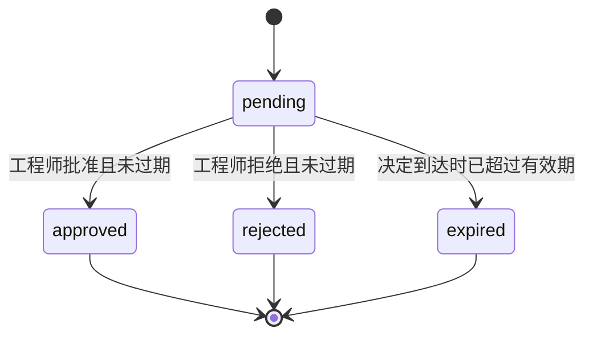
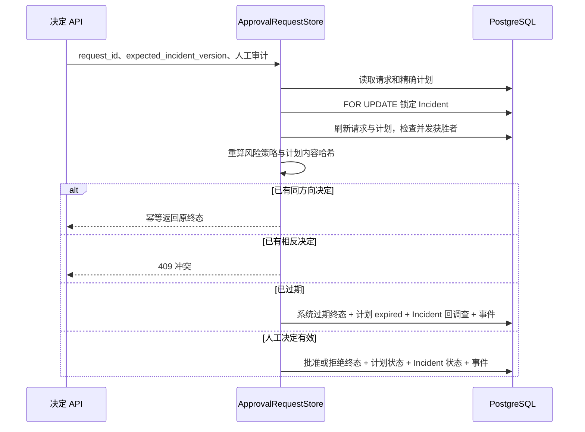

# 审批决定、过期收敛与审计设计

## 1. 目标与边界

本切片让工程师能够对 `pending` 审批请求提交批准或拒绝，并把超时请求确定性收敛为 `expired`。每个终态都保存操作者、原因和时间，计划、Incident 与时间线必须同步变化。

批准只表达“这个精确计划版本获得执行资格”：审批请求和计划变为 `approved`，Incident 进入 `mitigating`。批准接口本身不会调用 Docker、Shell、SQL、故障开关或外部平台；后续执行必须通过独立白名单执行接口再次校验授权，详细设计见 [确定性白名单执行器](16-deterministic-operation-executor.md)。

## 2. 状态与业务动作

三个终态不可相互转换。同方向重复命令返回原决定并标记 `decision_applied=false`；相反方向的后到命令返回 `409`，不能覆盖最先提交的决定。

| 请求终态 | 计划终态 | Incident 动作与目标 | 审计主体 |
| --- | --- | --- | --- |
| `approved` | `approved` | `approve_plan → mitigating` | `human` 与操作者 ID |
| `rejected` | `rejected` | `reject_plan → investigating` | `human` 与操作者 ID |
| `expired` | `expired` | `expire_approval → investigating` | 无操作者 ID 的 `system` |

过期不是人工拒绝，因此使用独立 `expire_approval` 领域动作。这样时间线、指标和后续复盘可以区分“工程师认为计划不安全”和“值班人员没有及时处理”。

## 3. 原子事务与并发

仓储沿用与请求创建相同的 Incident 行锁顺序，避免创建与决定之间产生反向锁。等待行锁期间，请求可能已被另一个事务决定，因此取得锁后必须刷新请求和计划，再判断幂等或冲突。所有业务变化在一个事务提交，乐观锁失败时全部回滚。

## 4. 有效期与完整性

- 当决定的有效业务时间 `>= expires_at` 时，不再接受批准或拒绝，而是提交 `expired`。
- 过期时间使用固定 30 分钟策略；查询接口不产生隐式写入，只有决定命令触发显式收敛。
- 每次决定前重新加载计划、重算 `action-risk-v1` 和审批内容 SHA-256。
- 计划内容漂移、计划不在 `awaiting_approval`、Incident 版本过期或状态不允许时，决定事务失败。
- 数据库检查约束要求 `approved`、`rejected` 具备完整人工审计，`expired` 具备系统审计，`pending` 不得提前填决定字段。

## 5. API

| 方法与路径 | 语义 |
| --- | --- |
| `POST /api/v1/approval-requests/{request_id}/actions/approve` | 批准计划版本；首次 `decision_applied=true`，同向重试为 `false` |
| `POST /api/v1/approval-requests/{request_id}/actions/reject` | 拒绝计划版本并回到调查 |

两个请求都携带 `expected_incident_version`、`actor_id` 和 `reason`。请求不存在返回 `404`；相反终态、过期、计划完整性、Incident 版本或状态问题返回结构化 `409`。过期错误返回前，`expired` 事实已经提交，因此进程重启后仍可恢复。

## 6. 当前限制与下一步

- `actor_id` 仍是 localhost 演练的审计声明，不是可信身份认证。
- 没有角色、双人复核、租户、审批策略组或撤销批准。
- 过期策略固定为 30 分钟，没有后台扫描器；没有决定命令时保持 `pending`。
- 批准后 Incident 停在 `mitigating`，必须由独立执行命令和幂等键触发固定本地操作。
- LangGraph 暂停恢复尚未接入决定命令，业务事实仍以 PostgreSQL 为准。

后续已建立确定性白名单执行器和 `operation_executions`：只接受已批准计划，重新校验版本、哈希和动作参数，使用唯一幂等键执行本地故障演练操作，并完整保存结果。下一阶段将使用独立 `verification_runs` 判断系统是否真正恢复。

## 7. 面试表达

我把审批决定设计成不可变终态，不允许后到请求覆盖先到请求。同方向重试幂等返回，相反决定返回冲突；并发时先锁 Incident，再刷新审批请求，保证只有一个事务能同时迁移请求、计划、Incident 和时间线。超时使用独立系统动作，不伪装成人工拒绝。批准只授予后续确定性执行器资格，API 本身没有环境写权限，因此审批与执行的安全边界是清晰的。
