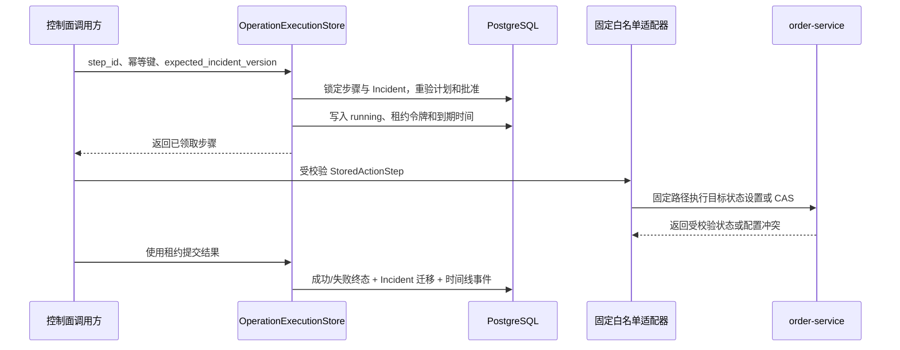

# 确定性白名单执行器与幂等操作设计

## 1. 目标与边界

本切片把“计划已获批准”推进为一次可审计、可恢复的本地操作。控制面只允许执行已批准计划中的具体步骤：版本回滚关闭 `order-service` 的 `release_500`，配置回滚通过固定管理接口比较并设置 `database_pool_size`；后续 Redis 切片在相同边界内增加固定依赖恢复动作。

LLM、LangChain 和 LangGraph 都不参与授权或执行。请求不能提供 Shell、SQL、URL、HTTP 方法或任意动作参数；执行器也不读取计划中的地址来拼接请求。操作成功只把 Incident 从 `mitigating` 推进到 `verifying`，随后由独立的[逐次恢复验证](17-persistent-recovery-verification.md)判断是否真正恢复。

## 2. 执行链路

授权事务在任何环境操作之前依次确认：

1. 步骤属于数据库中可重建且风险策略仍有效的计划。
2. 目标计划是该调查的当前版本，状态为 `approved`。
3. 审批请求精确绑定计划 ID、版本和内容哈希，状态为 `approved`。
4. Incident 处于 `mitigating`，且版本等于请求的 `expected_incident_version`。
5. 步骤动作、目标类型和目标名称与执行器白名单完全匹配。

## 3. 白名单和网络边界

当前三个执行器名称分别为 `local_fault_lab_release_500_v1`、`local_fault_lab_database_pool_v1` 和 `local_fault_lab_redis_dependency_v1`。前两个只接受 `service + order-service`，Redis 执行器只接受 `dependency + redis`；各自进一步限制为：

- `rollback_release`：固定路径 `/__admin/faults/release-500` 和固定请求体 `{"enabled": false}`；
- `rollback_configuration`：只允许 `database_pool_size`，固定路径 `/__admin/configuration/database-pool`，请求体只能来自计划的严格整数当前值与目标值。
- `restore_dependency`：只允许 `redis`，固定路径 `/__admin/dependencies/redis`，请求体只能来自计划冻结的严格布尔预期值与目标值。

基础地址只能是明文 HTTP 的 `127.0.0.1`、`localhost` 或 Compose 服务名 `order-service`，不能包含用户信息、路径、查询参数或片段。请求关闭环境代理继承，默认超时 3 秒、配置上限 10 秒。返回值经过 Pydantic 校验并限制为 16 KiB，异常只落库有限的稳定错误码和中文摘要。

版本动作采用“设置为关闭”，不采用“切换开关”。配置和 Redis 动作先读取当前状态：等于目标时按崩溃重放成功；等于计划预期时使用原子比较并设置；状态漂移时拒绝覆盖。三种动作都具备安全重放语义。

## 4. 幂等、租约与一致性

`operation_executions.idempotency_key` 全局唯一。首次请求创建 `running` 记录并取得 15 秒租约；同键在有效租约内返回同一运行记录，不再次调用适配器。同键在租约过期后可以取得新令牌并增加 `attempt_count`，不同键不能接管运行中的步骤。一个步骤最多存在一个运行记录和一个成功记录。

执行分成三个阶段：授权并预留、外部 HTTP 动作、提交终态。PostgreSQL 事务不能和本地 HTTP 组成原子事务，因此进程可能在环境已改变但终态尚未保存时崩溃。系统不宣称物理上的恰好一次；它通过相同幂等键、短租约和幂等外部动作实现可恢复的至少一次执行。后续接管可能物理重放一次“设置为关闭”，但逻辑效果不变。

完成事务会重新读取当前时间并校验租约令牌和到期时间。迟到实例不能覆盖接管者：租约失效时终态提交被拒绝。成功时，执行记录变为 `succeeded`，Incident 通过 `complete_mitigation` 进入 `verifying`；失败时记录变为 `failed`，Incident 通过 `fail_mitigation` 返回 `investigating`。执行终态、Incident 乐观锁更新和时间线事件在同一个数据库事务提交。

## 5. API 契约

| 方法与路径 | 成功语义 |
| --- | --- |
| `POST /api/v1/action-steps/{step_id}/executions` | 首次成功 `201`；同键已有终态 `200`；同键仍在运行 `202` |
| `GET /api/v1/operation-executions/{execution_id}` | 返回不含租约令牌的持久执行记录 |

执行请求只包含 `idempotency_key` 与 `expected_incident_version`。适配器失败会先持久化失败和 Incident 回流，再返回 `502`；未批准、版本冲突、幂等键冲突、步骤已有其他运行或成功执行返回 `409`。路径不存在返回 `404`。

## 6. 当前限制与下一步

- API 内同步执行最长 3 秒的本地动作；长时间或生产操作必须改为独立执行 Worker。
- `actor_id` 和审批身份仍不可信，因此只能在 localhost/Compose 演练。
- 只有两个固定动作和一个故障服务，没有 Kubernetes、Docker Socket 或云平台权限。
- 执行失败后的新计划版本与重审批循环尚未打通。
- `verifying` 只是状态，不代表系统已经恢复。

后续已实现 `verification_runs` 和不可变样本：根据计划中冻结的验证规则查询订单接口，只有样本数量和观察窗口同时满足才进入 `resolved`，失败返回 `investigating`。下一阶段通过可重放 SSE 向作战室持续推送数据库时间线。

## 7. 面试表达

我没有让 Agent 直接操作生产环境，而是把模型输出收敛为严格的计划步骤，再由固定白名单适配器执行。执行前重新校验当前计划、精确审批、内容哈希、Incident 状态和乐观锁版本；数据库用全局幂等键、步骤部分唯一索引和 15 秒租约处理并发与崩溃恢复。因为数据库与 HTTP 没有分布式事务，我明确采用可重放的至少一次语义，外部动作设计为“设置目标状态”而不是“切换”，避免重放造成反向效果。成功和失败都与 Incident 迁移及时间线原子落库，但恢复结论留给独立验证阶段。
