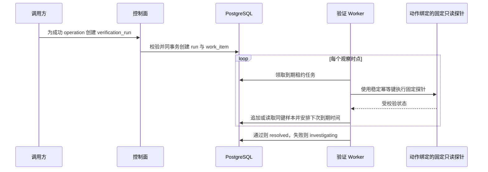

# 逐次恢复验证与持久样本设计

## 1. 目标与边界

本切片让 `verifying` 成为可持久化、可恢复、可审计的业务过程。验证只消费成功操作及其步骤中已经冻结的规则，不允许模型或客户端在验证时降低阈值、减少样本数或伪造观测值。

版本回滚规则是 `http_5xx_ratio < 0.01`，配置回滚规则是 `database_pool_saturation < 0.8`，Redis 恢复规则是 `redis_unavailable_ratio < 0.01`；三者都要求观察窗口 60 秒、至少 3 个成功样本。API 不在单次请求中等待 60 秒；后续切片已经增加持久验证 Worker，自动逐次触发固定只读探针，运行进度、调度状态和每个样本都写 PostgreSQL。LangChain 和 LangGraph 不参与恢复判定。

## 2. 为什么采用逐次采样

三次瞬时请求不能证明系统在 60 秒内持续健康，而让 API 请求睡眠 60 秒会占用连接、难以恢复，也违反控制面不承载长任务的边界。因此验证拆成“创建运行”和“追加样本”两个短命令：

测试通过可注入服务器时钟模拟观察间隔；生产规则仍为真实 60 秒，没有为了测试而缩短。

## 3. 服务端探针与判定

初始实现使用 `local_order_http_5xx_ratio_v1`、`local_database_pool_saturation_v1` 与 `local_redis_unavailable_ratio_v1` 访问固定状态路径。第 36 个切片已切换为三个 `prometheus_*_v1` 验证器：只访问项目内 Prometheus，并把动作和信号映射为代码中固定 PromQL。历史运行保留原名称；新适配器仍不接受客户端 URL、订单 ID、查询或观测值。

- 合法 2xx 且响应符合 `OrderResponse`：样本值为 `0.0`。
- 任意 5xx：样本值为 `1.0`。
- 超时、网络失败、无效响应或其他状态：保存 `error` 样本。
- 配置状态响应有效：直接读取 `database_pool_saturation`，由冻结的 `< 0.8` 判据评分。
- Redis 状态响应有效：可用映射为 `0.0`，不可用映射为 `1.0`，由冻结的 `< 0.01` 判据评分。

数值按计划冻结的 `less_than` 规则比较。任一 `failed` 或 `error` 样本立即终止运行并触发 `fail_verification`；健康样本达到 3 个后仍必须满足 `last_observed_at - first_success_at >= 60 秒`，才能触发 `confirm_recovery`。

## 4. 幂等、并发和事务

每次成功操作最多一个验证运行，重复创建返回原运行，不重复冻结规则。样本幂等键在运行内唯一；已保存同键样本直接返回，不重复调用探针。探针是只读请求，因此进程在读取后、落库前崩溃时可以安全重读，不需要把数据库锁跨越网络调用。

不同采样请求可能并行读取，但最终追加时必须锁定同一验证运行。取得锁后再次检查同键样本和运行终态，数据库连续分配样本序号。若另一请求已经结束运行，后到请求不能追加新样本。

运行进入 `passed` 或 `failed`、最后一个样本、Incident 乐观锁更新和 `incident_events` 在同一 PostgreSQL 事务提交。通过后 Incident 从 `verifying` 进入 `resolved`；阈值失败或探针错误从 `verifying` 返回 `investigating`。中间健康样本不改变 Incident 版本。

## 5. 数据与 API

`verification_runs` 唯一绑定成功执行记录，保存 Incident、步骤、执行前版本、冻结规则、成功样本计数、观察时间和终态摘要。`verification_samples` 是只追加明细，保存运行内幂等键、连续序号、判定、数值或错误、HTTP 状态和服务器观测时间。`verification_work_items` 保存唯一调度任务、下一次到期时间、租约、调度序号、尝试次数和有限错误。

| 方法与路径 | 成功语义 |
| --- | --- |
| `GET /api/v1/verification-candidates` | 返回最新调查当前计划中成功且尚未完成验证的操作 |
| `POST /api/v1/operation-executions/{execution_id}/verification-runs` | 首次创建 `201`；同操作幂等读取 `200` |
| `GET /api/v1/verification-runs/{run_id}` | 返回冻结规则、进度、终态和全部样本 |
| `GET /api/v1/verification-runs/{run_id}/work-item` | 返回不含租约令牌的自动采样状态 |
| `POST /api/v1/verification-runs/{run_id}/samples` | 首次样本 `201`；同键样本 `200` |

## 6. 当前限制与下一步

- 自动采样由 Compose 中的常驻 Worker 触发；手动样本接口仍用于本地诊断。
- 第 56 步已经增加恢复验证中心；浏览器只能创建运行并只读观察 Worker，不能提交样本内容。
- 当前已支持 Prometheus 固定即时查询，但尚未支持生产流量区间聚合或多信号组合。
- 单个请求代表一个 0 或 1 的 5xx 样本，不是生产流量的统计分位。
- 验证失败后的自动重新调查、生成新计划和再次审批尚未闭环。
- Incident 已能进入 `resolved`，但关闭、复发和 UI 仍未提供完整操作入口。

基于 `incident_events.id` 与 `Last-Event-ID` 的可重放 SSE 已在 [可重放事故时间线 SSE](18-replayable-sse-timeline.md) 中实现，让执行和验证进度能够断线续传给后续作战室界面。

## 7. 面试表达

我没有用三次瞬时请求冒充 60 秒持续恢复，也没有让 API 阻塞等待。验证规则从已执行步骤冻结到业务库，验证运行和调度任务同事务创建，独立 Worker 按数据库到期时间逐次采样。每个调度轮次使用稳定幂等键；样本落库后即使 Worker 崩溃，租约接管也只会读取原样本。达到样本数且覆盖完整窗口才通过，失败样本、运行终态、Incident 状态和时间线原子提交。探针是只读操作，数据库行锁只用于领取和最终判定，不跨越网络调用。
