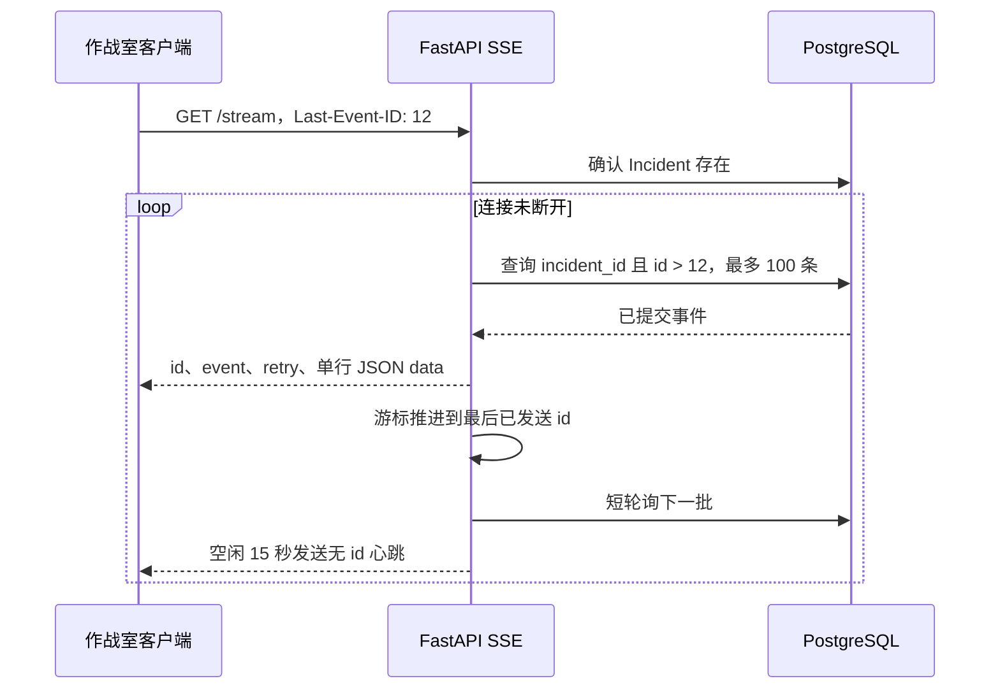

# 可重放事故时间线 SSE 设计

## 1. 目标与边界

本切片让作战室客户端能够实时观察已经提交的事故事件，并在浏览器断线、API 重启或网络抖动后从最后游标继续。SSE 只负责服务端到客户端的事实投递；审批、执行和验证命令继续使用 REST。

PostgreSQL `incident_events` 是唯一时间线事实来源。实现不维护进程内消息队列，也不把 SSE 是否发送成功写回业务状态，因此客户端连接状态不会影响 Incident 事务。

## 2. 重放协议



- 首次连接没有 `Last-Event-ID` 时从 0 开始，补发该 Incident 的完整时间线。
- 重连只读取严格大于请求游标的事件，避免跳过尚未收到的新事实。
- 每批默认最多 100 条；满批立即读取下一批，未满批等待 1 秒。
- 每条事件携带 `retry: 3000`，建议客户端断线 3 秒后重连。
- 空闲 15 秒发送 `: heartbeat` 注释，不携带事件 ID，也不改变恢复游标。

SSE 是至少一次传输：连接可能在服务端发送后、客户端确认前中断，所以同一事件可能重放。调用方必须使用全局数字 `id` 幂等更新界面。

## 3. 数据库连接与失败语义

`IncidentStore.list_events` 每次调用创建短生命周期异步会话，查询结束即归还连接。SSE 在轮询等待期间不持有事务或连接，避免大量空闲浏览器耗尽连接池。

连接前先查询 Incident，因此不存在的 ID 可以返回普通结构化 `404`。流响应头发出后，数据库故障无法再改成 JSON 错误响应；此时终止连接，让客户端使用未推进的 `Last-Event-ID` 重连。系统不会发送伪造的“成功”事件掩盖故障。

当前短轮询带来最多约 1 秒新事件延迟和持续轻量查询。后续只有在连接规模和数据库负载证明必要时，才引入 PostgreSQL `LISTEN/NOTIFY` 作为唤醒信号；即使引入，补发和事实判断仍读取 `incident_events`。

## 4. 事件格式与安全

事件块由四个字段组成：

```text
id: 13
event: incident.status_changed
retry: 3000
data: {"cursor":13,"event_type":"incident.status_changed"}
```

完整 `data` 通过 Pydantic 响应模型序列化为单行 JSON。换行等字符由 JSON 转义，不能注入新的 SSE 字段。配置使用 `OPSSWARM_SSE_` 前缀并限制批量、轮询、心跳与重试范围。

当前 API 没有身份认证，仍只允许 localhost 本地演练。正式入口限制 `--host` 为 `127.0.0.1` 或 `localhost`。在 Windows 上入口显式选择 Psycopg 支持的 Selector 事件循环，避免 Uvicorn 默认 Proactor 循环导致数据库请求失败。

## 5. 测试策略

- 纯单元测试验证事件编码、中文 JSON、换行转义、游标推进、心跳和配置边界。
- PostgreSQL 集成测试验证 `Last-Event-ID` 之后只补发新事件。
- API 测试验证不存在 Incident 为 `404`、非法请求头为 `422`，并检查 OpenAPI 契约。
- 真实进程冒烟通过两次告警生成 `id: 1` 与 `id: 2`，第二次连接携带 `Last-Event-ID: 1` 时只收到第二条。

## 6. 当前限制与下一步

- Vue 3 作战室已使用原生 EventSource 消费具名事件，并按数字游标去重、按 Incident 版本保护当前快照。
- 短轮询没有连接数配额、每用户授权或跨租户隔离，因此不可用于生产。
- 只发送 Incident 时间线事件；调查节点级 token 流或模型思考过程不属于业务事实，不进入该流。
- Incident 关闭与关闭前后复发语义见 [Incident 关闭与告警复发](19-incident-closure-and-recurrence.md)，客户端实现见 [Incident 作战室前端](20-incident-workroom-ui.md)。

## 7. 面试表达

我没有把实时进度建立在进程内队列上，而是复用了事务内只追加的事故事件表。数据库递增主键同时作为 SSE ID，首次连接补历史，重连用 Last-Event-ID 读取更大的记录。心跳不带 ID，客户端按 ID 幂等处理，因此 API 重启不会丢时间线。轮询等待不占数据库连接，异常时直接断流并从旧游标恢复。这个设计先获得可靠、易解释的至少一次投递，再根据真实负载决定是否增加通知机制。
