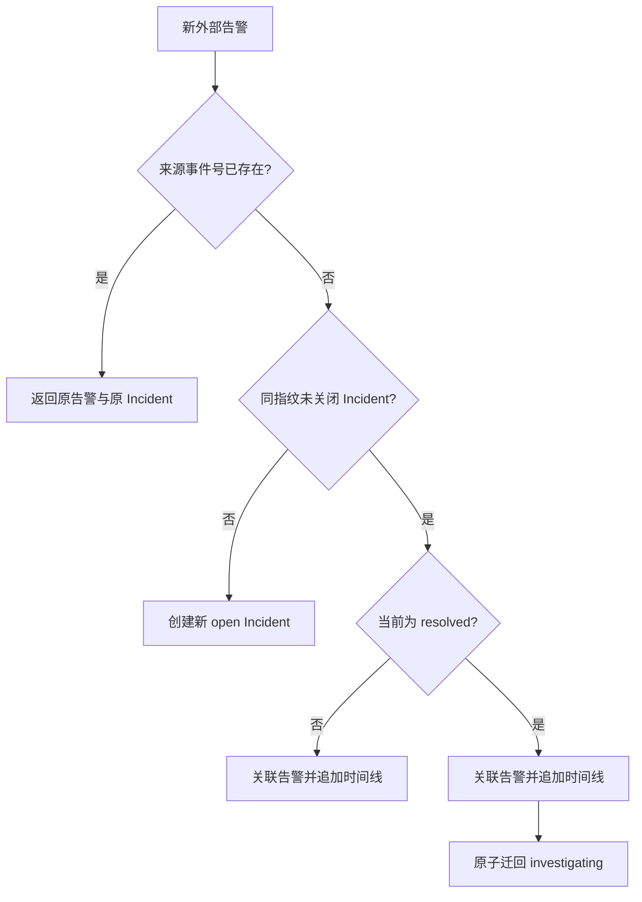

# Incident 关闭与告警复发设计

## 1. 目标与边界

本切片补齐恢复确认后的生命周期：`resolved` 不是终态，必须由工程师明确关闭；关闭前再次出现同一故障信号时回到调查，关闭后则创建新事故。整个判断由确定性领域规则和 PostgreSQL 事务完成，不交给 LLM。

当前 `actor_id` 仍是本地审计声明，不是可信身份认证。接口只允许 localhost 演练，不能作为生产关闭权限。

## 2. 三种告警语义

- 活动事故收到同指纹新事件：关联到原 Incident，不增加状态版本。
- 已恢复但未关闭：先记录告警到达，再执行一次 `reopen`，清空 `resolved_at` 并增加版本。
- 已正式关闭：部分唯一索引不再把历史事故视为活动记录，新事件创建新的展示序号和 Incident ID。
- 完全重复事件：无论原 Incident 当前状态如何，都返回原 `alert_id` 和原 Incident，不创建新事故。

## 3. 并发与事务

告警接收使用 `SELECT ... FOR UPDATE` 锁定同指纹活动 Incident。首个命中 `resolved` 的事务保存 Alert 和 `incident.alert_attached`，然后通过统一状态机执行 `REOPEN`；其他并发请求取得锁后看到的已是 `investigating`，只追加各自告警事件。因此多个复发告警最多产生一次状态版本变化。

告警行、告警到达事件、Incident 乐观锁更新和 `reopen` 状态事件在同一事务提交。任何一步失败都会整体回滚，不会出现“告警已经关联但事故仍显示已恢复”的中间事实。

事件顺序刻意保留因果关系：先出现 `incident.alert_attached`，其中状态仍为 `resolved`；随后出现 `incident.status_changed`，从 `resolved` 进入 `investigating`，payload 中记录 `action=reopen`。SSE 客户端按递增事件号即可重建相同过程。

## 4. 工程师关闭命令

`POST /api/v1/incidents/{id}/actions/close` 接受：

| 字段 | 约束 | 作用 |
| --- | --- | --- |
| `expected_version` | 大于等于 1 | 防止过期页面覆盖最新事故状态 |
| `actor_id` | 1～100 字符 | 本地审计操作者 |
| `reason` | 1～500 字符 | 关闭依据 |

服务端固定执行 `IncidentAction.CLOSE`。只有 `resolved` 可以关闭；提前关闭返回 `invalid_incident_transition`，版本过期返回 `incident_version_conflict`。成功后原子写入 `closed_at`、增加版本并追加人工状态事件。`closed` 拒绝所有后续状态动作。

关闭命令没有隐藏的“强制”参数，也不会自动关闭调查、审批或验证记录。能到达 `resolved` 已经意味着恢复验证运行通过；关闭只确认业务生命周期结束。

## 5. 测试策略

- 复用纯领域状态机测试证明 `resolved → closed`、`resolved → investigating` 和 `closed` 终态。
- PostgreSQL 测试验证告警、两个复发事件与状态变更原子持久化。
- 8 条并发复发告警验证只发生一次 `reopen`，同时保存全部不同外部事件。
- API 测试覆盖成功关闭、提前关闭、旧版本冲突、关闭前自动复发和关闭后创建新 Incident。
- OpenAPI 测试固定关闭接口路径，防止文档与实现漂移。

本切片复用已有表、检查约束和部分唯一索引，不新增 Alembic 迁移。

## 6. 当前限制与下一步

- 没有登录系统，`actor_id` 不能证明真实身份。
- 没有关闭备注的独立结构化分类，当前原因是受长度限制的审计文本。
- 没有自动关闭策略；这是刻意保留的人机边界。
- 最小 Vue 3 作战室已经读取 Incident 列表、详情和 SSE 时间线；下一步增加调查与处置链路的只读聚合展示，仍不接入生产环境。

## 7. 面试表达

我把 resolved 和 closed 分开：恢复验证通过只代表系统健康，最终关闭仍由工程师确认。关闭前的新告警会在同一事务中关联证据并自动回到调查；关闭后则创建新事故，历史记录不被改写。并发告警通过行锁串行化，只有第一个请求增加状态版本，所有外部事件仍逐条落库。这样既避免漏报复发，也不会把一次新事故污染到已经关闭的审计记录。
