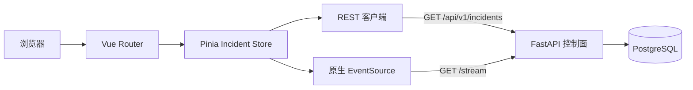
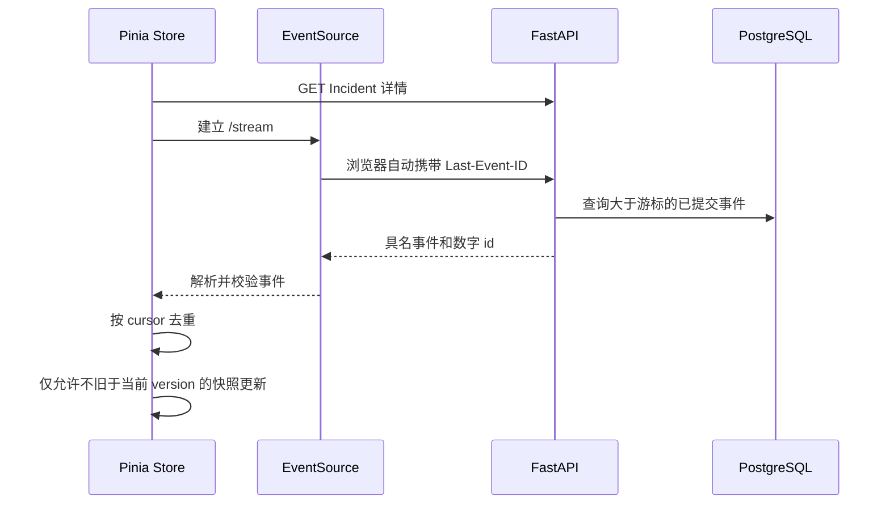

# Incident 作战室前端设计

## 1. 目标与边界

本切片建立第一个可运行的 Vue 3 作战室，让值班工程师在一个页面中读取 Incident 列表、当前事故详情和持续更新的不可变时间线。前端只展示已经由控制面提交到 PostgreSQL 的业务事实，不保存独立业务状态，也不直接访问故障演练服务。

首版刻意保持只读：不提供开始调查、审批、执行、验证或关闭按钮。这样可以先验证路由、实时事件和前后端数据契约，再逐步引入需要乐观锁、身份和二次确认的命令交互。

## 2. 组件与数据边界

- `IncidentWorkroomView` 负责 URL 与当前选择同步，不复制业务状态。
- `IncidentList`、`IncidentDetail` 和 `IncidentTimeline` 是展示组件，只通过 props 与事件交互。
- Pinia store 负责加载状态、错误状态、当前选择和 SSE 生命周期。
- REST 客户端只处理 HTTP、JSON 和稳定错误；SSE 客户端只处理具名事件和连接状态。
- FastAPI 与 PostgreSQL 仍是事实来源，页面刷新后能够完整重建界面。

## 3. 路由与并发请求

作战室使用 `/incidents/:incidentId?`。没有路径参数且列表非空时，页面把第一个 Incident 写入 URL；有路径参数时可刷新或分享链接并恢复相同选择。

选择不同 Incident 时，store 先关闭旧 EventSource、清空旧时间线，再读取新详情并建立新流。每次选择都有递增 generation；较早请求即使晚返回，也不能覆盖较新的选择。这解决了用户快速切换列表时常见的异步竞态。

列表刷新也不能直接覆盖 SSE 已经推进的快照：store 按 Incident ID 合并结果，优先保留更高版本，版本相同时保留更新时间更晚的快照。这样一个较早开始、较晚返回的 REST 请求不会让侧栏短暂倒退。

当前列表一次读取最近 100 条，尚未实现滚动分页。该限制在 UI 中不伪装成完整历史能力，后续根据真实使用补充分页游标。

## 4. SSE 一致性策略

- 只监听 `incident.created`、`incident.status_changed` 和 `incident.alert_attached`，不使用无法区分类型的默认消息。
- 原生 EventSource 负责保存最后事件 ID 和自动重连；服务端用相同游标补发。
- store 使用 `cursor` 去重，因为 SSE 是至少一次投递，同一事件允许重放。
- 历史事件仍进入时间线，但只有 `incident_version` 不小于当前快照时才更新状态和时间字段，避免完整历史补发把新状态倒退。
- JSON、枚举、版本和必要字段在进入 store 前做运行时校验；畸形事件只显示连接内错误，不污染现有事实，也不主动关闭可恢复连接。

## 5. 技术选择与本地网络

前端位于独立 `web/` 目录，使用 Vue 3.5、TypeScript 6、Vite 8、Pinia 4、Vue Router 5、Vitest 4 和 Vue Test Utils。`package-lock.json` 固定实际解析结果；生产构建同时执行 `vue-tsc --noEmit`，类型错误不能生成交付包。后续评测面板切片把品牌、全局导航和本地演练标识提升到根级 `App`，作战室视图只保留自身业务布局。

开发环境中浏览器只请求 Vite 的同源 `/api`，由 Vite 转发到 `127.0.0.1:8000`。这使 REST 与 SSE 都保持同源，也不会为了开发便利扩大 FastAPI 的 CORS 安全边界。`VITE_API_BASE_URL` 仅作为未来部署适配项，默认不配置。

初次尝试 TypeScript 7 时，当前 `vue-tsc` 仍依赖已经不再导出的编译器入口，因此选择兼容的 TypeScript 6。这里遵循“工具链经过真实构建验证后再升级”，不是追逐最高版本号。

## 6. 界面与可访问性

- 桌面端使用左侧 Incident 队列和右侧作战室详情；窄屏改为纵向布局。
- 状态、严重程度和连接状态同时使用文本，不只依赖颜色。
- 列表使用原生按钮，错误使用 `role="alert"`，加载和连接状态使用 `aria-live`。
- 时间显示使用浏览器本地时区格式化，原始 `datetime` 保留 API 的带时区字符串。
- 页面明确标识 `LOCAL FAULT LAB`，避免把本地演练界面误认为生产控制台。

## 7. 测试策略

- API 客户端测试固定查询参数、成功响应和结构化错误映射。
- SSE 单元测试使用假 EventSource 验证具名事件、连接状态、关闭行为和畸形载荷隔离。
- Pinia 测试验证游标去重、历史版本保护和列表/详情同步。
- 组件测试验证时间线关键事实与连接状态可见。
- 真实浏览器冒烟连接本地 FastAPI 和 PostgreSQL，验证直达路由、真实 SSE 新事件、断线提示、桌面与 390px 窄屏布局。

## 8. 当前限制与下一步

- 前端没有身份认证，所有内容仍只用于 localhost 演练。
- 页面没有状态变更命令，因此还不涉及 `expected_version`、审批确认或按钮级权限。
- 调查、Evidence Board、计划、审批、执行和验证已经通过只读聚合投影展示；当前调查的逐次 Worker 尝试、Token 和费用也已通过独立只读接口展示，其他领域明细仍需使用对应查询接口读取。
- 前端当前由本地 Node 开发服务运行，尚未制作生产静态资源容器和正式反向代理配置。
- Vite 只承担开发代理；正式反向代理是否及时终止异常 SSE、浏览器能否无刷新续传，需要在部署切片中单独做端到端故障测试。
- 评测集、公平对照、结果持久化和只读评测面板已经完成；浏览器命令交互继续等到身份和最小权限边界明确后再引入。

## 9. 面试表达

我没有让前端维护另一份事故真相，而是先用 REST 获取快照，再用 PostgreSQL 事件表驱动的 SSE 补历史和实时更新。SSE 允许至少一次投递，所以 Pinia 按全局游标去重；完整历史会重放，因此又用 Incident 乐观锁版本阻止旧事件把新状态倒退。路由保存当前选择，异步 generation 防止快速切换造成旧请求覆盖。开发时通过 Vite 同源代理连接 FastAPI，没有为了方便直接放宽后端 CORS。
