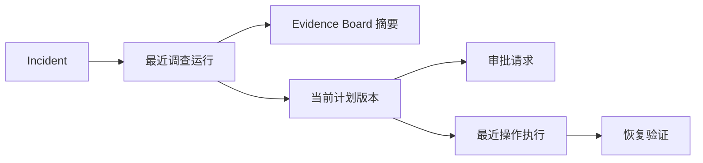

# Incident 作战室只读聚合投影

## 1. 目标与边界

本切片让值班工程师在 Incident 作战室内一次看清调查、Evidence Board、处置计划、人工审批、白名单执行和恢复验证六个阶段。它解决的是跨领域读取，不新增任何写命令，也不让前端自行拼接多个时点不同的响应。

`GET /api/v1/incidents/{incident_id}/workroom` 只读取业务数据库。LangGraph checkpoint 仍只用于工作流恢复，不作为页面事实来源；原始日志、证据正文、动作参数和工具调用记录继续由各自明细接口承载。

## 2. 投影链路



阶段选择规则固定在后端，只读仓储不允许调用方指定任意关联 ID：

1. 调查运行按 `created_at DESC, id DESC` 选择最近一条。
2. 处置计划限定在该调查内，按 `version DESC, id DESC` 选择当前版本。
3. 审批请求由计划唯一约束确定；没有提交审批时返回 `null`。
4. 操作执行限定在当前计划内，按 `created_at DESC, id DESC` 选择最近一条。
5. 恢复验证由操作执行唯一约束确定；尚未开始验证时返回 `null`。
6. Evidence Board 随调查阶段出现，并汇总证据数、专业报告数和唯一主假设；它不复制原始证据内容。

该选择规则表达“当前调查链路”，不是 Incident 全部历史。历史调查、旧计划和旧执行仍保留在业务库中，后续审计页面应使用独立分页接口读取。

## 3. 一致性设计

`WorkroomStore` 使用一条 SQLAlchemy 语句完成关联和计数。PostgreSQL 的单条语句读取同一个语句级快照，避免前端依次请求六个接口时出现“计划已经更新，但审批仍来自旧版本”的时间撕裂。

这不是新的业务表，也不是缓存或物化视图：

- 所有字段都从现有审计事实实时投影，不产生第二份真相。
- 当前演练数据量较小，相关外键、唯一约束和排序键足以支撑查询。
- 数据增长后先用 `EXPLAIN ANALYZE` 和真实基数验证，再决定增加索引、分页明细或物化读模型，不能凭猜测提前复制状态。

Pydantic 投影模型额外校验阶段不能跳过前置记录。Incident 可以没有调查，调查可以没有计划，执行可以没有验证；但当前安全流程不允许没有计划却出现审批，或没有执行却出现验证。

## 4. 响应与安全边界

响应携带 `incident_id` 和 `incident_version`，其余阶段都是可空摘要：

```json
{
  "incident_id": "00000000-0000-0000-0000-000000000000",
  "incident_version": 5,
  "investigation": {
    "status": "succeeded",
    "mode": "multi_agent",
    "data_source_mode": "live"
  },
  "evidence_board": {
    "evidence_count": 3,
    "specialist_report_count": 3,
    "primary_hypothesis": { "status": "supported" }
  },
  "action_plan": { "version": 1, "risk_level": "high", "status": "approved" },
  "approval_request": { "status": "approved" },
  "operation_execution": { "status": "succeeded" },
  "verification_run": { "status": "running", "successful_sample_count": 1 }
}
```

示例省略了响应模型中的其他只读字段。接口不会：

- 创建调查、计划、审批、执行或验证；
- 接受 `expected_version` 或动作参数；
- 暴露任意 Shell、SQL、凭据或原始工具输出；
- 绕过已有领域服务和白名单执行器。

## 5. 前端刷新与竞态

Pinia 为当前 Incident 维护独立的投影加载、错误和手工重试状态。选择切换与投影请求各有递增 generation，旧请求晚返回时不能覆盖新选择。响应的 `incident_version` 小于当前 Incident 版本时也会被丢弃。

SSE 收到新的 `incident.status_changed` 后重新读取投影，因为重要阶段提交都会伴随 Incident 状态事件。重复游标、历史状态事件和旧版本事件不会触发额外读取，避免首次重放时间线时形成请求风暴。页面仍提供“同步”按钮处理当前没有状态迁移的明细进度变化。

## 6. 展示与测试

前端使用六张固定阶段卡片。调查卡片把 `frozen` 映射为“冻结基准”、把 `live` 映射为“真实现场”，与 Agent 模式和模型名一起展示；尚未到达的阶段明确显示等待原因，不用空白或颜色猜测状态。桌面为三列、平板为两列、390 像素窄屏为单列。

验收覆盖：

- 新 Incident 返回六个空阶段，不把未发生状态伪造成成功。
- 完整演练链路返回同一调查下的证据计数、主假设、当前计划、审批、执行和验证进度。
- OpenAPI 暴露稳定响应模型，不存在 Incident 返回统一 `404`。
- 前端覆盖 URL 编码、选择竞态、版本保护、SSE 刷新条件、错误重试和六阶段渲染。
- 真实 PostgreSQL、FastAPI、Vite 和浏览器共同验证桌面与移动布局。

## 7. 当前限制与下一步

- 聚合只展示最新链路，不提供历史调查与旧计划的分页审计视图。
- Evidence Board 只展示数量和主假设，原始证据需要进入后续明细页面。
- 后续作战室已通过独立接口展示当前调查的逐次 Worker 尝试；增长型历史没有塞入本聚合响应，详见 [作战室调查尝试与成本展示](44-investigation-attempt-workroom.md)。
- 状态事件会触发刷新，但运行中采样等不改变 Incident 状态的更新仍依赖手工同步；后续可以增加专用领域事件。
- 当前没有认证和按钮级权限，页面继续保持只读。
- 下一切片建立版本化评测集，对同一故障输入的单 Agent 与多 Agent 结果做可复现对照。

## 8. 面试表达

我没有让 Vue 串行请求六个领域接口，因为每个请求可能读到不同时间点。后端用单条 PostgreSQL 查询构建只读投影，固定选择最近调查、当前计划和最近执行，同时只暴露作战室需要的安全摘要。前端用请求 generation 和 Incident version 防止异步响应倒退，SSE 只在新的非过期状态事件到来时刷新，因此兼顾一致性、可恢复性和请求成本。
