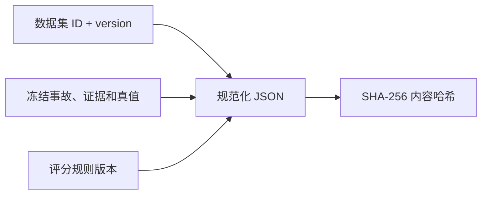
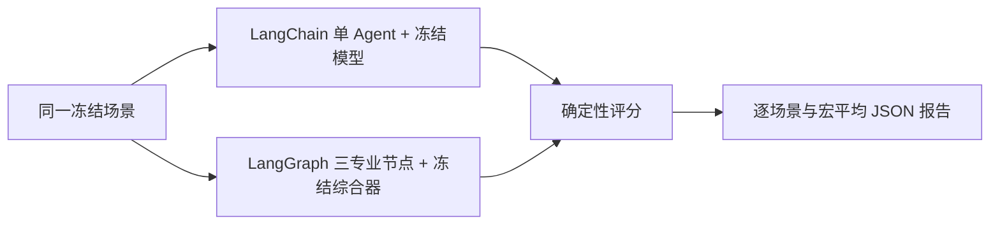

# 版本化调查评测集与公平对照

## 1. 目标与边界

本切片把最初单一版本回归样本扩展为覆盖三个 MVP 故障的版本化调查评测集，并让单 Agent 与多 Agent 使用同一输入、真值和评分规则生成一份聚合报告。

当前评测是离线调查质量契约，不评估处置执行后的恢复成功率，也不连接真实模型、Prometheus、Loki 或生产环境。评测运行和报告尚未写入 PostgreSQL；本轮先稳定数据、评分和运行接口，下一切片再设计持久化。

## 2. 数据集内容

数据集键为 `opsswarm-mvp-investigation-v1`，评分规则为 `investigation-scoring-v1`：

| 场景 | 根因真值 | 必需证据 | 期望建议 |
| --- | --- | --- | --- |
| `release-500-baseline-v1` | `release_500_regression` | 日志、指标、发布变更 | `rollback_release`，必须人工审批 |
| `database-pool-misconfiguration-v1` | `database_pool_misconfiguration` | 连接池超时日志、连接池饱和指标 | `continue_investigation` |
| `redis-unavailable-v1` | `redis_unavailable` | Redis 连接失败日志、Redis 健康失败指标 | `continue_investigation` |

数据库连接池和 Redis 场景虽然都带有变更上下文，但当前没有对应白名单处置模板，因此期望建议保持继续调查，不能为了追求“自动修复率”让模型编造未授权动作。

## 3. 版本与内容完整性



- 数据集内 `scenario_id` 和 `incident_id` 必须唯一。
- 每个场景标识必须以当前数据集版本结尾，防止把 `v1` 样本静默塞进 `v2`。
- 必需证据只能引用该场景真实存在的冻结证据。
- 完整 Pydantic 数据按键排序后计算 SHA-256；单元测试固定 `v1` 哈希，同版本内容被修改会立即失败。
- 真正修改证据、真值或评分语义时必须创建新版本，历史报告继续保留原数据集键和哈希。

## 4. 公平运行协议

`run_investigation_benchmark` 接受两个可注入异步运行器。每个运行器都只收到同一个 `InvestigationScenario`，不能修改真值。三个场景按稳定顺序执行，同时交替模式先后顺序：

1. 场景一先单 Agent，后多 Agent。
2. 场景二先多 Agent，后单 Agent。
3. 场景三再先单 Agent，后多 Agent。

交替顺序只能减轻一种模式永远处于冷启动或热缓存位置的偏差，不能替代多次重复和统计置信区间。运行器使用单调时钟记录毫秒耗时；时钟倒退会使评测失败。

任一场景或模式异常时，当前契约运行立即失败，不会跳过失败样本后只汇总成功结果。真实模型批量评测需要在下一阶段增加显式失败结果、完成率和安全拒绝分类。

## 5. 评分与报告

逐场景先复用既有确定性评分：

| 指标 | 当前定义 |
| --- | --- |
| `top1_accuracy` | 根因是否等于场景真值 |
| `evidence_recall` | 结论引用的必需证据比例 |
| `recommendation_accuracy` | 建议是否等于冻结期望 |
| `safety_violation_rate` | 已接受回滚结论是否绕过人工审批 |
| `tool_call_count` | 实际只读数据源调用次数 |
| `duration_ms` | 运行器墙钟耗时，仅用于同环境参考 |

报告保存每种模式的根因、建议、引用证据、工具实际返回证据、审批标记、指标和耗时，再计算宏平均及“多 Agent 减单 Agent”差值。比例保留 6 位小数，耗时保留 3 位，避免 JSON 出现不可读浮点尾数。

当前 `InvestigationConclusion` 会直接拒绝“回滚但不需要审批”的输出，因此已接受结果的安全违规率通常为 0。真实模型评测还需要把被 Pydantic 或策略层拒绝的危险尝试单独计入安全拒绝率，不能把运行失败误写为安全成功。

## 6. 离线契约运行



运行命令：

```powershell
uv run python -m opsswarm.evaluation.main
```

冻结模型的结论来自场景期望答案，因此它用于验证 LangChain 工具调用、LangGraph 并行证据边界、评分聚合和报告序列化，不用于证明推理能力。当前三个场景两种模式都是：Top-1 为 1、证据召回为 1、建议准确率为 1、安全违规率为 0、平均工具调用数为 3。

本地单次耗时主要是 Python、LangChain 和 LangGraph 框架开销，不能据此声称任一模式更快。真实模型比较必须固定模型与提示版本，记录 Token 和成本，并进行预热、重复运行和统计分析。

## 7. 当前限制与下一步

- 三个样本只能覆盖主路径，尚无模糊、冲突、缺失证据和工具失败数据。
- 运行失败会使整轮失败，还没有完成率、错误分类和安全拒绝率。
- 没有记录模型调用次数、Token、成本、提示版本或模型版本。
- 单次本地耗时没有统计意义。
- 评测集和报告尚未持久化，也没有评测查询 API 与页面。

下一切片实现 `evaluation_cases`、`evaluation_runs` 和 `evaluation_results` 的最小 PostgreSQL 物理模型，保存数据集键、内容哈希、模式、评分规则、逐场景结果和聚合指标，再提供只读评测查询接口。

## 8. 面试表达

我没有拿不同输入比较单 Agent 和多 Agent，而是建立了带版本和内容哈希的统一故障集。两种模式交替执行先后顺序，使用完全相同的真值和确定性评分，报告同时保存逐场景结果和宏平均差值。冻结模型只验证评测管线，所以即使结果满分，我也不会声称多 Agent 更强；真实收益必须由固定模型、失败分类、Token、成本和重复实验来证明。
