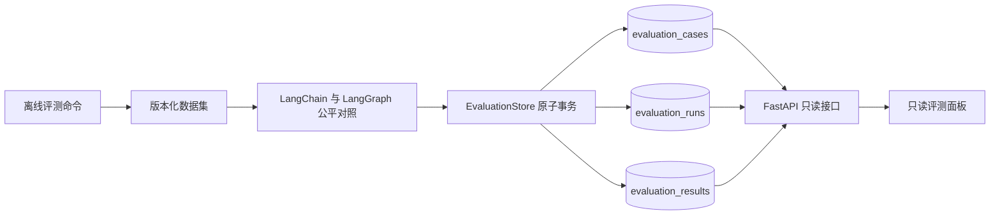
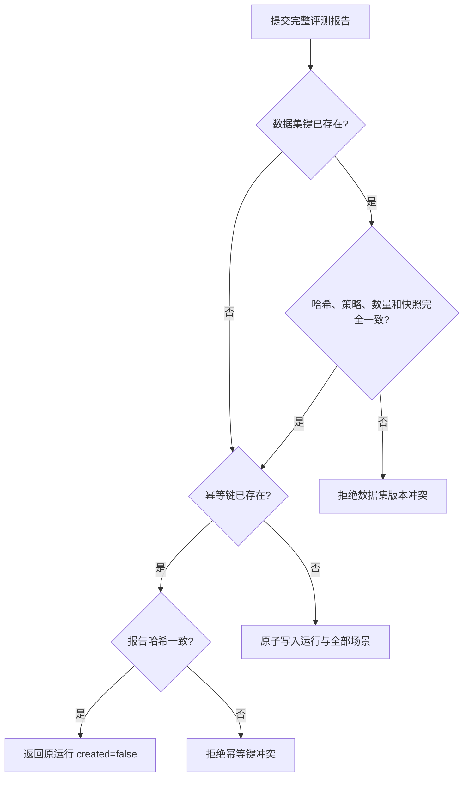

# 评测结果持久化与只读查询

## 1. 目标与边界

本切片把三故障公平对照从一次性标准输出升级为可恢复、可审计的业务事实：冻结数据集快照、完整报告、逐场景结果和聚合指标进入 PostgreSQL，评测面板可以通过稳定只读接口读取历史。

评测仍由离线命令发起。控制面没有创建评测运行的 HTTP 写接口，避免当前无鉴权 API 被调用方用高成本任务或任意输入污染评测事实。当前冻结运行器不访问网络，也不代表真实模型质量。

## 2. 写入与读取边界



- `EvaluationRunSubmission` 在写库前绑定数据集、报告、幂等键、运行器版本和 UTC 时间。
- 仓储在一个事务内创建或复用数据集快照、创建运行并追加全部场景结果；不会留下只有聚合指标的半份报告。
- API 只有 `GET`，不能启动 Agent、改写报告或删除审计数据。
- 报告仍是业务库事实；LangGraph checkpoint 不参与评测查询。

## 3. 最小物理模型

### 3.1 `evaluation_cases`

一行保存一个数据集版本的完整规范化 JSONB 快照，同时保存 `dataset_key`、SHA-256、评分规则版本和场景数。数据集键与内容哈希均唯一；同一键内容变化会被拒绝，内容没有变化也不应伪造新版本。

### 3.2 `evaluation_runs`

一行表示一轮完成的公平对照，保存：

- 全局递增 `sequence`，作为倒序分页游标；
- 数据集快照外键和唯一 `idempotency_key`；
- 完整报告 SHA-256、运行器名称、生成与落库时间；
- 单 Agent、多 Agent 聚合指标及二者差值。

`generated_at <= created_at` 由数据库约束保证。表不保存“运行中”状态，因为当前命令只有报告全部生成后才进入持久化事务；未来真实模型批量运行若需要进度恢复，应单独设计显式生命周期，不能把完成表兼作任务队列。

### 3.3 `evaluation_results`

每个场景保存一行完整模式对照 JSONB，并冗余 `scenario_id` 与从 1 开始的 `position`。`(evaluation_run_id, scenario_id)` 和 `(evaluation_run_id, position)` 均唯一，防止重复计分或顺序漂移。三个表的外键都使用 `ON DELETE RESTRICT`，迁移降级在存在评测审计时主动拒绝。

## 4. 幂等与完整性



- PostgreSQL 唯一约束和 `INSERT ... ON CONFLICT DO NOTHING` 让并发相同提交收敛为一个运行。
- 幂等键表示“一份确定报告”，不是“反复重新运行评测”。重新执行会产生新的生成时间和耗时，应使用新幂等键；只有完全相同的报告重放才返回原记录。
- 详情读取会重建数据集和完整报告，重新校验结构、数据集哈希、元数据绑定、场景顺序、证据归属、冻结真值评分、逐场景差值、聚合指标和报告哈希。
- 列表读取也校验数据集快照与聚合指标，数据库内容损坏不会被伪装成正常历史。

## 5. 命令与 API

只生成报告、不写数据库：

```powershell
uv run python -m opsswarm.evaluation.main
```

显式持久化：

```powershell
uv run alembic upgrade head
uv run python -m opsswarm.evaluation.main `
  --persist `
  --idempotency-key fixture-contract-20260827-001 `
  --runner-name fixture-contract-v1
```

`--persist` 必须和 `--idempotency-key` 同时使用；没有开关时命令绝不创建数据库连接。读取接口为：

- `GET /api/v1/evaluation-runs?limit=50&before_sequence=...`：按 `sequence DESC` 返回聚合历史。
- `GET /api/v1/evaluation-runs/{run_id}`：返回完整逐场景报告；不存在时返回 `evaluation_run_not_found`。

列表默认 50 条、最多 100 条。存在下一页时，调用方把 `next_before_sequence` 原样传回；新运行插入不会造成 offset 翻页重复或漏读。

## 6. 当前限制与下一步

- 当前只保存完成报告，没有运行中、失败和取消状态。
- 运行器名称已保存，但冻结报告尚无模型名、提示版本、Token、成本和安全拒绝分类。
- 评测集只有三个确定性主路径场景，不能证明真实模型泛化能力。
- 控制面尚无可信身份，因此只读评测接口也只允许 localhost 和 Compose 内网。
- 只读评测面板已经落地；下一阶段扩展真实模型重复运行、失败分类和成本统计时，必须先持久化对应事实，不能由页面虚构不存在的数据。

## 7. 面试表达

我把 Agent 评测当作审计事实，而不是终端里的一次输出。数据集版本保存完整快照和内容哈希，每轮运行保存聚合指标与逐场景报告，并用幂等键和唯一约束解决并发重复。写入只允许离线评测命令，HTTP 只读；详情读取还会重算数据集与报告哈希。这样评测面板展示的是可追溯结果，同时不会让未鉴权 API 成为任意触发模型成本的入口。
