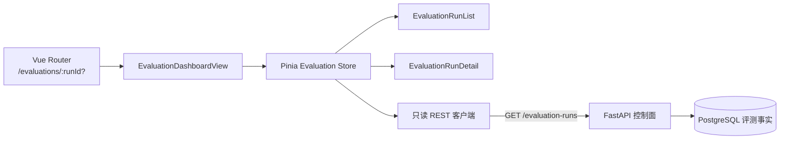

# 只读评测面板设计

## 1. 目标与边界

本切片把已经持久化的 Agent 评测事实呈现为可复核页面，让工程师能够查看历史运行、比较单 Agent 与多 Agent 的聚合指标，并下钻到每个冻结场景检查根因、建议和证据引用。

页面严格只读。它不启动评测、不修改报告，也不把前端计算结果写回数据库。离线命令仍是唯一写入入口，FastAPI 与 PostgreSQL 仍是事实来源。当前页面展示冻结假模型契约结果，因此明确提示：满分只证明评测链路可复现，不能证明多 Agent 在真实模型上更强。

## 2. 前端组件与数据流

- `EvaluationDashboardView` 只负责路由选择、首次默认项和组件编排。
- `EvaluationRunList` 展示按全局序号倒序排列的运行摘要，并触发刷新、选择和加载更早历史。
- `EvaluationRunDetail` 展示完整性哈希、六项聚合指标和逐场景证据，不发出命令请求。
- Pinia store 统一管理列表游标、选择、加载和错误状态，组件不各自保存重复事实。
- 根级 `App` 提供事故作战室与评测面板的全局导航，两个页面共享本地演练环境标识。

## 3. 路由与历史分页

评测面板路由为 `/evaluations/:runId?`。访问 `/evaluations` 时，页面先读取最新一页运行，再把第一项 ID 写入 URL；访问带 ID 的地址时，页面可以在刷新后恢复同一详情。

历史列表直接使用服务端 `before_sequence` 游标，不在前端用数组偏移模拟分页。点击“加载更早运行”时把 `next_before_sequence` 原样传回，追加结果前按运行 ID 去重。这样即使翻页期间产生新运行，也不会因为 offset 漂移而重复或漏掉旧记录。

列表刷新与详情选择都有独立 generation。较早请求即使晚返回，也不能覆盖较新的列表或选择；路由离开页面时会让未完成的详情响应失效。当前没有主动取消 HTTP 请求，因为读请求有界且无副作用，generation 已能保证界面一致性。

## 4. 指标语义与可审计性

页面并列展示以下聚合指标：

- 根因 Top-1、证据召回和建议准确率，越高越好；
- 安全违规率，越低越好；
- 平均工具调用数，需要与结果质量一起解释；
- 平均耗时，只代表本轮本地执行，不作为稳定性能结论。

差值统一定义为“多 Agent − 单 Agent”，避免每一行使用不同方向造成误读。页面不重新评分，只格式化后端已经验证并重建的持久结果。数据集 SHA-256 与报告 SHA-256 同时可见，便于把页面结果追溯到冻结输入和完整输出。

逐场景区域展示冻结真值、期望建议、交替执行顺序，以及两种模式各自的根因、建议、证据召回、工具调用、耗时和引用证据 ID。用户因此可以从聚合数字下钻到可解释样本，而不是只看到一张无法复核的总分卡。

## 5. 界面与可访问性

- 桌面端使用左侧历史列表、右侧详情；小于 900px 时改为纵向布局。
- 390px 窄屏下主导航换行，哈希卡片和场景对照改为单列，指标表保留横向滚动。
- 历史项使用原生按钮，当前选择通过 `aria-current` 暴露；错误使用 `role="alert"`，加载区域使用 `aria-live`。
- 指标区域使用表格角色与列标题；场景结果使用有名称的 section，屏幕阅读器能够区分单 Agent 与多 Agent。
- 颜色只承担辅助作用，模式、指标方向、运行序号和环境均保留文字标签。

## 6. 测试策略

- API 客户端测试覆盖游标参数和详情 ID 编码。
- Pinia 测试覆盖分页追加、重复 ID 去重和详情请求竞态。
- 组件测试覆盖解释边界、六项指标、场景真值、两种模式与证据 ID。
- 类型检查和生产构建保证 API 契约及 Vue 模板可编译。
- 真实浏览器连接本地 FastAPI 与 PostgreSQL，验证默认选择、详情直达刷新、全局导航、真实三场景数据、桌面与 390px 布局，并检查控制台错误。

## 7. 当前限制与下一步

- 当前只有一轮冻结假模型契约数据，列表分页逻辑已有测试，但真实页面尚无多页历史可操作验证。
- 页面不展示模型名、提示版本、Token、成本、失败类型或重复运行分布，因为后端目前没有这些事实。
- 当前没有前端身份认证，也不提供创建或删除评测运行的按钮。
- 图表库暂不引入；六项指标用明确数值表比只有一个样本的趋势图更诚实，也减少首版依赖。
- 下一阶段应先设计真实模型评测元数据、重复运行和失败分类，再决定趋势图、成本视图和置信区间，不能由前端虚构数据。

## 8. 面试表达

我把评测面板设计成持久评测事实的只读投影：路由保存选中的运行，服务端序号游标支持稳定历史分页，Pinia generation 防止异步旧响应覆盖新选择。页面先展示数据集和报告哈希，再把六项聚合指标下钻到逐场景根因、建议与证据 ID，同时明确冻结假模型满分不代表真实效果。这既体现了 Agent 评测能力，也避免为了好看的仪表盘夸大实验结论。
