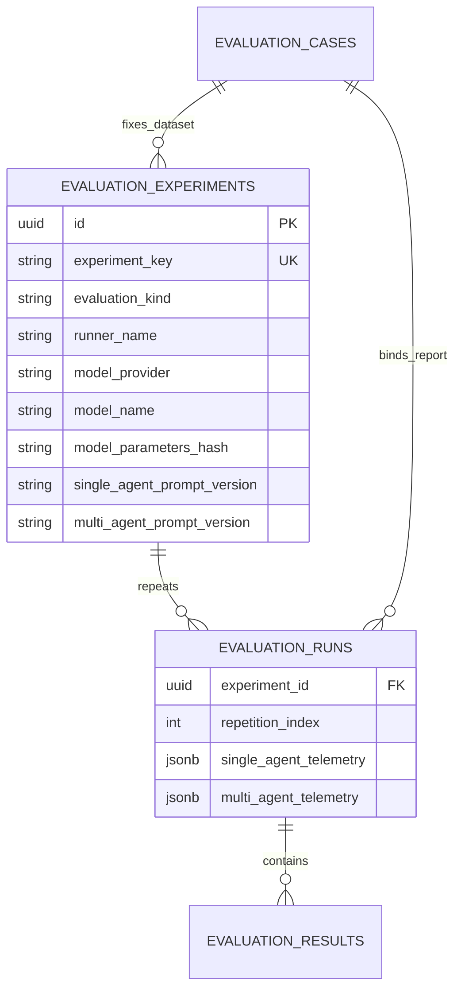
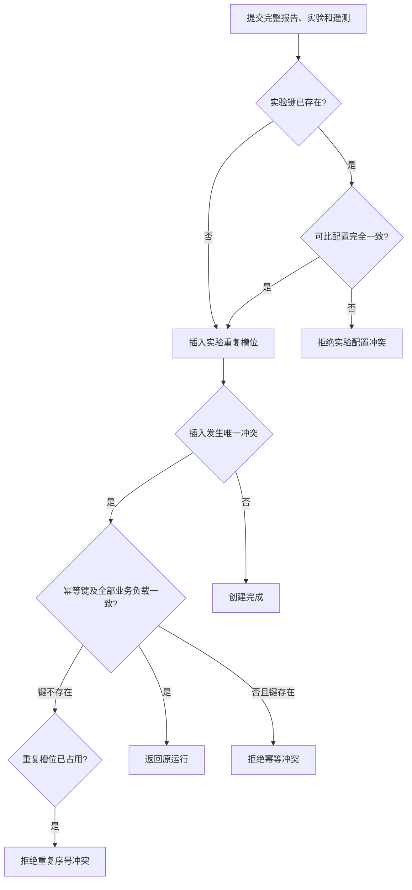

# 评测实验身份、重复运行与遥测设计

## 1. 目标与边界

本切片解决“两个评测结果是否真的可比”的问题。数据集和最终分数相同还不够；模型、参数、提示版本、运行器或重复序号任一变化，都可能改变结果。因此系统把跨重复运行不变的配置保存为实验，把每次完成运行的 Token、成本和失败计数保存为遥测。

当前离线命令仍只运行冻结假模型契约，不访问网络或产生模型费用。领域模型和数据库已经能够表达真实模型身份，但没有把冻结结果伪装成真实模型。控制面继续只读，密钥、`base_url` 和完整模型参数不会进入数据库。

## 2. 物理边界



`evaluation_experiments` 固定数据集、运行器和执行配置。`evaluation_runs` 仍只保存完整报告，但增加实验外键、1～1000 的重复序号和两种模式的遥测。`(experiment_id, repetition_index)` 唯一，因此同一实验的第 N 次运行不能被另一个幂等键覆盖。

运行仍直接绑定 `evaluation_cases`。这是有意保留的审计冗余：读取时仓储会验证运行、实验和数据集三者一致，关联损坏不会因为只沿一条外键链查询而被隐藏。

## 3. 实验定义

`EvaluationExperimentSpec` 保存：

- 稳定 `experiment_key`；
- `fixture_contract` 或 `real_model` 评测类型；
- 运行器版本；
- 单 Agent 与多 Agent 提示版本；
- 真实模型的提供方、模型名和规范化参数 SHA-256。

冻结契约评测必须把三个模型身份字段保持为空；真实模型评测必须完整提供三者。数据库使用检查约束重复保护这个规则。模型参数只保存哈希，既能检测温度等设置变化，又避免把供应商密钥、私有地址或可能含敏感信息的完整配置写入审计表。

同一 `experiment_key` 再次出现时，仓储会比较数据集、评测类型、运行器、模型身份和两套提示版本。任一不同都返回实验配置冲突，调用方必须创建新实验，而不能静默改变历史可比条件。

## 4. 资源与失败遥测

每种 Agent 模式保存：

- 输入、输出和总 Token；总数必须等于输入加输出；
- 精确到小数点后六位的美元估算成本；
- 模型请求错误、工具错误、超时、结构化输出错误和安全拒绝五类计数。

冻结假模型显式保存全零遥测，不用 `null` 混淆“没有采集”和“确实没有调用”。成本是根据运行时价格表计算的估算事实，未来真实运行器还必须记录价格规则版本，不能把它当作供应商账单。

这里的失败计数只表示一轮最终完成评测中已经恢复或纳入计分的失败尝试。当前 `evaluation_runs` 没有运行中、整体失败或取消状态，不能用这些计数替代失败运行生命周期；该生命周期需要后续单独的 attempt 表或持久任务设计。

## 5. 幂等与并发



幂等重放现在比较报告哈希、数据集、实验、重复序号、运行器和两种模式遥测，不再只比较报告哈希。这样同一幂等键不能悄悄绑定不同成本或模型配置。实验创建和运行创建均使用 PostgreSQL 唯一约束与 `ON CONFLICT DO NOTHING` 收敛并发竞争。

## 6. 迁移与兼容

迁移 `0012_evaluation_experiments` 会为已有每轮评测创建独立的 `fixture-backfill-{sequence}` 实验，重复序号设为 1，提示版本使用当时已经持久化调查运行采用的版本，遥测显式回填为零。旧报告、哈希、序号和逐场景结果保持不变。

存在实验审计记录时，迁移拒绝有损降级。空库迁移测试仍会验证从 head 降到 base 再升回 head；开发持久库则只做向前升级。

## 7. 命令、API 与页面

持久化冻结契约运行时必须显式声明实验和重复序号：

```powershell
uv run python -m opsswarm.evaluation.main `
  --persist `
  --idempotency-key fixture-contract-exp01-r01 `
  --experiment-key fixture-contract-exp01 `
  --repetition-index 1
```

第 2 次重复使用相同实验键、新幂等键和 `--repetition-index 2`。API 路径没有增加写操作；评测列表和详情响应增加 `experiment`、`repetition_index` 与 `telemetry`。页面展示实验上下文和单/多 Agent 资源失败对照，不在浏览器中重新计算或改写这些事实。

## 8. 当前限制与下一步

- 尚未实现真实模型评测运行器，因此不能自动采集 Token、价格或失败回调。
- 尚未持久化运行中、整体失败和取消尝试，也没有批量重复任务调度。
- 参数只保存哈希；要复现实验，还需要受控保存不含密钥的规范化参数快照和价格规则版本。
- 当前 API 仍只允许 localhost 和 Compose 内网读取。
- 下一步应实现真实模型“单场景、单次、显式预算”的最小运行器，先验证用量采集和失败落库，再扩展批量重复。

## 9. 面试表达

我没有把每次 Agent 分数直接当成可比实验，而是新增实验实体固定数据集、模型、参数哈希、运行器和提示版本，再用唯一的实验加重复序号保存每轮结果。Token、成本和五类失败按单 Agent、多 Agent 分开记录，读取时重新做 Pydantic 完整性校验。幂等重放也会比较遥测和实验配置，所以同一键不能悄悄绑定另一份成本数据。冻结假模型明确保存零遥测，真实模型接入前不伪造效果或费用。
