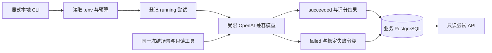
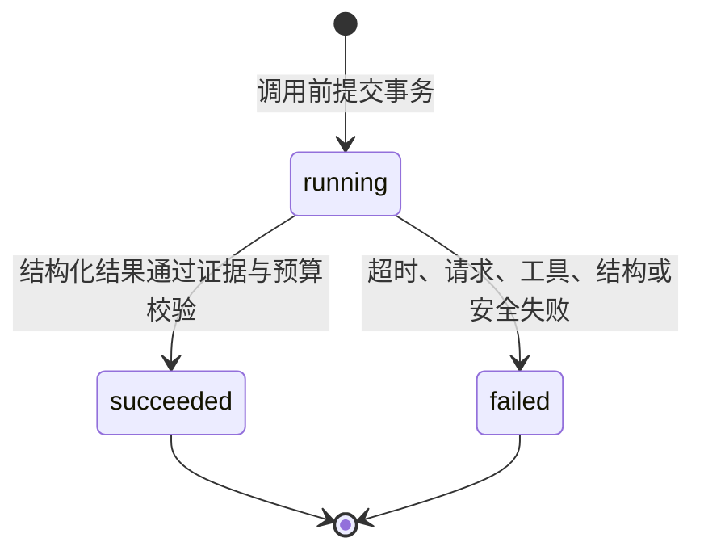

# 真实模型单场景冒烟与尝试生命周期

## 1. 目标

真实模型评测不能只是把 `LLM_API_KEY` 接到现有三场景基准。外部调用可能超时、返回错误结构、引用虚构证据或在中途超过预算；如果系统只保存完整成功报告，这些失败会从评测历史中消失，导致质量和可靠性被高估。

本切片先实现最小的真实模型入口：在同一个冻结故障场景上分别运行单 Agent 和多 Agent，每种模式在调用前独立落库，调用后收敛到成功或失败终态。它验证模型推理和 Agent 编排，不接真实生产日志、指标或执行权限。

## 2. 边界与运行顺序

- 付费调用只能由本地命令显式启动；控制面 API 只有查询能力。
- 首次只选择一个冻结场景，但单 Agent、多 Agent 必须使用相同数据、模型、温度、提示版本和预算。
- 奇数重复先运行单 Agent，偶数重复先运行多 Agent，降低固定先后顺序造成的偏差。
- 单 Agent 仍通过 LangChain 工具循环；多 Agent 仍通过 LangGraph 的三个并行专业节点和综合节点。
- 冻结数据源只提供日志、指标和最近变更三个只读工具，不拥有 Shell、SQL 或执行器权限。
- 两种模式各有独立尝试。一种失败不会抹掉另一种的结果，也不会伪造成完整对照报告。

## 3. 尝试状态与幂等

`evaluation_attempts` 的唯一槽位是 `(experiment_id, repetition_index, scenario_id, mode)`，幂等键也全局唯一。相同命令重放时：

- 已成功或失败的尝试直接返回原记录，不再次付费调用。
- 仍为 `running` 的尝试保持原状，不自动猜测外部请求是否已经计费或成功。
- 同一幂等键改变模式、场景、实验或预算时返回冲突。
- `succeeded` 和 `failed` 都是不可覆盖终态，仓储更新只允许从 `running` 条件更新一次。

进程在调用后、提交终态前崩溃时会留下 `running`。这是如实表达不确定状态；后续切片可以增加超时扫描和人工裁决，但当前不会冒险自动重放可能已经计费的请求。

## 4. 五层调用护栏

每条尝试在网络调用前冻结 `EvaluationAttemptBudget`：

1. 整种 Agent 模式的总超时。
2. 最大模型请求次数；回调在下一次网络请求开始前拒绝超额调用。
3. 最大只读工具调用次数；单 Agent 的证据收集器在工具执行前拒绝超额调用，多 Agent 图固定只有三个工具节点。
4. 每次模型请求的最大输出 Token，由模型适配器传给 OpenAI 兼容接口。
5. 最大估算美元费用；依据供应商返回的 Token 用量和本地配置价格累计，超过后终止后续流程。

费用是基于供应商 usage 的估算值，不是账单承诺。接口兼容层无法在发送前准确知道最终输入 Token，因此输出 Token 理论上限会先做静态校验，输入费用则在每次响应后累计检查。价格不硬编码在代码中，避免模型价格变化后历史计算口径不明。

## 5. 密钥与实验身份

`.env` 已由 Git 忽略，真实命令从项目根目录读取：

- `LLM_API_KEY`、`LLM_MODEL`、可选 `LLM_BASE_URL` 与 `LLM_TEMPERATURE`。
- `LLM_THINKING_MODE` 显式选择供应商默认、开启或关闭思考模式。
- `LLM_STRUCTURED_OUTPUT_METHOD` 显式选择 `json_schema`、`json_mode` 或 `function_calling`。
- `EVALUATION_INPUT_COST_PER_MILLION_USD`、`EVALUATION_OUTPUT_COST_PER_MILLION_USD` 与费用上限。

数据库只保存提供方、模型名和配置 SHA-256。哈希包含模型行为参数、思考模式、结构化输出方式、兼容接口地址和预算快照，但不包含 API Key。失败消息在持久化前替换已知密钥并限制为 500 字符；命令参数不接受密钥，因此 Key 不会进入 Shell 历史中的命令行。

DeepSeek V4 默认启用思考模式，而思考模式不接受 LangChain 单 Agent 结构化结论使用的强制 `tool_choice`；其 Chat Completions JSON Output 使用 `json_object`，不是 OpenAI 的 `json_schema`。因此本地 DeepSeek 配置显式使用 `disabled + json_mode`。`json_mode` 下，适配器把 Pydantic JSON Schema 放入提示词，模型返回 JSON 对象后仍由 Pydantic 严格校验；这只是模型接口适配，不削弱 Evidence ID 白名单和确定性安全校验。具体能力以 [DeepSeek 思考模式](https://api-docs.deepseek.com/zh-cn/guides/thinking_mode/) 与 [JSON Output](https://api-docs.deepseek.com/zh-cn/guides/json_mode/) 文档为准。

## 6. 遥测与失败分类

每种模式保存模型请求数、输入 Token、输出 Token、总 Token、六位小数美元估算成本和失败计数。终端失败归一化为：

- `model_request_error`
- `tool_error`
- `timeout`
- `structured_output_error`
- `safety_rejection`
- `budget_exceeded`

成功结果保存 `InvestigationModeBenchmark`，因此根因 Top-1、证据召回、建议准确率、安全违规率、工具调用数和耗时都能按冻结真值复算。失败尝试不生成虚假的零分结果；未来汇总策略必须明确选择“失败计零分”或“可靠性单独统计”。

## 7. 接口与测试

只读接口：

- `GET /api/v1/evaluation-attempts`
- `GET /api/v1/evaluation-attempts/{attempt_id}`

真实命令不会成为持续集成前提。单元测试直接验证预算、Token 累计、请求前阻断、失败分类和密钥脱敏；集成测试使用真实 PostgreSQL 验证迁移、调用前落库、幂等重放、成功/失败收敛和终态不可覆盖。只有人工配置 `.env` 并显式运行真实命令时才会产生网络请求和费用。

完整运行命令见根目录 [README](../../README.md)。
