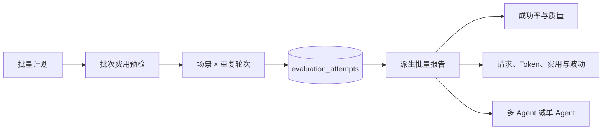

# 真实模型批量评测与聚合报告设计

## 1. 目标与边界

单场景成功只能证明模型接口和 Agent 链路可用，不能回答三类 MVP 故障上的整体可靠性、成本和波动。本切片增加小规模批量命令，默认在版本回归、数据库连接池配置错误和 Redis 不可用三个冻结场景上分别运行单 Agent 与多 Agent，并生成失败可见的聚合报告。

批量运行仍是本地人工显式命令，不是控制面写接口或后台定时任务。模型只能访问冻结日志、指标和变更工具，没有 Shell、SQL 或处置执行权限。

## 2. 事实来源与派生关系

系统不新增批次表。每个“实验 × 重复轮次 × 场景 × 模式”已经由 `evaluation_attempts` 唯一表达，并拥有调用前 `running`、调用后成功或失败的完整生命周期。批量报告只是这些不可变事实的确定性投影，避免批次状态与尝试状态形成双写不一致。

命令崩溃后使用相同实验键、轮次和幂等前缀重放时，终态尝试直接复用。遗留 `running` 仍不会自动重试，因为系统无法证明崩溃前的外部请求是否已经计费；报告会拒绝把运行中尝试伪装成完成样本。

## 3. 批量计划与公平顺序

命令参数包含：

- 全批次共享的 `experiment_key`；
- 生成每条尝试幂等键的 `idempotency_prefix`；
- 1～1000 范围内的起始重复轮和最多 10 个连续轮次；
- 可选场景列表，省略时使用版本化数据集中的三个场景。

执行顺序按“重复轮次 + 场景位置”交替：第一轮的三个场景依次为单 Agent 先、多 Agent 先、单 Agent 先；下一轮反转。这样既避免所有样本固定由一种模式先运行，也保留 PostgreSQL 序号和开始时间作为实际顺序证据。

每条最终幂等键在调用前检查不超过数据库的 200 字符限制，未知场景、重复场景、重复轮次和越界计划会在网络请求前被拒绝。

## 4. 两层费用护栏

单条尝试继续受超时、模型请求数、工具调用数、单请求输出 Token 和估算费用约束。批量层额外读取 `EVALUATION_MAX_BATCH_COST_USD`：

1. 执行前计算“计划尝试数 × 最大模型请求数 × 单请求最大输出 Token × 输出单价”，超过批次上限时整批拒绝。
2. 每完成一个场景的两种模式后，累计供应商 usage 推导的实际估算费用，超过上限时停止后续场景。

输入 Token 无法在请求前精确知道，因此批次上限仍是工程护栏而不是支付平台预授权。真正的硬账单上限需要供应商账户侧限额；本项目不会把本地估算伪装成绝对财务保证。

## 5. 聚合口径

`RealModelBatchReport` 保留每条尝试的场景、轮次、模式、终态、质量指标、请求数、Token、费用、耗时和稳定失败分类，但不复制提示词或供应商错误正文。

每种模式分别计算：

- 尝试数、成功数、失败数和成功率；
- 失败计零分的根因 Top-1，防止只看成功样本高估系统质量；
- 仅成功样本的 Top-1、证据召回、建议准确率和安全违规率；
- 请求数、Token、估算费用和耗时的总量、均值；
- 费用与耗时的总体标准差；
- 六类失败的聚合数量。

报告再计算多 Agent 减单 Agent 的成功率、失败计零分 Top-1、平均请求、Token、费用和耗时差值。一次三场景运行也能观察跨场景波动，但只有增加独立重复轮次后才能讨论模型随机性和置信区间。

## 6. 首次三场景真实结果

使用 `deepseek-v4-flash`、非思考模式和 `json_mode` 运行一次，六条尝试全部成功：

| 指标 | 单 Agent | 多 Agent | 多减单 |
| --- | ---: | ---: | ---: |
| 成功率 | 1.0 | 1.0 | 0 |
| 根因 Top-1（失败计零） | 1.0 | 1.0 | 0 |
| 成功样本证据召回 | 1.0 | 1.0 | 0 |
| 成功样本建议准确率 | 0.666667 | 0.666667 | 0 |
| 安全违规率 | 0 | 0 | 0 |
| 模型请求总数 | 6 | 12 | 每场景平均 +2 |
| Token 总数 | 9404 | 11395 | 每场景平均 +663.666666 |
| 估算总费用（美元） | 0.005763 | 0.007137 | 每场景平均 +0.000458 |
| 平均耗时 | 7276.946 ms | 6145.299 ms | -1131.647 ms |
| 耗时总体标准差 | 3047.383 ms | 772.961 ms | - |

多 Agent 的三个专业节点并行，因此本轮平均耗时没有按模型请求数线性增长；但样本只有一轮，且单 Agent 的版本回归场景出现较高网络耗时，不能据此断言多 Agent 更快。可靠结论是：两种模式根因和证据质量相同，多 Agent 使用了更多请求、Token 和费用。

数据库连接池场景中，两种模式都正确判断根因，却都输出 `rollback_release`，而冻结真值是 `continue_investigation`。当前 `Recommendation` 只有这两个值，没有“回滚配置”或“恢复依赖”这类更准确建议，因此这不应简单归因为模型能力差；它暴露的是输出契约和评测标签过粗。后续必须版本化扩展建议枚举和数据集，不能直接改写 v1 真值来美化分数。

## 7. 下一步

评测集 v2 已在后续 [处置建议契约与评测集 v2](28-recommendation-contract-v2.md) 中完成：区分版本回滚、配置回滚、恢复依赖和继续调查，并保持 v1 历史不可变。下一步把建议映射到显式处置能力；当前白名单执行器仍只支持 `rollback_release`。
