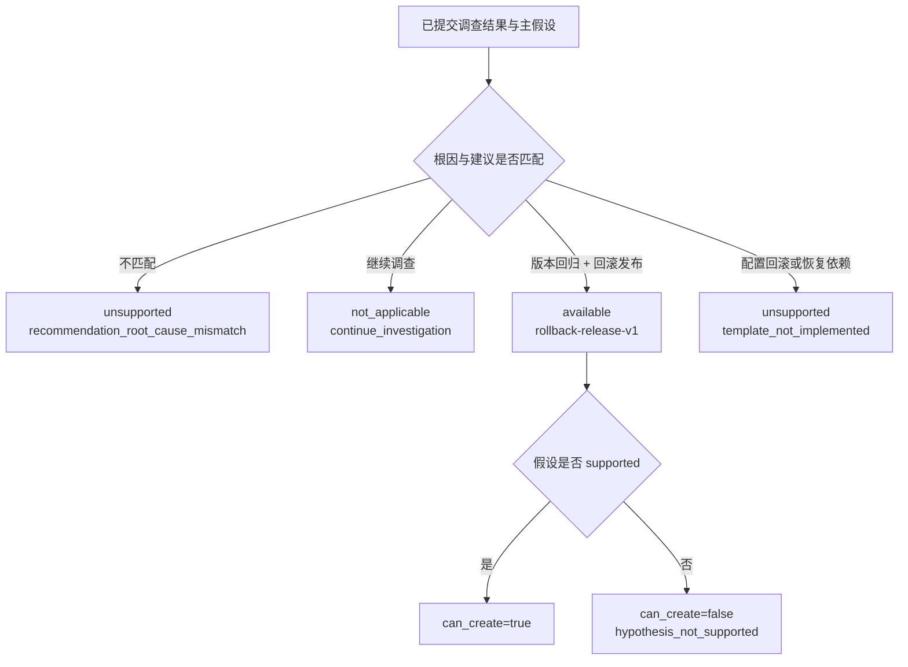

# 确定性处置计划能力映射

## 1. 问题与目标

处置建议契约 v2 可以表达版本回滚、配置回滚、恢复依赖和继续调查，但旧计划器只读取主根因。只依赖根因会留下一个危险缺口：调查结论可能建议继续调查或配置回滚，计划器却仍按另一个根因模板生成版本回滚。

本切片把 `root_cause`、`recommendation` 和 `hypothesis_status` 一起纳入确定性能力判断，并向 API 暴露只读结果。能力映射不调用模型、不创建计划，也不执行动作。

## 2. 能力状态

`ActionPlanCapability` 返回三种状态：

| 状态 | 含义 | 当前示例 |
| --- | --- | --- |
| `available` | 存在经过验证的确定性模板 | 版本回归 + `rollback_release` |
| `unsupported` | 建议已识别，但模板未实现或建议与根因不匹配 | 配置回滚、恢复依赖 |
| `not_applicable` | 调查明确要求继续收集证据，不应生成动作计划 | `continue_investigation` |

响应同时包含：

- 根因、建议和主假设状态；
- 可选的白名单动作类型和模板版本；
- 是否需要人工审批；
- `can_create` 与稳定 `reason_code`；
- 面向工程师的中文解释。

`available` 只表示模板存在。只有主假设为 `supported` 时 `can_create` 才能为 `true`。例如版本回滚模板存在，但假设为 `contested` 时仍不得生成计划。

## 3. 冻结映射规则



当前唯一可用映射为：

| 根因 | 建议 | 动作 | 模板版本 |
| --- | --- | --- | --- |
| `release_500_regression` | `rollback_release` | `rollback_release` | `rollback-release-v1` |

以下语义已识别但没有执行模板：

| 根因 | 建议 | 原因码 |
| --- | --- | --- |
| `database_pool_misconfiguration` | `rollback_configuration` | `template_not_implemented` |
| `redis_unavailable` | `restore_dependency` | `template_not_implemented` |

系统禁止建议借用其他根因模板。例如数据库配置错误却建议 `rollback_release` 时返回 `recommendation_root_cause_mismatch`，不会尝试从变更证据拼出发布回滚计划。

## 4. API 契约

只读查询：

```http
GET /api/v1/investigations/{run_id}/action-plans/capability
```

可创建的版本回滚示例：

```json
{
  "investigation_run_id": "00000000-0000-0000-0000-000000000001",
  "root_cause": "release_500_regression",
  "recommendation": "rollback_release",
  "hypothesis_status": "supported",
  "status": "available",
  "action_type": "rollback_release",
  "template_version": "rollback-release-v1",
  "requires_human_approval": true,
  "can_create": true,
  "reason_code": "template_available",
  "explanation": "版本回滚模板可用，且主根因假设已经通过确定性质疑。"
}
```

配置回滚返回 `200` 和 `unsupported`，因为查询成功且系统能够明确说明当前能力。随后调用计划创建接口会返回 `409 action_plan_capability_unavailable`，错误详情复用同一能力字段，且数据库不会产生 `action_plans` 或 `action_steps` 记录。

调查未成功、缺少结构化结果或主假设时，能力本身还无法判断，因此返回既有的 `409 action_plan_not_ready`。调查不存在仍返回 `404 investigation_run_not_found`。

## 5. 计划生成的强制边界

`propose_action_plan` 现在必须显式接收 `recommendation`。生成前按以下顺序检查：

1. 主假设必须为 `supported`；
2. 根因与建议必须匹配；
3. 对应模板必须为 `available`；
4. 版本回滚证据必须给出合法且不同的前后版本；
5. 风险策略仍要重新计算并要求人工审批。

这不是 UI 提示，而是领域函数和 PostgreSQL 仓储共同执行的服务端约束。调用方跳过能力查询直接 POST 创建计划，也会经过相同判断。

## 6. 持久化与兼容性

能力是已持久调查结果和主假设的确定性投影，不新增业务表，也不保存第二份可漂移状态。每次查询都从 `investigation_runs.result` 与 `hypotheses` 重算；如果结论根因与假设根因不一致，系统以 `action_plan_not_ready` 阻止继续。

本切片不需要 Alembic 迁移。既有版本回滚计划和接口保持兼容；新增只读端点不会修改 Incident 状态或版本。旧的 `UnsupportedPlanningRootCause` 类型暂时保留作为代码兼容边界，新计划生成路径使用信息更完整的能力不可用错误。

## 7. 当前限制与下一步

- 配置回滚与依赖恢复仍不可执行，这是有意的安全限制。
- 能力尚未加入 Incident 作战室聚合投影，当前通过独立 API 查询。
- 下一步应优先设计数据库连接池配置回滚模板：冻结允许修改的配置键、旧值来源、参数类型、风险规则、幂等本地适配器和恢复验证信号，再决定是否开放执行。

## 8. 面试表达

我在扩展 Agent 建议枚举后，没有直接给新建议接执行器，而是增加了一个确定性能力层。它用根因、建议和假设状态共同判断模板是否存在以及当前能否创建，API 将“可用、尚未实现、无需动作”明确区分。计划器本身也强制执行同一映射，所以客户端不能绕过查询接口。这样系统既能展示模型已经识别出配置回滚，又不会把它错误降级成版本回滚或获得未审计的生产权限。
