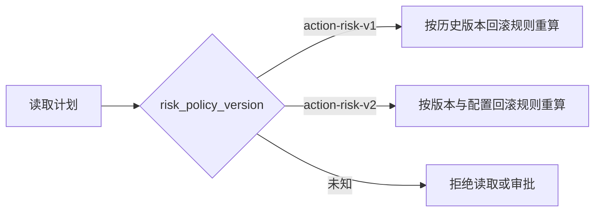
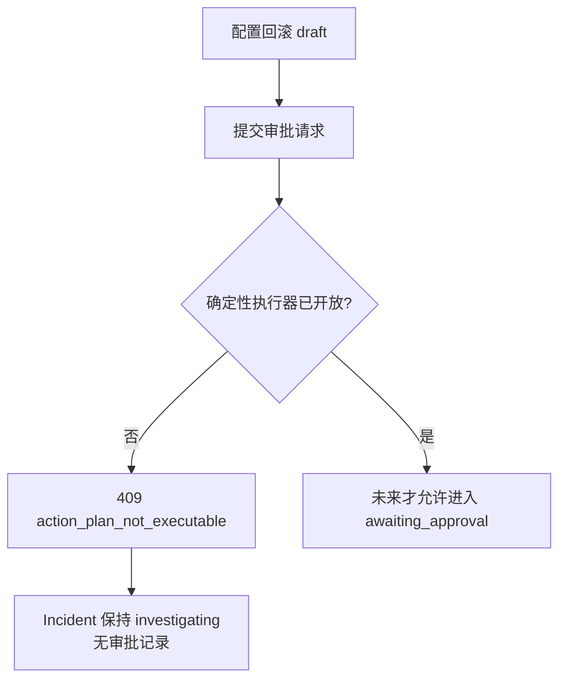

# 数据库连接池配置回滚计划模板

## 1. 目标与边界

调查建议和能力层已经能准确表达 `database_pool_misconfiguration + rollback_configuration`，但此前没有可审查的 Action Plan。本切片新增数据库连接池配置回滚的确定性草案模板，使工程师能够看到动作目标、旧值来源、风险和未来验证规则。

本切片只开放计划生成，不开放审批或执行：

- 可以查询能力并创建不可变 `draft`；
- 不能创建审批请求，Incident 保持 `investigating`；
- 不能创建操作执行记录；
- 不增加故障开关，也不修改本地服务配置。

这样可以先验证计划契约和历史兼容性，再用独立切片实现故障演练适配器与恢复探针。

## 2. 配置键与参数白名单

第一版只允许一个配置键：

```text
database_pool_size
```

`RollbackConfigurationParameters` 固定包含：

| 字段 | 约束 | 来源 |
| --- | --- | --- |
| `key` | 只能是 `database_pool_size` | 确定性模板常量 |
| `current_value` | 整数，1～1000 | 最新有效变更证据的 `to_value` |
| `target_value` | 整数，1～1000，且不能等于当前值 | 同一证据的 `from_value` |

计划器只接受 `kind=change`、`change_type=configuration`、`completed=true` 且键名完全匹配的证据。字符串数字、布尔值、越界值、无变化值或其他配置键都不能成为回滚目标。客户端和模型不能提交或覆盖这些参数。

## 3. 计划模板

能力映射新增：

| 根因 | 建议 | 动作 | 模板版本 |
| --- | --- | --- | --- |
| `database_pool_misconfiguration` | `rollback_configuration` | `rollback_configuration` | `rollback-configuration-database-pool-v1` |

模板生成一个服务级步骤：

```json
{
  "action_type": "rollback_configuration",
  "target_type": "service",
  "target_name": "order-service",
  "parameters": {
    "key": "database_pool_size",
    "current_value": 5,
    "target_value": 50
  },
  "verification": {
    "signal": "database_pool_saturation",
    "operator": "less_than",
    "threshold": 0.8,
    "observation_window_seconds": 60,
    "required_successful_samples": 3
  }
}
```

验证规则此时只是计划中冻结的未来验收契约。当前验证服务不支持该信号，也不会因为计划存在就启动探针。

## 4. 风险策略版本

新计划使用 `action-risk-v2`：

- 版本回滚继续判为 `high`；
- 运行配置回滚判为 `high`；
- 两者都必须人工审批；
- 配置回滚规则码为 `rollback_changes_runtime_configuration`。

风险策略不能直接把常量从 v1 改写为 v2，否则数据库中的历史计划会在读取重验时失效。因此策略按计划保存的版本分派：



新版本回滚计划也使用 v2；已保存的 v1 版本回滚计划仍能重算和读取，历史审计语义不被改写。

## 5. 审批与执行双重阻断

计划草案不等于执行能力。若允许一个没有执行器的计划进入审批，批准后 Incident 会迁移到 `mitigating`，却没有合法动作可以完成。因此审批仓储在状态迁移和写入审批记录前检查所有步骤：



执行仓储和本地 HTTP 适配器还保留第二道 `rollback_release` 白名单检查。即使数据库被异常写入批准记录，配置动作也会在创建执行记录或访问 HTTP 前被拒绝。

## 6. PostgreSQL 迁移

Alembic `0014_configuration_rollback` 只扩展 `action_steps.action_type` 检查约束：

```text
rollback_release
rollback_configuration
```

参数仍保存为 JSONB，并在计划写入和每次读取时经过动作对应的 Pydantic 模型校验。高风险不得关闭审批的数据库约束保持不变。

降级前会检查是否已有 `rollback_configuration` 历史步骤；存在时拒绝降级，避免为了恢复旧约束而删除或篡改审计数据。

## 7. API 行为

数据库连接池场景完成调查后：

1. 能力查询返回 `available`、`can_create=true` 和模板版本；
2. 创建计划返回 `201` 和高风险 `draft`；
3. 查询当前计划可以完整读取配置参数和验证规则；
4. 提交审批返回 `409 action_plan_not_executable`；
5. Incident 状态和版本保持 `investigating`、版本 2；
6. `approval_requests` 和 `operation_executions` 均不产生记录。

缺失或不安全的配置变更证据返回 `409 unsafe_configuration_rollback_target`，不会创建半成品计划。

## 8. 当前限制与下一步

- 当前故障实验室尚未模拟连接池容量变化。
- 配置回滚没有执行适配器，不能进入审批。
- `database_pool_saturation` 尚无真实或冻结恢复探针。
- 下一切片应先扩展本地故障实验室：提供确定性的连接池配置状态、只允许设置白名单整数值的管理接口，并让订单接口在错误容量下稳定复现超时；随后才接执行与验证链路。

## 9. 面试表达

我把模型建议的“回滚配置”转换成确定性草案时，只允许一个配置键，并且当前值和目标值只能来自同一条已提交变更证据。风险策略升级到 v2，但按计划冻结版本重算，所以历史 v1 计划仍可读取。更关键的是，我没有因为模板存在就开放审批：没有执行器的计划如果获批会让 Incident 卡在 mitigating，因此审批事务在状态迁移前拒绝，同时执行仓储和适配器保留第二道白名单。这体现了计划能力、审批能力和执行能力是三个独立安全层。
