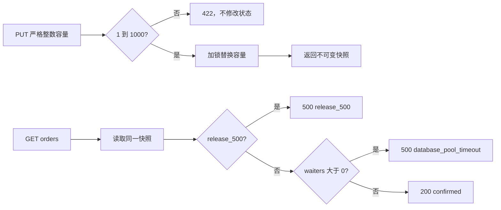

# 数据库连接池确定性故障演练

## 1. 目标与边界

本切片把冻结评测集中的数据库连接池配置错误落实为可运行的本地故障：工程师可以把 `order-service` 的模拟连接池容量从安全值 `50` 设置为错误值 `5`，随后订单接口稳定返回连接获取超时；恢复为 `50` 后立即恢复正常。

本切片只扩展 Docker Compose 故障实验室：

- 不修改真实 PostgreSQL 参数，也不创建真实数据库连接风暴；
- 不让 LLM、浏览器或客户端获得任意配置写权限；
- 不开放配置计划审批和执行；
- 不把演练状态写入业务数据库；
- 不实现控制面的恢复验证适配器。

这样可以先获得低成本、可重复的故障输入，再单独验证审批、执行和恢复链路。

## 2. 确定性容量模型

演练服务使用固定负载容量 `10`，不依赖并发时序或随机数：

```text
required_capacity = 10
database_pool_saturation = min(1.0, required_capacity / database_pool_size)
database_pool_waiters = max(0, required_capacity - database_pool_size)
```

| 配置值 | 饱和度 | 等待数 | 订单行为 |
| --- | ---: | ---: | --- |
| `50` | `0.2` | `0` | 返回 `200` |
| `10` | `1.0` | `0` | 返回 `200` |
| `5` | `1.0` | `5` | 返回结构化 `500 database_pool_timeout` |

故障判据使用“等待数大于 0”，因此容量恰好等于固定负载时虽然饱和，但尚未出现等待请求。未来真实 Prometheus 适配器可以使用同一信号名称，但不能把该模拟公式当成生产连接池算法。

## 3. 状态与并发边界

`FaultController` 在同一把线程锁内保存版本故障开关和连接池容量，路由只能读取不可变 `FaultSnapshot`。饱和度、等待数和故障状态全部由快照属性计算，不保存可漂移的重复字段。



当两个故障同时开启时，`release_500` 固定优先。这不是根因推断，而是故障源的稳定仲裁规则，确保相同状态总产生相同响应。

演练状态仍是单 Worker 进程内状态，容器重启后版本故障关闭、连接池容量回到 `50`。Incident、计划、审批和执行审计继续由 PostgreSQL 持久化；临时故障旋钮不冒充业务事实。

## 4. 管理接口

### 4.1 查询配置

```http
GET /__admin/configuration/database-pool
```

安全默认响应：

```json
{
  "key": "database_pool_size",
  "value": 50,
  "database_pool_saturation": 0.2,
  "database_pool_waiters": 0,
  "status": "healthy"
}
```

### 4.2 更新配置

```http
PUT /__admin/configuration/database-pool
Content-Type: application/json

{"value": 5}
```

请求只允许一个 `value` 字段，并且必须是严格整数 `1～1000`。字符串 `"5"`、布尔值、浮点数、越界值和未知字段都返回 `422`。控制器领域入口再次执行相同整数与范围校验，避免内部调用绕过 HTTP 模型。

管理路径只绑定 `127.0.0.1:18001` 或 Compose 演练网络，不具备生产鉴权，不能部署为真实配置中心。

## 5. 订单故障响应

容量为 `5` 时，合法订单请求稳定返回：

```json
{
  "error_code": "database_pool_timeout",
  "message": "数据库连接池容量不足，订单接口模拟获取连接超时",
  "order_id": "order-001",
  "database_pool_size": 5
}
```

`GET /health` 仍返回进程健康，因为该故障表达的是业务依赖容量不足，而不是容器进程退出。后续监控和调查必须同时区分进程存活、订单成功率与连接池饱和度。

## 6. 与处置计划的边界

故障实验室接口与 Action Plan 参数现在可以一一映射：

| Action Plan | 故障实验室 |
| --- | --- |
| `key=database_pool_size` | 固定管理路径，不接受客户端路径 |
| `target_value` | 执行器请求体中的唯一目标容量值 |
| `database_pool_saturation < 0.8` | 状态接口提供同名只读观测值 |

映射存在不代表自动授权。后续已完成固定 CAS 执行适配器、当前值复核、幂等测试和恢复探针；配置动作仍必须经过人工审批，详细设计见 [配置回滚受控执行与恢复验证](32-configuration-execution-and-verification.md)。

## 7. 测试策略

- 控制器单元测试验证安全默认值、`5 → 50` 状态变化、饱和公式和非法值拒绝。
- FastAPI 测试验证默认健康、错误容量稳定 500、恢复 200、严格类型和故障优先级。
- 计划参数测试验证字符串和布尔值不能被 Pydantic 转成整数。
- Docker Compose 端到端测试使用真实 `order-service` 容器完成 `50 → 5 → 50`，并在结束时恢复安全值。

本切片不新增业务表或 Alembic 迁移。

## 8. 面试表达

我没有为了模拟连接池错误而制造随机并发或耗尽真实数据库连接，因为那会让测试慢且不稳定。我用固定负载容量建立可解释公式，配置为 5 时稳定出现等待和超时，恢复为 50 后饱和度降到 0.2。HTTP 和领域入口都拒绝非严格整数，多个故障同时存在时也有固定优先级。这样后续执行器和恢复探针面对的是稳定、可复现且无生产权限的被控环境。
