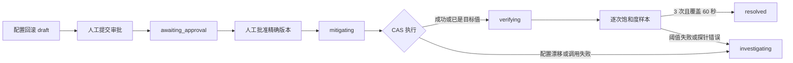
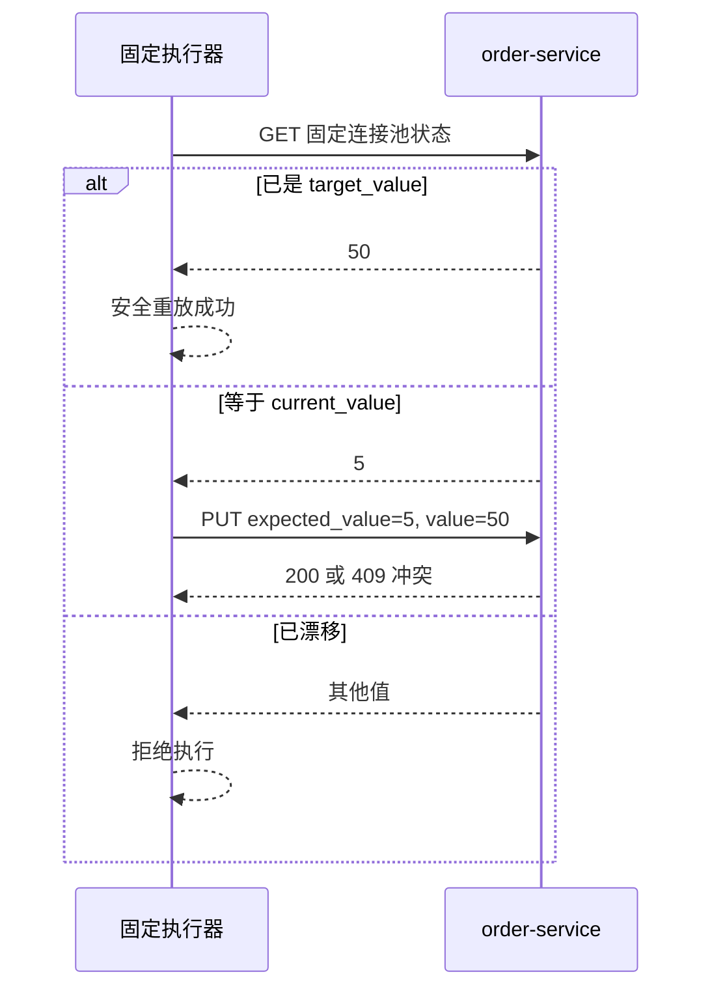

# 配置回滚受控执行与恢复验证

## 1. 目标与安全边界

本切片把数据库连接池配置错误从“可审查草案”推进为完整本地处置链路：人工审批精确计划后，确定性执行器把 `database_pool_size` 从证据中的当前值安全回滚到旧值，再由只读探针持续验证饱和度。

系统仍遵守以下边界：

- LLM 只产生结构化调查结论，不接触审批或执行接口；
- 客户端只提交步骤 ID、幂等键和 Incident 版本，不提交 URL、配置键或配置值；
- 执行器只操作本地 `order-service` 的固定连接池管理路径；
- 配置写入必须经过当前值复核与原子比较并设置；
- 恢复探针只读取固定状态路径，观测值不能由客户端提供；
- 真实配置中心、PostgreSQL 参数、Docker Socket 和生产环境均不在范围内。

## 2. 端到端状态流



计划创建、审批、执行、验证仍是四个独立业务动作。任何一步失败都不会伪造后续成功状态。

## 3. 配置当前值复核与 CAS

计划参数固定为：

```json
{
  "key": "database_pool_size",
  "current_value": 5,
  "target_value": 50
}
```

执行器先读取固定状态端点，然后按三种情况处理：

| 环境当前值 | 行为 | 原因 |
| ---: | --- | --- |
| `50` | 直接成功，`already_at_target=true` | 外部动作可能已成功但数据库终态尚未提交，允许安全重放 |
| `5` | 发送 `expected_value=5, value=50` | 只修改计划审批过的精确当前状态 |
| 其他值 | 失败，错误码 `configuration_current_value_mismatch` | 环境已漂移，禁止覆盖新配置 |

故障实验室在同一进程锁中比较 `expected_value` 和当前值再更新，消除“读取后、写入前”被其他请求修改的竞态。如果 CAS 返回 `409 database_pool_value_conflict`，适配器把它收敛为稳定执行失败，操作记录与 Incident 回流在 PostgreSQL 同一事务保存。



## 4. 执行白名单与审计

配置执行器名称固定为 `local_fault_lab_database_pool_v1`，只接受：

- `action_type=rollback_configuration`；
- `target_type=service`；
- `target_name=order-service`；
- `parameters.key=database_pool_size`；
- Pydantic 严格整数 `current_value` 与 `target_value`；
- 本地或 Compose 白名单基础地址；
- 固定 GET/PUT 路径。

执行结果最多保存配置键、计划当前值、目标值、最终当前值、最终饱和度、是否已处于目标值和服务名。结果仍受 16 KiB 上限保护，不保存任意响应体。

`OperationExecutionStore` 继续重验当前计划、精确批准、内容哈希、Incident `mitigating` 状态、版本和全局幂等键。配置执行使用相同 15 秒租约与至少一次恢复语义；完成事务使用执行记录自己的执行器名称写时间线，历史版本回滚审计名称不会被改写。

## 5. 饱和度恢复探针

配置验证器名称固定为 `local_database_pool_saturation_v1`，只读取：

```http
GET /__admin/configuration/database-pool
```

响应必须符合 `DatabasePoolStatus`，探针把 `database_pool_saturation` 映射为 `VerificationObservation`。仓储要求动作、目标、信号和比较符精确匹配：

```text
rollback_configuration
order-service
database_pool_saturation < 0.8
```

目标值 `50` 的演练饱和度为 `0.2`，单个样本通过；错误值 `5` 的饱和度为 `1.0`，首个样本即失败。一次健康样本仍不能解决 Incident，必须累计 3 个成功样本并覆盖 60 秒观察窗口。

版本回滚原有 `http_5xx_ratio` 探针保持不变。验证运行保存各自动作对应的验证器名称，完成事件使用该名称作为执行者，避免所有验证都被错误记为订单探针。

## 6. PostgreSQL 约束与迁移

Alembic `0015_configuration_execution` 扩展四个检查约束：

- `operation_executions.executor_name` 允许版本与配置两个执行器；
- `verification_runs.verifier_name` 允许订单与连接池两个验证器；
- `verification_runs` 允许两个白名单信号使用 `less_than`；
- `verification_samples.signal` 允许两个白名单信号。

迁移不增加表或可空字段。降级前检查配置执行、验证运行和样本历史；只要存在任一审计事实，就拒绝恢复旧白名单，避免删除或篡改历史。

## 7. API 与失败语义

配置回滚复用现有控制面接口：

1. `POST /api/v1/action-plans/{plan_id}/approval-requests`；
2. `POST /api/v1/approval-requests/{request_id}/actions/approve`；
3. `POST /api/v1/action-steps/{step_id}/executions`；
4. `POST /api/v1/operation-executions/{execution_id}/verification-runs`；
5. `POST /api/v1/verification-runs/{run_id}/samples`。

配置漂移不是 HTTP 请求校验错误。执行器先把 `operation_executions` 收敛为 `failed`，保存 `configuration_current_value_mismatch`，把 Incident 原子返回 `investigating`，然后控制面按既有契约返回 `502 operation_execution_failed`。工程师可以基于新环境事实重新调查和生成计划。

## 8. 测试策略

- 故障控制器与 API 测试覆盖 CAS 成功、静态漂移、读写间竞态和非法预期值。
- 执行适配器测试覆盖 `5 → 50`、已是目标值重放、当前值漂移和 CAS 冲突。
- 验证适配器测试覆盖健康 `0.2` 与失败 `1.0` 样本。
- 控制面与真实 PostgreSQL 测试覆盖计划、审批、批准、执行、验证运行和持久样本。
- 迁移测试覆盖从空库降级与重新升级，元数据检查防止 ORM 与迁移漂移。
- 真实 Compose 容器验证 CAS 不覆盖漂移值，并在结束时恢复安全值 `50`。

## 9. 当前限制与下一步

- 配置与饱和度仍是确定性故障模型，不是真实应用连接池。
- 后续已经增加持久验证 Worker，按冻结窗口自动触发逐次采样，见[持久恢复验证调度 Worker](33-persistent-verification-scheduler.md)。
- 配置漂移失败后系统返回调查，但尚未自动创建新的调查任务。
- 作战室仍是只读界面，不直接提供审批、执行和采样按钮。

下一步可以开始 Redis 不可用故障的依赖恢复计划，或为作战室增加受身份与权限保护的操作入口。

## 10. 面试表达

我没有把配置回滚实现成一次无条件 PUT。计划中的当前值是审批内容的一部分，执行器先读取环境，再用 expected-value CAS 防止 TOCTOU；若动作已成功但进程在落库前崩溃，看到目标值会安全重放成功，若环境变成其他值则拒绝覆盖并返回调查。恢复阶段也不信任执行成功，而是读取固定饱和度信号，满足三次样本和 60 秒窗口后才解决事故。应用校验、数据库白名单、幂等租约和恢复探针共同构成了安全边界。
