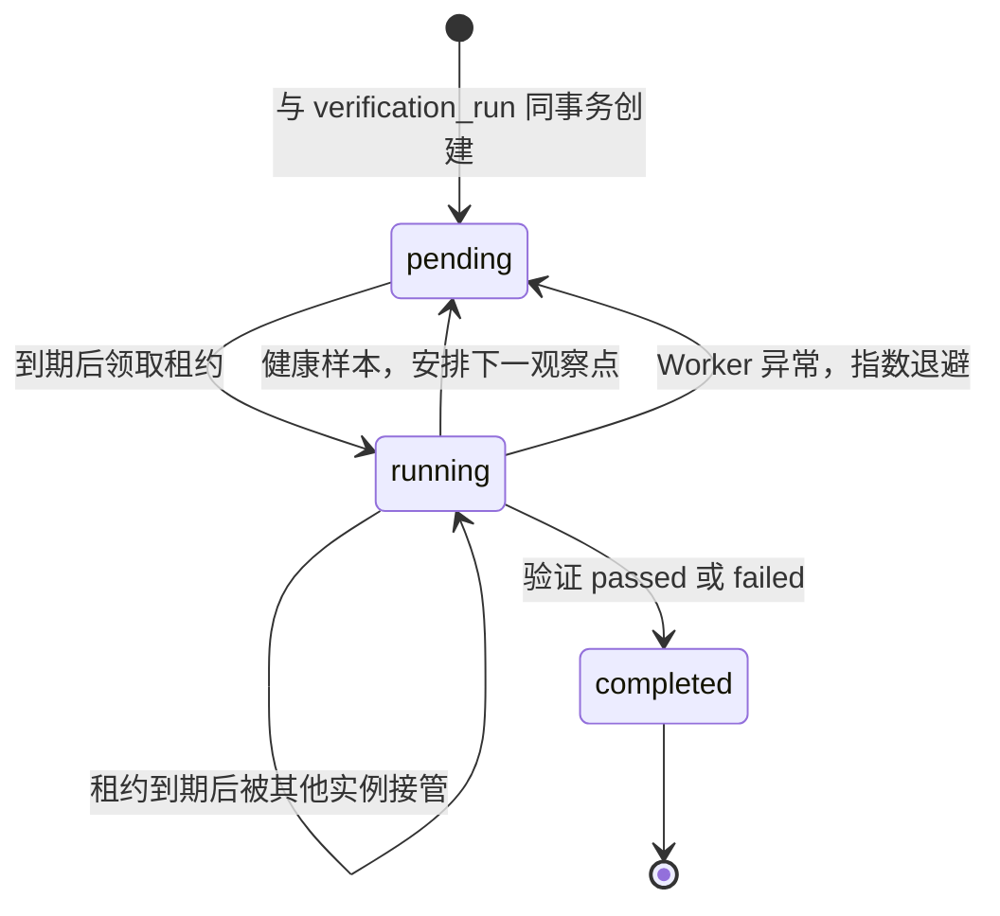
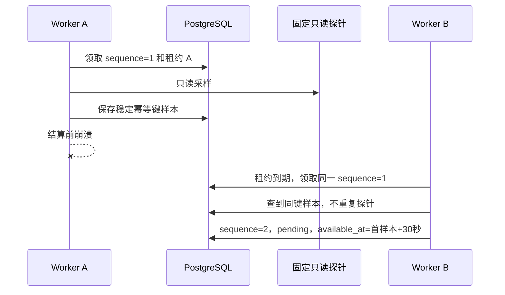

# 持久恢复验证调度 Worker

## 1. 目标与边界

本切片把恢复采样从“调用方手动触发”推进为独立常驻 Worker 自动执行。验证运行创建时，控制面在同一个 PostgreSQL 事务中创建唯一调度任务；Worker 按数据库中的到期时间领取任务、调用固定只读探针、结算样本并安排下一个观察点。API 或 Worker 重启都不会丢失进度。

安全边界保持不变：

- Worker 不能提交 URL、信号、阈值或观测值，只消费计划中冻结的验证规则；
- Worker 没有 Shell、Docker Socket、模型密钥或生产环境权限；
- 探针仍只访问本地 `order-service` 的固定路径；
- 调度异常与被管系统验证失败严格区分，数据库或 Worker 故障不能伪造恢复失败；
- 手动样本接口保留给本地诊断，但不是正常自动流程的必需步骤。

## 2. 为什么新增独立任务表

已有 `work_items` 通过非空唯一外键绑定 `investigation_runs`，其生命周期、最大尝试次数和失败终态都服务于 Agent 调查。把验证任务硬塞进该表需要多态外键和大量可空字段，还会把“调查处理失败”与“持续验证调度失败”混成同一语义。

因此新增一对一的 `verification_work_items`：

```text
verification_runs 1 ─── 1 verification_work_items
```

任务只保存调度事实，样本与恢复结论仍分别属于 `verification_samples` 和 `verification_runs`。它不替代业务审计，也不保存探针响应体。

## 3. 状态、租约与自动采样



领取使用 `FOR UPDATE SKIP LOCKED`。`running` 必须同时保存 `locked_by`、`locked_until` 和每次领取新生成的 `lease_token`；结算或退避必须匹配令牌并发生在租约到期前。控制面只读接口不会返回令牌。

当前冻结规则要求 3 个成功样本覆盖 60 秒。首个任务立即到期；首个健康样本后，下两次目标时间约为首样本后 30 秒和 60 秒。通用算法使用：

```text
interval = ceil(observation_window_seconds / max(required_successful_samples - 1, 1))
```

若人工样本或调度延迟已经改变进度，下一次时间从运行真实的 `first_success_at` 和成功样本计数重新计算，不依赖进程内计时器。

## 4. 崩溃恢复与幂等

每个调度轮次的样本幂等键由任务 UUID 和 `next_sample_sequence` 确定性生成：

```text
verification-scheduler-{work_item_uuid_hex}-{sequence}
```



| 故障点 | 恢复行为 |
| --- | --- |
| 探针读取前崩溃 | 租约到期后重新读取固定只读探针 |
| 探针读取后、样本落库前崩溃 | 允许再次只读探测，数据库仍只追加一个同键样本 |
| 样本落库后、任务结算前崩溃 | 重领同一序号并读取原样本，不重复探测 |
| 人工采样先结束验证 | Worker 发现运行终态，只把任务收敛为 `completed` |
| Worker 内部异常 | 保存稳定脱敏错误，按 2～60 秒指数退避 |

验证探针明确返回阈值失败或错误时，仍按既有业务规则让验证失败并把 Incident 返回调查。只有调度器自身异常才重试，二者不能混淆。

## 5. 数据库、API 与 Compose

Alembic `0016_verification_work_items` 创建任务表、到期领取索引和过期租约索引，并为已有验证运行回填任务：运行中的验证转为立即可领取 `pending`，已有终态转为 `completed`。存在未完成任务时拒绝降级，避免丢失恢复能力。

新增只读接口：

```http
GET /api/v1/verification-runs/{run_id}/work-item
```

响应包含状态、下一调度序号、`available_at`、Worker 标识、租约到期时间、总领取次数、连续失败次数和有限错误；不包含 `lease_token`，也不提供修改命令。

Compose 复用同一受限运行镜像：

- `control-migrate`：等待 PostgreSQL 健康，执行 `alembic upgrade head` 后以退出码 0 结束；
- `order-service`：固定故障演练服务，只加入演练网络；
- `verification-worker`：等待迁移完成和演练服务健康，随后常驻轮询，同时加入控制网与演练网；
- 三者都以非 root 用户运行；长期进程使用只读根文件系统、移除 Linux capabilities 并启用 `no-new-privileges`。

## 6. 测试策略

- 单元测试验证稳定幂等键、成功结算、错误脱敏和指数退避配置。
- 真实 PostgreSQL 测试验证运行与任务同事务创建、两个 Worker 并发只领取一次。
- 崩溃测试先保存样本但不结算任务，再让新 Worker 接管，确认探针调用次数仍为一次。
- 自动窗口测试使用可注入 UTC 时钟推进到 0、30、60 秒，验证 3 个样本后 Incident 才进入 `resolved`。
- 迁移测试从空库升级、降级和重新升级，并使用 `alembic check` 比对 ORM 元数据。
- Compose 验证迁移容器正常退出、数据库和演练服务健康、验证 Worker 持续运行。

## 7. 当前限制与下一步

- Worker 使用短轮询，不是 PostgreSQL `LISTEN/NOTIFY`；当前本地负载下优先简单和可恢复。
- 任务错误只保留最近一次有限摘要和累计次数，尚未建立独立 Worker 尝试历史表。
- 验证仍读取确定性 HTTP 状态，没有接入 Prometheus 区间查询和多信号组合。
- 验证失败后不会自动创建新的调查任务；工程师仍需确认是否重新调查。
- 控制面与前端尚未容器化，作战室仍没有可信身份和状态变更入口。

下一步优先实现 Redis 不可用故障的确定性依赖恢复链路，使第三个 MVP 故障也具备计划、审批、执行和验证能力。

## 8. 面试表达

我没有用进程内定时器实现 60 秒恢复窗口，因为 API 或 Worker 重启会丢失计时。我为每个验证运行同事务创建一个 PostgreSQL 调度任务，使用 `SKIP LOCKED`、到期租约和稳定样本幂等键。即使 Worker 在样本落库后崩溃，新实例也会读取同键样本并只推进一次调度序号。调度器自身错误只退避重试，不会被误写成被管系统恢复失败；业务阈值失败仍与 Incident 回流原子提交。
