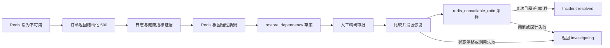
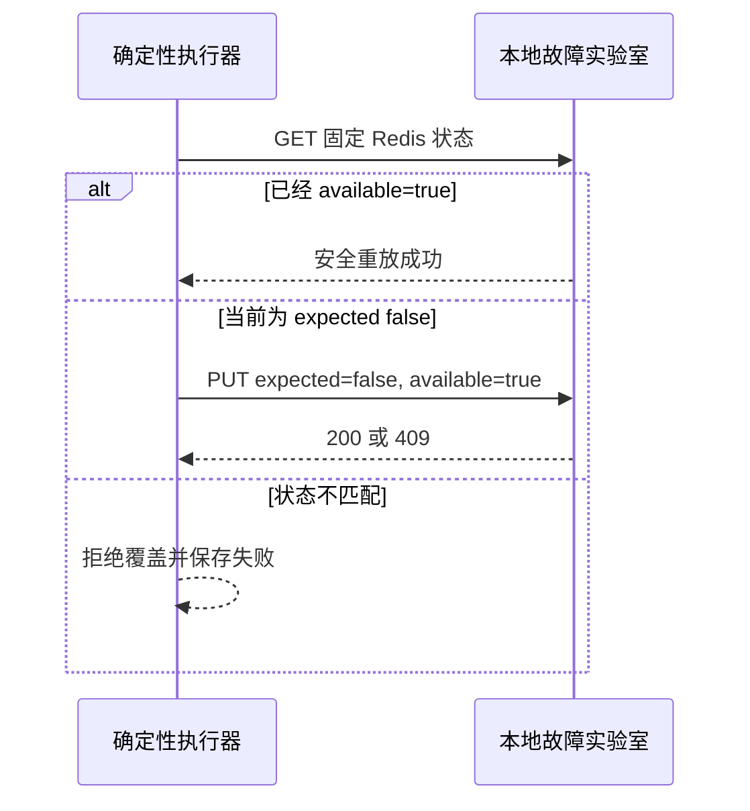

# Redis 不可用确定性处置闭环

## 1. 目标与边界

本切片让第三个 MVP 故障 `redis_unavailable` 具备与版本回归、数据库连接池错误相同的受控闭环：确定性故障、带证据计划、人工审批、白名单执行和持久恢复验证。

本切片先使用 `order-service` 进程内确定性依赖状态验证业务状态、授权、幂等和失败恢复。该临时实现已经由 [真实 Redis 与受控故障代理](35-real-redis-fault-proxy.md) 替代；系统仍没有 Docker Socket、任意 Shell、任意 URL 或生产 Redis 权限。

## 2. 端到端流程



计划、审批、执行和验证仍是四个独立业务动作。执行成功只表示依赖状态写入成功，不等于事故已经恢复。

## 3. 故障模型与稳定优先级

故障控制器增加 `redis_available`，安全默认值为 `true`。订单请求在 Redis 不可用时返回：

```json
{
  "error_code": "redis_connection_unavailable",
  "message": "Redis 依赖不可用，订单接口模拟连接失败",
  "order_id": "order-001",
  "dependency": "redis"
}
```

多个故障同时存在时固定按 `release_500 → database_pool_timeout → redis_connection_unavailable` 仲裁，避免同一状态随机返回不同错误。

管理接口固定为：

```http
GET /__admin/dependencies/redis
PUT /__admin/dependencies/redis
```

PUT 只接受严格布尔 `available` 和可选 `expected_available`。控制器在同一进程锁内完成比较和写入；状态已改变时返回 `409 redis_availability_conflict`。

## 4. 计划与风险策略

Redis 能力模板固定为 `restore-redis-dependency-v1`。只有以下事实同时成立才能创建计划：

- 根因是 `redis_unavailable`；
- 建议是 `restore_dependency`；
- 主假设状态为 `supported`；
- 指标证据明确包含 `redis_healthy=false`。

步骤契约为：

```json
{
  "action_type": "restore_dependency",
  "target_type": "dependency",
  "target_name": "redis",
  "parameters": {
    "dependency": "redis",
    "expected_available": false,
    "target_available": true
  }
}
```

Pydantic 参数模型拒绝非布尔值，并且只允许 `false → true`。`action-risk-v3` 把依赖状态变更判为 `high`，强制人工审批；读取历史计划时继续兼容 v1 与 v2 风险策略。

## 5. 白名单执行与安全重放

执行器名称固定为 `local_fault_lab_redis_dependency_v1`。客户端仍只能提交步骤 ID、幂等键和 Incident 版本，不能提交依赖名、目标状态或管理地址。



执行结果只保存依赖名、计划状态、最终状态、不可用比例和是否已在目标状态，不保存任意响应体。执行仍使用 PostgreSQL 15 秒租约、全局幂等键和至少一次恢复语义。

## 6. 恢复验证

验证器名称固定为 `local_redis_unavailable_ratio_v1`，只读取 Redis 固定状态接口。可用映射为 `0.0`，不可用映射为 `1.0`；冻结规则为：

```text
redis_unavailable_ratio < 0.01
```

规则要求至少 3 个成功样本并覆盖 60 秒。持久验证 Worker 继续按约 0、30、60 秒调度；客户端不能提供观测值、URL 或时间。

## 7. 数据库与迁移

`0017_redis_dependency_recovery` 不增加新表，只扩展五组白名单约束：

- `action_steps.action_type` 允许 `restore_dependency`；
- `action_steps.target_type` 允许 `dependency`；
- `operation_executions.executor_name` 允许 Redis 执行器；
- `verification_runs` 允许 Redis 验证器与信号；
- `verification_samples.signal` 允许 Redis 不可用比例。

降级前会检查计划、执行和验证历史；存在任意 Redis 恢复审计事实时拒绝收窄约束，避免历史数据被删除或变成非法状态。

## 8. 测试策略

- 控制器和 HTTP API 覆盖安全默认值、故障 500、恢复、严格布尔、CAS 冲突和故障优先级。
- 计划测试覆盖能力映射、严格参数、证据缺失与 v3 风险重算。
- 执行适配器覆盖真实恢复、已在目标状态的安全重放和读写间漂移。
- 验证适配器覆盖 0.0 健康样本与 1.0 失败样本。
- 控制面使用真实 PostgreSQL 验证调查、计划、审批、执行、验证运行和样本完整落库。
- 迁移测试从空库降级、重新升级并执行 ORM 元数据一致性检查。

## 9. 本切片交付时的限制与后续状态

- 第 34 个切片交付时，Redis 可用性仍是进程内确定性模型；第 35 个切片已改为真实 Redis 与固定代理。
- 第 35 个切片已支持确定性完全断连，但仍没有模拟延迟、丢包和主从切换。
- 调查工具仍读取冻结场景，不是 Loki、Prometheus 或真实 Redis 遥测。
- 浏览器作战室仍只读，没有可信身份与状态变更按钮。

上述真实 Redis 与固定故障代理已在第 35 个切片落地：Docker Desktop 会出现独立 Redis 与代理容器，订单服务通过代理执行真实 `PING`，执行器仍只调用固定恢复接口而不接触 Docker Socket。后续再补结构化日志、Prometheus 指标和 OpenTelemetry trace。

## 10. 面试表达

我没有让 LLM 或执行器重启任意 Redis。调查只输出结构化建议；计划模板把目标冻结为 `dependency + redis` 和严格的 `false → true` 参数，风险策略强制人工审批。执行器通过固定本地端点做 CAS，已在目标状态时支持崩溃重放，状态漂移时拒绝覆盖。恢复阶段继续读取独立信号并满足三样本、60 秒窗口，证明“操作成功”和“系统恢复”是两个不同业务状态。
