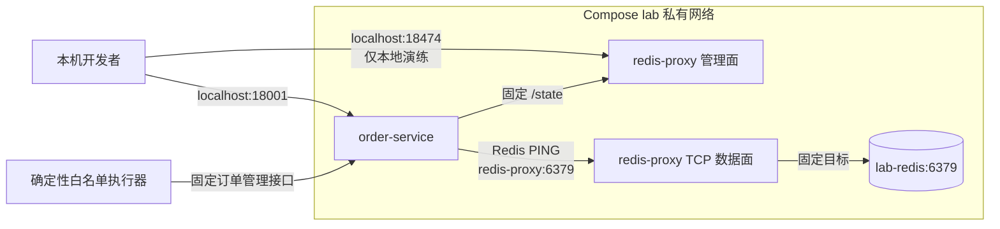

# 真实 Redis 与受控故障代理

## 1. 目标与边界

本切片把 `redis_unavailable` 从订单进程中的布尔状态升级为真实网络依赖：`order-service` 必须通过独立 TCP 代理访问 Compose 内的 Redis，并用真实 `PING` 判断订单依赖是否可用。

故障代理不是通用网络工具。它的后端在进程启动时固定为 `lab-redis:6379`，管理面只有查询状态和比较并设置连通性两个动作；不能改变目标地址、注入任意命令、访问 Docker Socket 或控制其他容器。

## 2. 容器拓扑



Compose 新增两个长期项目服务：

- `lab-redis`：固定 `redis:7.4.5-alpine`，不发布宿主机端口，只能从 `lab` 网络访问；
- `redis-proxy`：复用项目 Python 运行时，数据面监听 6379，管理面监听 8474；宿主机仅绑定 `127.0.0.1:16379` 与 `127.0.0.1:18474`，便于本地运行和故障演练。

Redis 在 MVP 中是可丢弃缓存依赖，关闭持久化并把 `/data` 放在临时文件系统。Incident、审批、执行和验证审计仍只保存在控制面 PostgreSQL，绝不能把 Redis 缓存误当作业务事实。

## 3. 为什么使用 TCP 故障代理

直接让执行器调用 `docker stop` 或挂载 Docker Socket，会把“恢复一个固定依赖”扩大为“控制宿主机全部容器”的权限，无法满足最小权限原则。只在订单进程里保存布尔值又不能证明系统真的访问了 Redis。

固定 TCP 代理把两者分开：

- 数据面透传原始 Redis 字节，不解释也不修改命令；
- 管理面只接受严格布尔 `available` 和可选 `expected_available`；
- 禁用时拒绝新连接，并主动关闭全部已有客户端与后端连接；
- 启用时只恢复到启动配置中的固定 Redis 地址；
- CAS 冲突返回 `409 redis_availability_conflict`，旧审批不能覆盖新状态。

主动关闭已有连接很关键。redis-py 使用连接池，如果代理只拒绝新连接，已经建立的连接仍可能继续成功，故障就会变得不确定。

## 4. 订单服务真实依赖判断

订单故障优先级仍固定为：

```text
release_500 → database_pool_timeout → redis_connection_unavailable
```

前两项都未触发时，订单服务使用 redis-py 经代理发送 `PING`。连接拒绝、连接中断、超时和 Redis 客户端错误统一映射为 `available=false`，订单返回已有的结构化 500 契约。

对执行器公开的接口保持不变：

```http
GET /__admin/dependencies/redis
PUT /__admin/dependencies/redis
```

订单服务把 PUT 转发到代理固定 `/state`，随后再次真实 `PING`。因此“代理开关已打开但 Redis 本身仍不可达”不会被误报为恢复成功。执行器、审批和验证器无需获得代理地址，也不需要修改上一切片已经冻结的计划契约。

## 5. 状态与恢复语义

代理开关是故障注入状态，默认 `available=true`，代理容器重启后回到安全状态。它可以丢失，不属于业务审计事实。

操作执行记录、Incident 状态和验证样本仍持久化在 PostgreSQL。若进程在代理恢复后、执行结果提交前崩溃，至少一次执行会重新读取订单管理接口；真实 `PING` 成功时按“已在目标状态”安全重放，不会重复执行不受限操作。

验证器继续读取 `redis_unavailable_ratio`：真实可访问映射为 `0.0`，不可访问映射为 `1.0`。必须满足三次成功样本和 60 秒覆盖窗口，才能把 Incident 标记为 `resolved`。

## 6. 配置护栏

订单服务环境变量：

- `OPSSWARM_FAULT_LAB_REDIS_URL`：只允许 `redis://`、0 号库，以及 `localhost`、`127.0.0.1` 或 `redis-proxy`；
- `OPSSWARM_FAULT_LAB_REDIS_PROXY_ADMIN_URL`：只允许 HTTP、本机或 `redis-proxy`，禁止用户信息、路径、查询参数和片段；
- `OPSSWARM_FAULT_LAB_TIMEOUT_SECONDS`：限制为 0～5 秒内的正数。

代理后端主机只允许 `127.0.0.1`、`localhost` 或 `lab-redis`。Compose 容器继续使用只读根文件系统、移除 Linux capabilities，并设置 `no-new-privileges`。

## 7. 运行与验证

```powershell
docker compose up -d --build --wait
docker compose ps

# 初始真实依赖可用
Invoke-WebRequest http://127.0.0.1:18001/orders/order-001 -SkipHttpErrorCheck

# 本地演练：切断代理
Invoke-RestMethod -Method Put `
  -Uri http://127.0.0.1:18474/state `
  -ContentType 'application/json' `
  -Body '{"expected_available":true,"available":false}'
Invoke-WebRequest http://127.0.0.1:18001/orders/order-001 -SkipHttpErrorCheck

# 恢复安全状态
Invoke-RestMethod -Method Put `
  -Uri http://127.0.0.1:18474/state `
  -ContentType 'application/json' `
  -Body '{"expected_available":false,"available":true}'
Invoke-WebRequest http://127.0.0.1:18001/orders/order-001 -SkipHttpErrorCheck
docker compose exec -T lab-redis redis-cli ping
```

日常暂停使用 `docker compose stop`，再次使用执行 `docker compose start`，无需每次重新创建。只有 Compose 定义、依赖或镜像内容发生变化时才执行 `docker compose up -d --build`。

## 8. 当前限制与下一步

- 当前只模拟完全断连，不模拟延迟、丢包、带宽限制、只读副本或主从切换；
- Redis 无鉴权，仅存在于本地演练私网，不能照搬到生产部署；
- 代理状态保存在单进程内存中，不支持多副本；
- 恢复验证已在第 36 个切片接入真实 Prometheus 指标；调查证据仍来自冻结评测场景，尚未采集真实 Redis 日志。

第 36 个切片已为故障实验室增加真实 Prometheus 并切换恢复验证。后续应实现受限的 Prometheus 调查数据源，再补结构化日志、Loki 与 OpenTelemetry，同时保留固定执行器与业务审计边界。

## 9. 面试表达

我没有为了演示 Redis 故障就把 Docker Socket 交给 Agent。订单服务现在确实通过 redis-py 和一个固定目标 TCP 代理访问真实 Redis；代理关闭时会同时拒绝新连接并清理连接池已有连接，所以故障是确定性的。LLM 仍只给结构化建议，高风险恢复要经过审批，执行器只调用固定 CAS 接口，恢复结果还要由真实 PING 和持久验证窗口确认。
