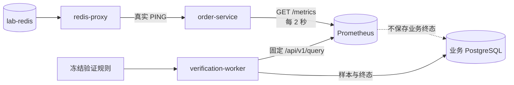

# Prometheus 指标与恢复验证

## 1. 目标与边界

本切片把恢复验证的数据源从 `order-service` 固定状态接口升级为真实 Prometheus 抓取和即时查询。验证规则、调度、样本、Incident 迁移和审计事实仍属于 PostgreSQL；Prometheus 只保存可重新采集的遥测，不替代业务数据库。

调查 Agent 暂时仍使用冻结评测数据。本切片只切换恢复验证，保持功能切片可运行、可测试且边界清晰。

## 2. 数据流



Compose 使用 `prom/prometheus:v3.13.2`，属于 Prometheus 3.13 LTS 系列。官方 LTS 周期为一年，适合本地项目减少非必要升级风险；镜像固定补丁版本而不使用 `latest`。[Prometheus LTS 周期](https://prometheus.io/docs/introduction/release-cycle/)

Prometheus 只加入 `lab` 网络，Web 与查询 API 仅绑定 `127.0.0.1:19090`。时间序列保存在 `prometheus-data` 命名卷，保留期固定为一天；删除它不会丢失 Incident、审批、执行或验证审计。

## 3. 指标契约

`order-service` 的 `/metrics` 使用独立 `CollectorRegistry`，避免应用工厂测试和多实例互相污染。每次抓取都会重新读取故障控制器并执行真实 Redis `PING`。

| 指标 | 类型 | 当前语义 |
| --- | --- | --- |
| `opsswarm_fault_lab_http_5xx_ratio` | Gauge | 此刻订单请求是否会返回 5xx，确定性取 `0` 或 `1` |
| `opsswarm_fault_lab_database_pool_saturation` | Gauge | 固定演练负载除以当前连接池容量，范围 `0～1` |
| `opsswarm_fault_lab_redis_unavailable_ratio` | Gauge | 真实 Redis `PING` 成功为 `0`，失败为 `1` |
| `opsswarm_fault_lab_order_requests_total` | Counter | 按固定结果与故障原因统计订单请求 |

所有指标只使用固定 `service="order-service"` 及有限结果标签。订单 ID、Incident ID、异常文本等高基数或敏感数据不得进入标签。

`http_5xx_ratio` 当前是故障实验室的瞬时 0/1 快照，不冒充生产流量窗口统计。未来接入持续流量后，可以新增基于 Counter 的 `rate()` 查询，但必须版本化查询与验证器名称，不能静默改变历史语义。

## 4. 固定 PromQL 白名单

验证适配器不接收客户端、计划或模型提供的 PromQL。三种已冻结信号在代码中一一映射：

| 计划信号 | 固定查询 |
| --- | --- |
| `http_5xx_ratio` | `opsswarm_fault_lab_http_5xx_ratio{service="order-service"}` |
| `database_pool_saturation` | `opsswarm_fault_lab_database_pool_saturation{service="order-service"}` |
| `redis_unavailable_ratio` | `opsswarm_fault_lab_redis_unavailable_ratio{service="order-service"}` |

只有动作、参数类型、目标类型、目标名称和信号整体匹配白名单时才会发起查询。例如 `restore_dependency + redis + redis_unavailable_ratio` 合法，客户端把目标改成其他服务时会在网络调用前拒绝。

## 5. 查询结果护栏

HTTP 200 不等于可信样本。适配器还会检查：

- Prometheus 响应必须是 `success + vector`；
- 结果必须且只能包含一个时间序列；
- `__name__` 和 `service` 标签必须与固定查询一致；
- 字符串数值必须可解析、有限且位于 `0～1`；
- 样本时间不能超过当前时间 5 秒，也不能早于当前时间 10 秒以上；
- 超时、网络失败、非 2xx、空结果、多结果、旧样本和无效响应都生成有限错误，不能被当作健康。

新鲜度检查用于防止 Prometheus 在抓取目标失联后继续返回 lookback 窗口中的旧健康值。当前抓取周期为 2 秒，10 秒上限允许短暂调度抖动，但不会让长期陈旧数据通过恢复判定。

## 6. 持久审计与迁移

新创建的验证运行记录实际数据源：

- `prometheus_order_http_5xx_ratio_v1`；
- `prometheus_database_pool_saturation_v1`；
- `prometheus_redis_unavailable_ratio_v1`。

Alembic `0018_prometheus_verification` 扩展 `verification_runs.verifier_name` 检查约束。历史 `local_*` 验证器名称继续合法，旧审计不重写；存在任意新 Prometheus 验证历史时拒绝降级，避免把已有业务事实变成非法数据。

数据源变化没有改变计划中的阈值和窗口：仍需 3 个健康样本覆盖至少 60 秒。每个 Prometheus 查询发生在数据库事务外；样本写入、运行终态、Incident 状态和时间线仍在 PostgreSQL 事务中提交。

## 7. Compose 与安全边界

- `prometheus` 等待 `order-service` 健康后启动；
- `verification-worker` 等待迁移、订单服务和 Prometheus 健康后启动；
- Worker 只配置项目内 Prometheus 基础地址，不能改变查询；
- Prometheus 容器使用只读根文件系统、移除 capabilities、启用 `no-new-privileges`；
- Prometheus 无生产鉴权，只允许本机和 Compose 私网访问；
- LLM 没有 Prometheus 写权限、Docker Socket、Shell 或业务数据库写权限。

本地查看：

```powershell
docker compose up -d --build --wait
docker compose ps
Invoke-RestMethod http://127.0.0.1:19090/api/v1/targets
Invoke-WebRequest http://127.0.0.1:18001/metrics
```

## 8. 当前限制与下一步

- 三个 Gauge 是确定性故障快照，不是生产流量的窗口聚合；
- Prometheus 只抓取 `order-service`，尚未采集 API、Worker、PostgreSQL 或 Redis Exporter；
- Prometheus 调查适配器已在后续切片实现，但持久调查 Worker 仍等待 Loki 与变更数据源形成完整现场证据链；
- 尚未接入 Alertmanager、Grafana、Loki 和 OpenTelemetry；
- Prometheus 只适用于本地演练，不具备生产鉴权、高可用和长期存储。

只读 Prometheus 调查数据源见 [Prometheus 只读调查数据源](37-prometheus-investigation-data-source.md)：它把受限服务名和回看分钟转换为固定查询并输出规范化 Evidence，冻结评测数据继续作为单/多 Agent 公平基线。

## 9. 面试表达

我把恢复验证从服务自报状态切换到了真实 Prometheus，但没有让 Agent 自由写 PromQL。动作、目标和信号先匹配代码白名单，再执行三条固定查询；响应还要通过单序列、标签、范围和样本新鲜度校验，避免旧健康值造成假恢复。Prometheus 只是可重建遥测，最终样本和 Incident 终态仍由 PostgreSQL 事务持久化。
