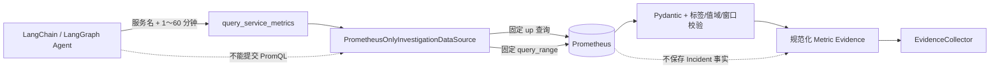

# Prometheus 只读调查数据源

## 1. 目标与边界

本切片让 LangChain 的 `query_service_metrics` 工具能够读取项目内真实 Prometheus，并把区间指标转换为可进入 Evidence Board 的 `EvidenceObservation`。模型只能提供服务名和 1～60 分钟回看窗口，不能提供 PromQL、目标地址、指标名或任意标签选择器。

当前只接入指标端口。Loki 和变更记录模拟器尚未实现，因此实时数据源的日志、变更查询明确返回空集合，不会用冻结场景伪装成现场数据。持久调查 Worker 继续使用冻结场景，直到三个现场数据端口能够形成一致证据链；离线和真实模型评测也继续使用版本化冻结数据，保证单 Agent、多 Agent 对照可重复。

## 2. 数据流与信任边界



`InvestigationDataSource` 仍是 Agent 与遥测系统之间的框架无关只读端口。LangChain 工具只负责参数 Schema、调用和证据收集；Prometheus 适配器负责网络、白名单、响应验证与规范化。LLM 不持有 Prometheus 写权限、Shell、Docker Socket 或数据库写权限。

## 3. 固定查询注册表

一次指标工具调用只会执行两条代码内固定查询：

| 用途 | 固定查询 | 原因 |
| --- | --- | --- |
| 抓取健康 | `up{job="order-service",instance="order-service:8000"}` | 区间查询的求值时间不能单独证明目标仍可抓取 |
| 指标窗口 | 固定匹配三个 `opsswarm_fault_lab_*` Gauge 的选择器 | 一次读取完整指标集合，避免 Agent 自由拼接 PromQL |

指标选择器同时固定 `job="order-service"`、`instance="order-service:8000"` 和 `service="order-service"`。第一版只注册 `order-service`；其他服务在任何 HTTP 请求前被拒绝。Prometheus 基础地址也只允许本机 `localhost:19090`、`127.0.0.1:19090` 或 Compose 服务 `prometheus:9090`，禁止其他端口、HTTPS 降级猜测、用户信息、路径、查询参数和片段。

## 4. 有界区间查询

外部参数必须是 1～60 的整数分钟。适配器根据窗口计算 `start`、`end` 和 `step`，保证每条序列最多返回 121 个求值点：

```text
step = max(2 秒, ceil(窗口秒数 / 120))
```

因此 60 分钟查询使用 30 秒步长，最多产生 121 个点；15 分钟查询使用 8 秒步长。这个限制同时约束网络响应、Pydantic 校验和进入模型上下文的数据量，防止一个看似只读的工具成为无界成本入口。

## 5. 响应校验

只有满足全部条件时才生成 Evidence：

- `up` 响应必须是 `success + vector`，且恰好一条固定标签序列、值等于 `1`；
- 指标响应必须是 `success + matrix`，恰好包含三个白名单指标且不能重复；
- 每条序列的指标名、`job`、`instance`、`service` 标签必须完整匹配；
- 每条序列必须有 1～121 个样本，时间严格递增并位于请求窗口内；
- 所有值必须是有限数且位于 `0～1`；
- 超时、网络错误、非 2xx、无效 JSON、目标不可抓取、缺失或重复指标都失败关闭，不能降级成“没有异常”。

这里额外检查 `up=1`，是因为 Prometheus 区间查询返回的是各求值点时间，目标停止抓取后仍可能在 lookback 语义内短暂复用旧样本。把“目标可抓取”与“业务指标值”分开验证，能避免把遥测失联误判为健康。

## 6. Evidence 规范化契约

三个时间序列被聚合成一条指标证据，避免模型看到上百个原始样本。属性保留确定性规则真正需要的摘要：

- 5xx 比例的窗口首值、末值、最小值、最大值和样本数；
- 数据库连接池饱和度的末值、最大值和样本数；
- Redis 不可用比例的末值、最大值、样本数及派生的 `redis_healthy`；
- 服务名、回看分钟和抓取目标健康状态。

`evidence_id` 由固定来源、观测秒数和规范化属性 SHA-256 摘要组成。同一秒、同一内容重放得到相同标识；内容变化会得到不同标识，`EvidenceCollector` 不会把冲突观察静默覆盖。原始 Prometheus 响应不直接进入模型或业务库。

## 7. 运行与配置

该切片不需要模型 API Key。先确保 Compose 中 `order-service` 与 `prometheus` 健康，再通过 Agent 实际使用的工具层执行冒烟查询：

```powershell
docker compose up -d --build --wait
uv run python -m opsswarm.investigation.prometheus_smoke --lookback-minutes 15
```

本机默认地址是 `http://127.0.0.1:19090`，可通过 `OPSSWARM_INVESTIGATION_PROMETHEUS_BASE_URL` 覆盖；超时由 `OPSSWARM_INVESTIGATION_REQUEST_TIMEOUT_SECONDS` 配置且最多 10 秒。Compose 内未来运行调查 Worker 时使用 `http://prometheus:9090`。

## 8. 评测与运行时隔离

冻结数据源与 Prometheus 数据源有不同目标：

| 数据源 | 用途 | 是否计算 Top-1 等基准分数 |
| --- | --- | --- |
| `FrozenScenarioDataSource` | 单/多 Agent 评测、checkpoint 与回归测试 | 是 |
| `PrometheusOnlyInvestigationDataSource` | 本地现场指标读取与工具冒烟 | 否 |

不能拿实时指标结果对照固定 `release_500` 答案计算准确率，也不能把冻结日志、变更和实时指标混成一次“现场调查”。只有当 Loki 与真实变更适配器就绪后，运行时 Worker 才会显式切换到完整现场数据源；评测命令始终保留冻结数据集。

## 9. 当前限制与下一步

- 当前 Gauge 是故障实验室 0～1 快照，不是生产流量 Counter 的 `rate()`；
- 只支持固定 `order-service`，没有服务目录驱动的多服务查询注册表；
- 尚未接入 Loki 日志和部署/配置变更记录，运行时 Worker 因此仍使用冻结证据；
- Evidence 保存窗口摘要，不保存原始样本引用或 Prometheus 查询审计表；
- 当前同步工具适配符合 LangChain 工具边界，未来高并发 Worker 需要评估线程池和连接复用。

下一步应实现确定性结构化日志源：故障服务输出有限字段 JSON 日志，Loki 只读适配器使用固定 LogQL 注册表，并把日志证据与本切片的真实指标证据关联到同一事故时间窗。

## 10. 面试表达

我没有让 Agent 自由生成 PromQL，而是把它的输入压缩为白名单服务和有界时间窗。适配器先用固定 `up` 查询确认抓取目标在线，再用固定区间查询读取三个低基数指标；响应必须通过数量、标签、时间、值域和样本上限校验，最后只把窗口摘要作为 Evidence 暴露给模型。实时数据与冻结评测严格分开，因此既能演示真实工具调用，又不会污染单 Agent、多 Agent 的公平对照。
