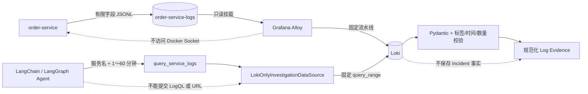

# 结构化日志与 Loki 只读调查数据源

## 1. 目标与边界

本切片让故障实验室把三类订单失败写成有限字段 JSON 日志，再由 Alloy 采集到项目内 Loki。LangChain 的 `query_service_logs` 工具通过固定 LogQL 查询这些日志，并转换成可进入 Evidence Board 的 `EvidenceObservation`。

模型仍只能提供白名单服务名和 1～60 分钟回看窗口，不能提交 LogQL、Loki 地址、文件路径、标签、返回上限或任意解析规则。本切片不调用 LLM，也不改变冻结评测集；持久调查 Worker 在真实变更数据源接入前继续使用冻结证据，避免把现场日志、现场指标和冻结变更混成一轮调查。

## 2. 数据流与信任边界



日志文件、Loki 存储和业务 PostgreSQL 有不同职责。日志与索引是可重建遥测；Incident、调查运行、证据板和审计终态仍只能由业务库持久化。Loki 适配器只读网络响应，不拥有 Shell、Docker Socket、数据库写权限或故障开关权限。

## 3. 结构化日志契约

`order-service` 只在确定性订单失败分支写入事件 `order_request_failed`。共同字段固定为：

| 字段 | 约束 |
| --- | --- |
| `timestamp` | UTC、带时区的 RFC 3339 时间 |
| `event` | 固定为 `order_request_failed` |
| `service` | 固定为 `order-service` |
| `route` | 固定模板 `/orders/{id}`，不记录实际订单号 |
| `status_code` | 固定为 `500` |
| `level` | 固定为 `warning` |
| `fault` | `release_500`、`database_pool_timeout` 或 `redis_unavailable` |

每种故障只增加判断根因所需字段：版本故障记录异常类型和发布版本；连接池故障记录容量及等待数；Redis 故障记录依赖名和有限错误类型。日志不接收任意异常消息，不写实际 `order_id`、密钥、审批令牌或请求正文，防止高基数与敏感数据进入遥测系统。

`structlog` 负责稳定、紧凑且可测试的 JSON 序列化。日志文件生命周期绑定 FastAPI lifespan；进程结束时显式关闭文件。未配置日志路径时仍可运行单元测试和本地 API，但不会伪造 Loki 证据。

## 4. 采集与存储设计

Compose 使用 `grafana/loki:3.7.7` 与 `grafana/alloy:v1.19.2` 固定镜像版本，不使用 `latest`。Grafana 已将 Promtail 标记为弃用并建议迁移 Alloy，因此新项目直接使用 Alloy；`loki.source.file` 为固定项目日志文件维护读取位置。[Loki Docker 安装](https://grafana.com/docs/loki/latest/setup/install/docker/)、[Alloy 文件日志组件](https://grafana.com/docs/alloy/latest/reference/components/loki/loki.source.file/)

没有挂载 Docker Socket。订单服务把 JSONL 写入项目专用命名卷，Alloy 只读挂载该卷并仅采集一个固定路径。这样即使采集器配置失误，也不能通过 Docker API 枚举或控制其他容器。

Alloy 流水线只做三件事：解析 `timestamp`、用应用事件时间覆盖采集时间、删除文件名标签，然后推送到固定 `http://loki:3100/loki/api/v1/push`。Loki 关闭自动 `service_name` 和日志级别发现，避免服务端额外标签破坏严格契约；流标签最终只能是低基数的 `service="order-service"` 与 `source="fault-lab"`。

Loki 数据保存在 `loki-data`，保留期为 24 小时；Alloy 读取位置保存在 `alloy-data`，容器重启后不会重复从文件头采集。删除这些卷不会删除业务事故事实，但会失去对应遥测和读取进度。

## 5. 固定 LogQL 与有界查询

适配器只有一条代码内固定查询：

```logql
{service="order-service",source="fault-lab",service_name=""} |= "\"event\":\"order_request_failed\""
```

`service_name=""` 只选择未被 Loki 自动补充服务标签的新严格流，也隔离本地升级前可能遗留的旧标签流。外部调用只能选择 `order-service` 和 1～60 分钟窗口。适配器固定使用向后排序，单次最多读取 100 条，每行最多 2 KiB；Loki 同时把服务端单次返回上限设为 100 条。

Loki 基础地址只允许本机 `localhost:13100`、`127.0.0.1:13100` 或 Compose 服务 `loki:3100`，禁止 HTTPS 猜测、其他主机或端口、用户信息、路径、查询参数和片段。超时最多 10 秒。

## 6. 响应校验与 Evidence 规范化

HTTP 200 不直接等于可信日志。适配器还会检查：

- 响应必须为 `success + streams`，只接受 Loki 已知的 `stats` 字段，其他未知顶层字段失败关闭；
- 每条流标签必须且只能是固定 `service` 与 `source`；
- 总日志数不能超过 100，纳秒时间戳必须位于请求窗口内且不超过 5 秒未来偏差；
- JSON 日志必须匹配三种精确 Pydantic 联合类型，未知字段、未知故障和超长行全部拒绝；
- Loki 时间与日志内时间差不得超过 1 秒，防止采集时间和事件时间错配；
- 网络失败、非 2xx、无效 JSON、标签漂移或单条坏日志都作为有限错误返回，不能降级成“没有异常”。

通过校验后按故障类型聚合，最多生成三条日志 Evidence。属性保留事件数、首末时间、固定路由、状态码和确定性根因规则所需字段；原始日志行不进入模型上下文。相同纳秒时间与相同原文先去重，证据标识再由来源、故障、观察秒数和规范化属性摘要组成。

## 7. Compose 与安全边界

- Loki 仅加入 `lab` 网络，查询端口只绑定 `127.0.0.1:13100`；
- Loki 使用只读根文件系统，只有 `/loki` 命名卷和 `/tmp` 可写；
- Alloy 固定以 UID/GID `473` 非特权用户运行，移除全部 capabilities 并启用 `no-new-privileges`；
- Alloy 只有配置只读挂载、日志只读挂载和专用位置数据卷，不拥有业务库或 Docker Socket；
- `order-service` 继续以非 root 用户和只读根文件系统运行，只增加专用日志卷；
- 日志与 Loki 没有生产鉴权，只适用于 localhost 与 Compose 私网演练。

Alloy 没有强制只读根文件系统：当前 Docker Desktop 与 Alloy 位置文件的原子写入存在兼容问题。安全边界改由非特权用户、无 capabilities、`no-new-privileges`、只读输入卷和隔离网络共同实现；这项取舍必须在未来升级 Alloy 时重新验证。

## 8. 运行与配置

该切片不需要模型 API Key。启动项目容器并通过 Agent 实际使用的日志工具冒烟：

```powershell
docker compose up -d --build --wait
uv run python -m opsswarm.investigation.loki_smoke --lookback-minutes 15
```

本机默认地址为 `http://127.0.0.1:13100`，可通过 `OPSSWARM_INVESTIGATION_LOKI_BASE_URL` 覆盖；Compose 内未来调查 Worker 使用 `http://loki:3100`。冒烟命令只查询已有故障日志，不自动打开故障开关，也不调用模型。

## 9. 评测隔离与下一步

实时指标、实时日志和真实变更目前分别由三个独立数据源提供无模型工具冒烟。它们不与冻结数据源混用，也不对固定真值计算 Top-1。变更记录实现见 [持久变更记录模拟器与只读调查数据源](39-change-record-simulator-and-investigation.md)；运行时切换前仍需统一现场数据源组合。

当前 JSONL 源文件还没有轮转，只适合低流量、短生命周期的本地故障演练；Loki 的 24 小时保留不会自动缩小源文件，进入持续压测或生产化前必须增加有界轮转。三类现场数据现已齐备，下一步组合日志、指标与变更端口，显式切换持久 Worker，并保留冻结评测命令作为公平对照。

## 10. 面试表达

我没有把 Docker 日志或自由 LogQL 直接交给 Agent，而是让业务服务输出有限字段 JSON 事件，通过不接触 Docker Socket 的 Alloy 文件采集链路进入 Loki。Agent 只能传白名单服务和时间窗；适配器执行固定 LogQL，并对流标签、数量、时间、JSON 联合类型和字段集合做失败关闭校验，最终按三种故障聚合为有限 Evidence。实时工具与冻结评测继续隔离，既能展示真实日志调查，又不会破坏单 Agent、多 Agent 的可重复对照。
