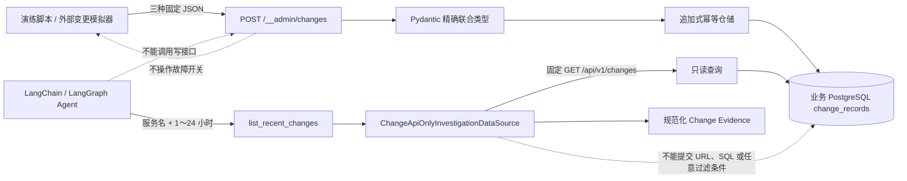

# 持久变更记录模拟器与只读调查数据源

## 1. 目标与边界

本切片补齐现场调查的第三类输入：发布、数据库连接池配置和 Redis 维护记录。独立 `change-service` 负责模拟外部变更平台，把不可变事实追加到业务 PostgreSQL；LangChain 的 `list_recent_changes` 工具通过受限 HTTP 适配器读取并转换为 `EvidenceObservation`。

变更记录不是故障开关，也不是执行审计。写入一条“版本已发布”记录不会自动开启版本故障；真正修改演练环境仍只能经过审批和确定性白名单执行器。本切片不调用模型、不切换持久调查 Worker，也不把现场结果与冻结真值混合评分。

## 2. 数据流与信任边界



服务端写接口和 Agent 查询适配器是两个独立边界。模型只注册 `list_recent_changes`，没有 `POST /__admin/changes`、数据库连接、Shell、Docker Socket 或故障控制权限。

## 3. 三种精确变更契约

| 类型 | 固定或受限字段 | 用途 |
| --- | --- | --- |
| `deployment` | `from_version`、`to_version`、`completed=true` | 与版本异常日志及 5xx 上升对齐 |
| `configuration` | `key=database_pool_size`、严格整数前后值、`completed=true` | 为连接池根因和安全回滚目标提供事实 |
| `dependency_maintenance` | `dependency=redis`、`operation=restart`、`order_release_changed=false` | 区分依赖维护与版本发布 |

共同字段 `external_change_id` 是 1～100 字符的小写安全标识。外部调用不能提交来源、服务名、发生时间、入库时间或任意详情字段：来源固定为 `fault-lab-change-simulator`，服务固定为 `order-service`，两个时间都由服务端 UTC 时钟产生。因此模拟器不能伪造任意历史时间，也不会把未完成变更包装成完成事实。

## 4. 持久化、幂等与并发

`change_records` 独立于 Incident。真实变更通常发生在告警和 Incident 创建之前，因此表不建立 Incident 外键；调查通过 `service_name` 和发生时间窗做相关性分析，进入 Evidence Board 后才与具体调查运行绑定。

表保存 UUID、来源、外部变更号、服务、类型、精确 JSONB、内容 SHA-256、发生与记录时间。数据库约束固定来源、服务、类型、JSON 对象、摘要格式和时间顺序；`(source, external_change_id)` 唯一。

仓储使用 PostgreSQL `INSERT ... ON CONFLICT DO NOTHING`：首次写入返回 `201`；相同编号与相同规范内容返回原记录及 `deduplicated=true`、HTTP `200`；相同编号但内容不同返回 `409`。并发重复由唯一约束收敛为一条记录，不依赖“先查询再插入”。应用不提供更新或删除 API，Alembic 在表中存在记录时拒绝有损降级，服务重启后仍从 PostgreSQL 读取历史。

## 5. 只读查询与失败关闭

`GET /api/v1/changes` 只接受固定 `order-service` 与 1～24 小时回看窗口。服务端使用自身当前时间计算上下界，按发生时间倒序读取，最多返回 100 条并显式给出 `truncated`。调用方不能传任意起止时间、排序、SQL、字段投影或上限。

Agent 适配器进一步限制：

- 地址只能是本机 `127.0.0.1:18002`、`localhost:18002` 或 Compose `change-service:8000`；
- 路径和查询参数由代码固定，关闭系统代理继承，请求超时不超过 10 秒；
- 响应最大 128 KiB，Pydantic 拒绝未知字段和未知变更类型；
- 查询生成时间必须新鲜，记录必须位于请求窗口，入库时间不能异常晚于响应；
- 记录 UUID 或外部编号重复、结果截断、非 2xx、坏 JSON、时间漂移都作为有限错误失败关闭，不能解释成“近期没有变更”。

通过校验后，一条记录对应一条 `change-simulator` Evidence。属性保留现有质疑与计划规则需要的 `change_type`、版本、配置前后值、依赖操作和 `completed`，同时增加外部变更号供审计；不把数据库行或任意原始 JSON 交给模型。

## 6. Compose 与数据库边界

`change-service` 使用共享 `ops-swarm-runtime:local` 镜像，只加入 `control` 网络，通过 `control-migrate` 成功后启动。宿主端口仅绑定 `127.0.0.1:18002`，容器使用只读根文件系统、`/tmp` 临时卷、移除全部 capabilities 并禁止提权。

记录写入既有业务数据库 `opsswarm` 和既有 `control-db-data` 卷，不新增 PostgreSQL 容器或数据卷。这样 Docker Desktop 中能看到一个项目 PostgreSQL 和一个 `change-service` 容器；重启变更服务不会丢记录。当前本地进程仍共用业务数据库账号，最小权限主要由网络与代码边界实现；生产化前必须拆分数据库角色。管理接口也没有生产鉴权，只适用于 localhost 与 Compose 私网故障演练。

## 7. 运行方式

本切片不需要模型 API Key。启动常驻容器后，可写入一条固定变更，再通过 Agent 实际使用的工具查询：

```powershell
docker compose up -d --build --wait

$body = @{
  change_type = "deployment"
  external_change_id = "release-demo-1"
  from_version = "stable"
  to_version = "2026.08.30-rc1"
} | ConvertTo-Json

Invoke-RestMethod `
  -Method Post `
  -Uri http://127.0.0.1:18002/__admin/changes `
  -ContentType application/json `
  -Body $body

uv run python -m opsswarm.investigation.change_smoke --lookback-hours 6
```

相同 `external_change_id` 和内容可安全重放；修改内容后复用编号会收到 `409`。冒烟只读取已持久化记录，不调用模型，也不改变订单服务故障状态。

## 8. 下一步与面试表达

三个独立现场数据源已经齐备，但持久 Worker 仍使用冻结场景。下一切片应实现组合数据源，把日志调用路由到 Loki、指标调用路由到 Prometheus、变更调用路由到变更服务，并通过显式运行配置切换 Worker；冻结数据源继续用于可重复评测，现场调查不对固定真值计算准确率。

面试时可以这样表达：我没有把 Git 平台或数据库查询权限直接交给 Agent，而是先做了一个追加式变更事实边界。外部编号通过 PostgreSQL 唯一约束保证并发幂等，内容摘要阻止编号复用时静默漂移；Agent 只能查询固定服务和有限时间窗，响应还要经过大小、类型、时间和重复校验。变更事实与 Incident 不建立错误的前置外键，而是在调查时按服务与时间关联，进入 Evidence Board 后再绑定具体运行。
