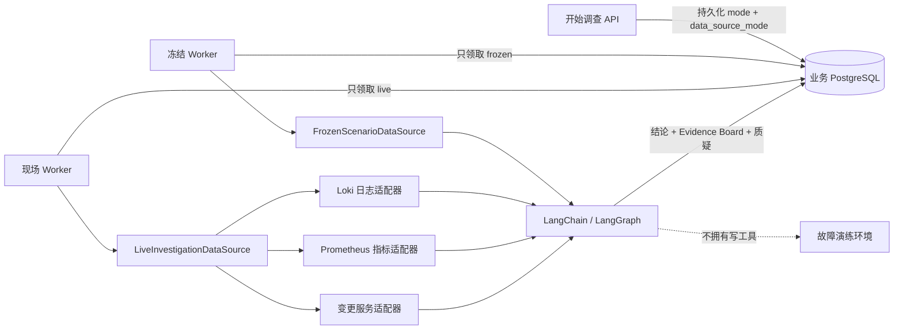

# 统一现场数据源与调查 Worker 安全切换

## 1. 目标与边界

本切片把已经独立可用的 Loki 日志、Prometheus 指标和 PostgreSQL 变更记录组合为一次完整现场调查，并让持久调查任务显式选择冻结评测数据或真实现场数据。API 只负责保存选择，Worker 只领取与自身配置匹配的任务；模型仍只有三个有界只读工具，没有 Shell、SQL、Docker Socket、故障管理接口或处置执行权限。

现场调查不是在线评测。它保存结构化结论、Evidence Board、根因质疑和工具调用数，但没有固定答案，因此不计算 Top-1、证据召回或建议准确率。版本化冻结数据集继续承担单 Agent 与多 Agent 的公平对照。

## 2. 为什么模式必须持久化

只给 Worker 增加一个环境变量会产生恢复歧义：任务由冻结 Worker 创建后，可能在重试时被现场 Worker 领取；LangGraph checkpoint 也可能使用另一套数据继续执行。这样同一个运行的证据来源会随部署变化，既不可审计，也无法解释评测结果。

因此 `investigation_runs.data_source_mode` 是业务运行的一部分：

| 值 | 语义 | 评分 |
| --- | --- | --- |
| `frozen` | 使用版本化、可重复的冻结场景 | 成功时保存完整 `metrics` |
| `live` | 使用当前 Loki、Prometheus 和变更记录 | `metrics=null`，工具调用数保存在 `result` |

API 默认写入 `frozen`，保持现有客户端和持续集成行为不变。Alembic `0020_investigation_data_mode` 为历史运行回填 `frozen`，随后移除数据库服务端默认值，要求新运行由应用显式声明。存在现场运行时降级会拒绝删除字段，避免静默丢失审计语义。后续 `0021_investigation_metric_scope` 在数据库层强制冻结成功运行必须有指标、现场成功运行必须没有冻结指标。

## 3. 数据流与隔离



`LiveInvestigationDataSource` 只做类型到适配器的一一委托：

- `query_logs` 固定进入 Loki 适配器；
- `query_metrics` 固定进入 Prometheus 适配器；
- `list_recent_changes` 固定进入变更服务适配器。

组合器不捕获错误并回退到冻结数据，也不把某个来源失败解释成空证据。任一适配器的地址、响应大小、时间、新鲜度、类型或截断校验失败都会向上形成有限错误，任务按既有租约和退避规则重试。这样一次调查要么使用完整现场边界，要么明确失败，不会生成真假混合的 Evidence Board。

## 4. Worker 领取与恢复规则

`OPSSWARM_WORKER_DATA_SOURCE_MODE` 控制一个 Worker 实例负责的工作池，默认 `frozen`。领取查询连接 `work_items` 与 `investigation_runs`，只对匹配的 `data_source_mode` 执行 `FOR UPDATE SKIP LOCKED`。`ProcessorContext` 再携带持久模式，单 Agent 和多 Agent 处理器都会在调用模型或访问 checkpoint 前复核。

这形成三层保护：

1. API 与 Pydantic 只接受 `frozen`、`live`；
2. PostgreSQL 检查约束拒绝其他值，任务创建与运行模式同事务提交；
3. Worker 领取过滤与处理器路由再次校验，配置错误不会消费另一工作池任务。

多 Agent 仍使用稳定 `graph_thread_id` 查询 checkpoint。数据源模式来自业务运行而不是 checkpoint 内容；只有同模式 Worker 能领取恢复任务，所以 pending writes 不会与另一套证据继续合并。

## 5. 运行指标与评测指标分离

`InvestigationRunResult.tool_call_count` 描述本次运行实际调用多少次工具，对冻结和现场都有意义。`InvestigationMetrics` 中的 Top-1、证据召回、建议准确率和安全违规率必须依赖版本化真值，只能在处理器收到明确 `InvestigationScenario` 时计算。

现场处理器把评测场景设为 `None`，仓储允许成功运行保存 `metrics=null`。这不是“没有采集”，而是“该类准确率在现场没有定义”。PostgreSQL 检查约束同时拒绝现场运行携带指标和冻结成功运行遗漏指标。作战室返回并展示数据源模式，让值班工程师不会把现场结论误读为冻结基准分数。

## 6. 单 Agent 收敛护栏

真实现场冒烟发现，兼容模型首轮已经并行取得日志、指标和变更，后续却重复调用相同工具，最终触发 LangGraph 递归限制。直接提高递归上限只会增加延迟和费用，不能保证收敛。

本切片保留 LangChain 高层 Agent 和 `ToolStrategy(InvestigationConclusion)`，同时增加确定性策略：

1. `EvidenceCollector` 线程安全地记录已完成工具名、证据和调用次数；
2. 三个必需工具全部完成后，`wrap_model_call` 中间件把下一轮可用工具收窄为空调查工具集合；
3. 结构化响应工具仍由 `ToolStrategy` 提供，并使用 `tool_choice=required` 强制模型提交结论；
4. 调查工具默认最多调用 6 次，递归限制继续作为第二道终止边界；
5. 最终结论仍必须通过 Pydantic 和实际证据 ID 集合校验。

该护栏不替模型判断根因，只控制何时停止读取。冻结假模型测试验证首轮能看到三个调查工具，证据齐备后的下一轮只看到 `InvestigationConclusion`。

## 7. API 与作战室可观测性

开始调查请求新增可选字段：

```json
{
  "expected_version": 1,
  "actor_id": "engineer-001",
  "reason": "使用真实现场证据调查",
  "mode": "single_agent",
  "data_source_mode": "live"
}
```

创建响应、调查详情和作战室调查摘要都会返回 `data_source_mode`。Vue 作战室把它显示为“冻结基准”或“真实现场”，并与 Agent 模式、模型名分开表达。非法值返回统一 `422`；运行创建后没有修改模式的 API。

## 8. 本地运行

`.env` 中保存模型配置，真实文件不提交。Worker 配置也可以放入同一文件：

```dotenv
OPSSWARM_WORKER_DATA_SOURCE_MODE=live
```

先启动本项目 Compose，再初始化独立 checkpoint 数据库：

```powershell
docker compose up -d --build --wait
uv run python -m opsswarm.checkpoints.setup
```

不调用模型的三工具冒烟：

```powershell
uv run python -m opsswarm.investigation.live_smoke
```

控制面创建 `data_source_mode=live` 任务后，显式运行现场 Worker：

```powershell
$env:OPSSWARM_WORKER_DATA_SOURCE_MODE = "live"
uv run python -m opsswarm.worker.main
```

故障注入必须由本地演练步骤显式完成，并在验证后恢复安全默认值。现场 Worker 不会自行打开或关闭故障。

## 9. 验收结果

真实 Compose 冒烟制造 `release_500` 后，统一数据源取得 8 条日志聚合、5xx 比例 `0.0 → 1.0` 的指标证据、与日志版本一致的发布记录，工具调用数为 3。故障随后关闭，项目容器重新确认健康。

真实模型持久任务第一次暴露重复工具调用问题；加入收敛护栏后，同一任务通过既有重试在第 3 次尝试成功。最终结果使用 `deepseek-v4-flash`，根因为 `release_500_regression`，建议为 `rollback_release`，工具调用数为 3，Evidence Board 保存 6 条现场证据，确定性质疑状态为 `supported`，并且 `metrics` 保持空值。

自动化质量门禁结果：Ruff、308 个文件格式检查、mypy 133 个源码文件和 452 个后端测试全部通过；前端类型检查、7 个测试文件中的 14 个测试和生产构建通过。前端首次并行全量运行出现两个 JSDOM 启动超时，原样重跑通过，未通过放宽超时掩盖问题。

## 10. 限制与下一步

- 调查 Worker 已在后续切片部署为冻结与现场两个常驻工作池，详见 [工作池设计](42-persistent-investigation-worker-pools.md)。
- 后续切片已增加逐次尝试审计、模型 Token、费用和耗时，并在作战室展示，详见 [调查尝试审计](43-investigation-attempt-audit.md) 与 [尝试历史界面](44-investigation-attempt-workroom.md)。
- 单 Agent 的工具集合当前固定为三类；增加新工具时必须同步更新“证据齐备”策略，不能仅注册工具后假设中间件自动理解。
- 现场变更查询会返回时间窗内多种记录，由确定性质疑规则判断支持、反驳或上下文；后续可增加 Incident 起始时间关联，但不能让模型提交任意时间范围。
- OpenTelemetry 跨进程 trace 与常驻调查 Worker 均已在后续切片实现；长任务租约续期尚未引入。
- 后续 [GitHub 只读变更数据源](45-github-readonly-change-source.md) 已复用固定目标、有限响应和 Evidence 规范化边界，并保留模拟器为默认来源。

## 11. 面试表达

我没有用一个环境变量临时替换 Agent 数据源，而是把 `frozen/live` 作为调查运行事实写入 PostgreSQL，并让两个 Worker 工作池只领取匹配任务，所以重试和 LangGraph 恢复不会换证据。现场组合器严格委托 Loki、Prometheus 和变更服务，任一来源失败都重试，不回退到冻结数据；现场没有真值，因此只保存工具统计，不伪造准确率。真实模型测试还发现它在证据齐备后重复查询，我用 LangChain 中间件把下一轮工具收窄为结构化结论，而不是提高递归上限。这样既展示了 LangChain/LangGraph，又把可靠性、成本和可审计性放在框架炫技之前。
