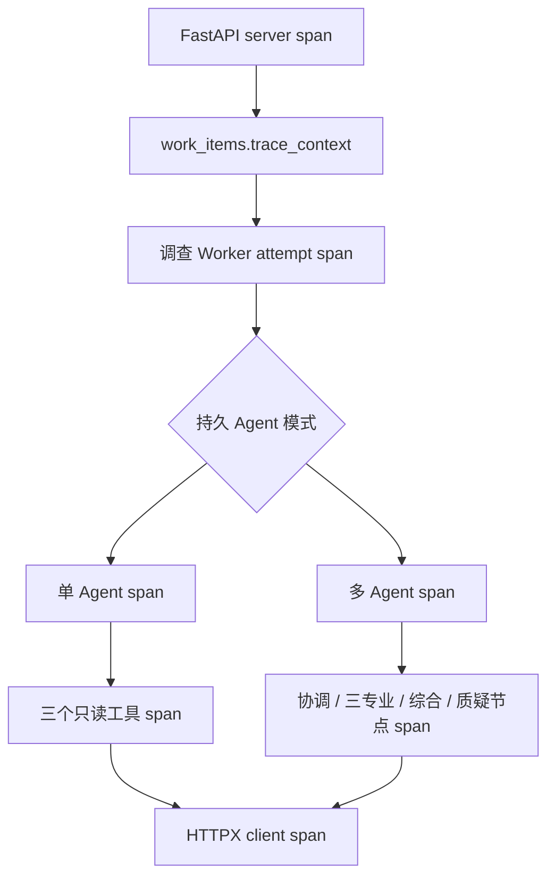

# OpenTelemetry 跨进程调查追踪

## 1. 目标与边界

本切片把一次“开始调查”从 HTTP 请求到 Worker、Agent 节点和只读工具请求串成可查询的 trace，主要回答三个问题：任务在哪里等待、某次重试在哪里失败、模型与外部只读工具分别消耗了多少时间。

OpenTelemetry 只提供运行诊断，不改变业务事实：Incident、任务租约、Evidence Board、审批和执行审计仍以 PostgreSQL 为准。Jaeger 使用本地内存存储，重启丢失 trace 不影响事故恢复。当前不接 OpenTelemetry logs 或 metrics；日志继续进入 Loki，业务指标继续由 Prometheus 保存。

## 2. 组件选择

- OpenTelemetry Python API/SDK 负责显式 span、采样和批量导出。
- FastAPI instrumentation 创建服务端请求 span，健康检查被排除。
- HTTPX instrumentation 创建模型接口、Loki、Prometheus 和变更服务的客户端 span。
- OTLP/HTTP exporter 只允许访问本机或 Compose 内 `jaeger:4318/v1/traces`。
- Jaeger 2.20 all-in-one 提供本地 OTLP 接收、内存存储和 Web UI。

官方建议优先使用 OTLP 并通过 Collector 或兼容后端导出；Jaeger 2.x all-in-one 原生接受 OTLP/HTTP，适合本地轻量演练。[OpenTelemetry Python Exporters](https://opentelemetry.io/docs/languages/python/exporters/)、[Jaeger 2.20 Getting Started](https://www.jaegertracing.io/docs/2.20/getting-started/)

## 3. Trace 结构



Span 只使用稳定低风险属性：`run_id`、`work_item_id`、Agent 模式、数据源模式、尝试次数、工具名、证据数量和稳定异常类型。禁止记录 API key、Authorization、提示词、模型响应、原始日志、证据详情、审批内容和任意异常消息。

控制面在追踪开启时返回 `X-Trace-ID`。值班工程师可以直接按该 ID 查 Jaeger，也可以按 Worker span 上的 `run_id` 搜索。该响应头不参与授权、状态迁移或幂等判断。

## 4. PostgreSQL 队列传播

HTTP 请求和 Worker 不在同一进程，也不保证同时存活，因此仅靠进程内 context variable 无法关联。开始调查事务从当前有效 server span 提取 W3C Trace Context，并写入：

```json
{
  "traceparent": "00-0123456789abcdef0123456789abcdef-0123456789abcdef-01",
  "tracestate": null
}
```

物理字段为 `work_items.trace_context JSONB NULL`。Pydantic 限制键集合、长度和 `traceparent` 格式，数据库限制非空值必须是 JSON 对象。只使用 `TraceContextTextMapPropagator`，明确不保存 baggage。

Worker 领取任务后把该上下文作为 `CONSUMER` span 的远端父节点。若追踪关闭或历史任务字段为空，Worker 创建独立根 trace；业务处理方式不变。任务重试始终读取同一父上下文，因此每次尝试成为同一 API span 下的兄弟 span，既能看到完整链路，也不会把不同尝试错误合并为一次。

## 5. 配置与失败策略

| 变量 | 默认值 | 约束 |
| --- | --- | --- |
| `OPSSWARM_OTEL_ENABLED` | `false` | 必须显式开启 |
| `OPSSWARM_OTEL_TRACES_ENDPOINT` | `http://127.0.0.1:14318/v1/traces` | 只允许本机或 Compose Jaeger |
| `OPSSWARM_OTEL_SAMPLE_RATIO` | `1` | `0～1`，继承父采样决定 |
| `OPSSWARM_OTEL_EXPORT_TIMEOUT_SECONDS` | `2` | 大于 0 且最多 10 秒 |

生产运行使用 `BatchSpanProcessor`，导出在后台批量进行。Jaeger 暂时不可用不会回滚业务事务或把调查标为失败；进程关闭时尽力刷新。配置不合法则启动失败，避免把事故元数据意外发送到外部地址。

## 6. 本地验收

```powershell
docker compose up -d jaeger
uv run python -m opsswarm.observability.smoke
```

Jaeger UI：`http://127.0.0.1:16686`。冒烟服务名为 `opsswarm-observability-smoke`，只产生一个不含业务内容的 span。

自动化测试分别验证：地址白名单、W3C 上下文往返、错误消息不进入 span、FastAPI 响应头与任务上下文一致、真实 PostgreSQL 持久化、Worker 父子关系、只读工具 span 和 LangGraph 六类节点 span。迁移必须继续通过真实 PostgreSQL 的升级、降级和 ORM 一致性检查。

## 7. 当前限制与下一步

- Jaeger 使用内存存储，只适合本地演练；当前不承诺 trace 长期保留。
- 调查 Worker 已在后续切片形成冻结与现场两个可优雅停机的常驻工作池，详见 [工作池设计](42-persistent-investigation-worker-pools.md)。
- 当前只贯通调查队列；审批、执行和恢复验证的异步传播将在有明确诊断需求时扩展，不能一次把所有表变成遥测载体。
- 模型 Token 与成本仍是评测业务事实，不从 HTTP span 推断。
- 下一步优先建立每次调查尝试的业务历史和模型遥测，不从 trace 反推 Token 与费用。

## 8. 面试表达

> 我没有把 trace 只停留在 FastAPI 自动埋点。调查任务跨进程、可重试，所以我把最小 W3C Trace Context 与任务一起持久化，Worker 每次尝试恢复远端父节点，再用显式 span 标记 Agent 节点和受限工具。Jaeger 故障不会影响业务事务，trace 也不替代 PostgreSQL 审计；同时用地址白名单和属性白名单避免把提示词、密钥或原始证据发到外部平台。
