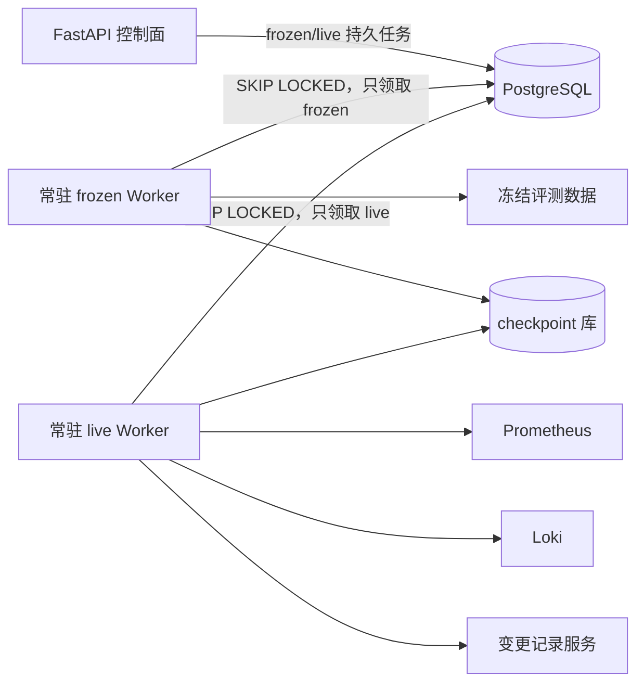

# 冻结与现场常驻调查工作池

## 1. 目标与边界

调查任务已经通过 PostgreSQL 持久化，但此前仍需要人工重复执行单次 Worker 命令。本切片将冻结数据与现场数据部署为两个常驻 Compose 工作池，使 API 投递后无需人工触发即可被对应工作池领取。

本步不改变任务的至少一次语义，不引入 Redis/Celery，不开放任意 Shell，也不让 Worker 自动注入或恢复故障。

## 2. 运行结构



`investigation-worker-frozen` 只连接控制网络，无法直访演练遥测服务。`investigation-worker-live` 同时连接控制与演练网络，只通过固定只读适配器访问 Prometheus、Loki 和变更服务。两者都没有 Docker Socket，也没有任意环境写权限。

## 3. 轮询与优雅停机

Worker 完成一个任务后立即尝试领取下一个；没有任务时按默认 1 秒低频轮询。空闲等待由 `asyncio.Event` 中断，不需要等完整轮询周期才退出。

收到 `SIGTERM` 或 `SIGINT` 时：

1. 停止下一次任务领取。
2. 若当前没有任务，立即释放 checkpoint、数据库和 trace 资源。
3. 若已领取任务，允许它完成成功或失败结算，再退出循环。

Compose 的 `stop_grace_period` 为 2 分钟，默认处理硬超时为 100 秒，租约为 120 秒，保证：

```text
处理超时 < 租约 <= 容器停机宽限
```

处理超时会取消当前协程，并通过原有失败结算进入指数退避重试，不会让任务占用到租约到期。当前 Agent 调查上限足以覆盖本地演练；若未来出现更长任务，需另行设计带令牌的租约续期，不盲目放大固定租约。

## 4. 配置护栏

| 环境变量 | 默认值 | 约束 |
| --- | --- | --- |
| `OPSSWARM_WORKER_POLL_INTERVAL_SECONDS` | `1` | `0.1～60` |
| `OPSSWARM_WORKER_LEASE_DURATION_SECONDS` | `120` | `10～1800` |
| `OPSSWARM_WORKER_PROCESSING_TIMEOUT_SECONDS` | `100` | `1～1790` 且必须小于租约 |
| `OPSSWARM_WORKER_BASE_RETRY_DELAY_SECONDS` | `5` | `0～3600` |
| `OPSSWARM_WORKER_MAX_RETRY_DELAY_SECONDS` | `300` | 不小于基础退避 |

入口默认是常驻模式，`--once` 仅作为运维诊断，用于至多领取一个任务后退出。现场模式不会因为一个数据源失败而静默回退到冻结数据。

## 5. Compose 安全边界

两个 Worker 复用同一运行镜像，但通过不同数据源模式和网络连接拆分权限。容器统一使用只读根文件系统、`tmpfs /tmp`、移除全部 Linux capabilities 和 `no-new-privileges`。业务库迁移必须成功后才启动；现场工作池还要求三个只读数据源健康。Jaeger 不作为启动依赖，因为 trace 不能阻塞业务。

## 6. 测试与验收

- 纯单元测试验证默认守护模式、`--once`、无效时间窗口和空闲停机。
- 真实 PostgreSQL 集成测试验证停止信号到达后当前任务仍原子提交。
- 真实 PostgreSQL 集成测试验证硬超时保存稳定错误分类，并返回 `pending/queued` 等待重试。
- `docker compose config --quiet` 验证配置，实际启动后两个工作池应保持运行且不会在无任务时调用模型。

## 7. 当前限制与下一步

- 执行中任务尚未续租；当前使用硬超时严格小于租约的有界模型。
- 后续切片已建立调查尝试历史，详见 [调查尝试审计与模型成本](43-investigation-attempt-audit.md)。
- 后续作战室已展示尝试历史与费用完整性，详见 [作战室调查尝试与成本展示](44-investigation-attempt-workroom.md)；未来再基于真实数据决定是否需要租约续期或增加工作池并发度。

## 8. 面试表达

> 我把调查 Worker 部署为冻结与现场两个常驻工作池，让数据源模式成为持久业务路由，而不是进程的隐式假设。空闲轮询可中断，停机时不再领新任务，但结算已领任务；同时保证处理超时小于租约、租约不超过容器宽限，使重试和接管语义可解释。
