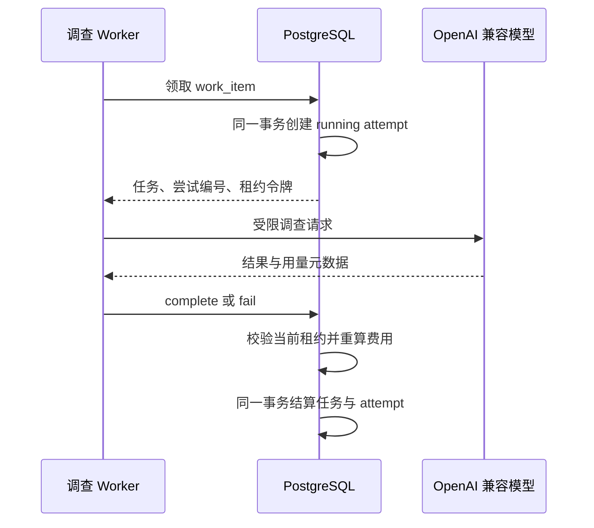
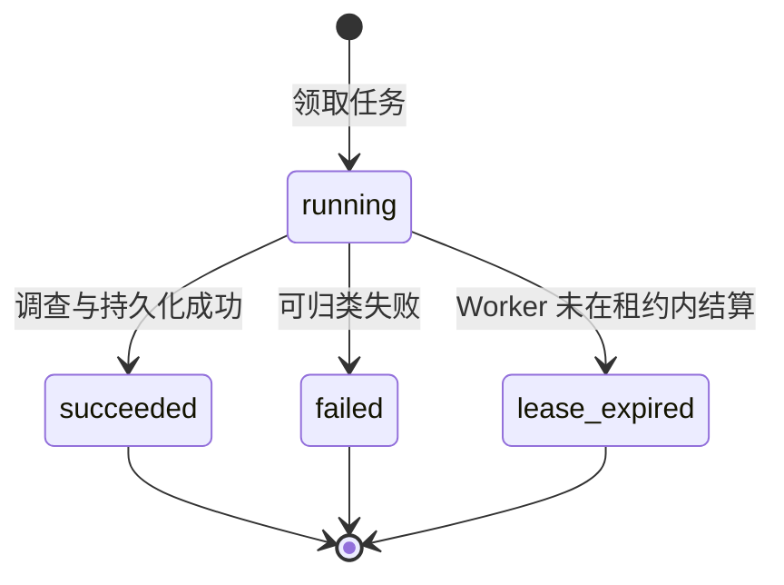

# 调查尝试审计与模型成本

## 1. 目标与边界

持久任务表描述“现在应该由谁处理”，但不能完整回答一次调查经历过多少次领取、每次为什么失败、实际用了多少 Token。日志和 trace 适合诊断，不应成为成本和重试历史的唯一事实来源。

本切片为每次 Worker 租约建立一条独立、可结算的 `investigation_attempts` 记录，保存耗时、结果、错误、模型请求数、Token 和价格快照。它不改变任务队列的至少一次语义，不调用额外模型，也不把内部租约令牌暴露给 API。

## 2. 事务边界



- 领取任务和创建 `running` 尝试在同一事务完成，不产生“任务已领取但没有审计行”的正常状态。
- 成功或失败结算会锁定当前任务和对应尝试，校验租约令牌后在同一事务写入终态。
- Worker 崩溃无法上报用量时，下一次领取先将旧尝试结算为 `lease_expired`，再创建新尝试。
- 过期尝试不猜测模型用量和费用；它明确保存为未知，而不是错误地记录为零成本。

## 3. 状态模型



`failed` 和 `lease_expired` 的 `will_retry` 说明任务是否仍会重试；尝试本身一旦结算便不再回到 `running`。任务的多次重试对应多条历史记录，不覆盖前一次结果。

## 4. 数据模型

`investigation_attempts` 的关键字段分为五组：

| 分组 | 字段 | 作用 |
| --- | --- | --- |
| 关联 | `investigation_run_id`、`work_item_id`、`attempt_number` | 定位调查和任务内第几次尝试 |
| 租约 | `lease_token`、`worker_id`、`started_at`、`lease_expires_at` | 防止旧 Worker 结算新租约；令牌只在内部使用 |
| 结果 | `status`、`finished_at`、`duration_ms`、`will_retry` | 保存不可变的尝试结论 |
| 模型 | `model_name`、输入/输出价格快照 | 保留当时成本计算依据，避免以后改价重写历史 |
| 用量与错误 | 请求数、Token、`usage_complete`、估算费用、错误码与安全摘要 | 支持成本、稳定性和容量分析 |

数据库检查约束保证 Token 总数可重算、价格必须成对出现、运行中记录没有终态字段、成功记录没有错误、失败记录必须有错误，以及未完整观测用量时费用必须为空。

## 5. 用量与费用语义

Worker 通过 LangChain 回调观察每个模型请求，并以一次租约为统计窗口。超时后的迟到回调会被丢弃，不能污染随后尝试。模型请求部分成功、部分失败时，已经观察到的 Token 仍然保留，但 `usage_complete=false`。

费用只在以下条件同时成立时计算：

1. 本次所有已发出的模型请求都有可靠用量元数据。
2. 输入和输出每百万 Token 价格均已配置。
3. 任务结算事务能够重新使用数据库中的价格快照与 Token 重算结果。

计算公式为：

```text
输入费用 = input_tokens × input_cost_per_million_usd / 1_000_000
输出费用 = output_tokens × output_cost_per_million_usd / 1_000_000
估算费用 = 输入费用 + 输出费用
```

结果按美元小数点后 6 位保存。Worker 提交的估算费用不是可信事实，仓储层会基于已持久化的价格快照重新计算并拒绝不一致值。

价格优先读取 `LLM_INPUT_COST_PER_MILLION_USD` 与 `LLM_OUTPUT_COST_PER_MILLION_USD`；未单独配置时兼容复用现有评测价格。两项必须同时存在，密钥和价格仍只从本地环境变量读取。

## 6. 只读接口

```http
GET /api/v1/investigations/{run_id}/attempts
```

接口按 `attempt_number` 返回该调查的全部尝试，包括结果、持续时间、价格快照、用量完整性、Token、估算费用和安全错误摘要。不存在的调查返回 `404`。响应不包含 `lease_token`，避免把内部并发控制能力暴露到控制面客户端。

## 7. 安全与可观测性边界

- 尝试记录是业务审计事实，trace 用于跨组件诊断，两者可以通过调查与任务标识关联，但不能互相替代。
- 模型回调只收集计数和供应商返回的用量元数据，不记录提示词、响应正文或 API Key。
- 费用是根据配置单价得到的估算值，不作为供应商账单；`usage_complete` 使 UI 和评测能够区分完整统计与部分观测。
- API 只读，任务领取和尝试结算仍只允许受控 Worker 通过内部仓储完成。

## 8. 测试与验收

- 纯单元测试验证并行请求累计、迟到回调隔离、部分用量和费用计算。
- 真实 PostgreSQL 集成测试验证领取与尝试同事务、成功/失败/过期结算、多次重试历史、费用重算和伪造费用回滚。
- API 测试验证顺序、字段语义、内部令牌隐藏和不存在调查的 `404`。
- 迁移测试验证升级、降级和 ORM 元数据无漂移。
- Compose 验收验证两个常驻工作池升级后保持健康；没有待处理任务时不会调用真实模型。

## 9. 当前限制与下一步

- 费用依赖供应商返回标准用量元数据；缺失时会明确标记不完整，不做启发式估算。
- 当前没有在前端展示尝试历史，下一步在 Incident 作战室增加“调查尝试”区域，明确区分失败、租约过期和成本未知。
- 尝试级指标尚未聚合为评测面板统计；应先积累真实记录，再决定成本告警和并发容量阈值。

## 10. 面试表达

> 我没有只依赖日志统计 Agent 成本，而是让每次 PostgreSQL 租约领取都在同一事务创建独立尝试记录。成功、失败和租约过期都有明确终态；Token 不完整时费用为空，完整时由仓储基于价格快照重算，避免 Worker 伪造或后续改价污染历史。这使重试、成本和可靠性成为可查询、可恢复的业务事实。
