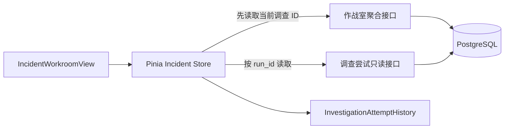

# 作战室调查尝试与成本展示

## 1. 目标与边界

本切片把已持久化的调查尝试历史展示到 Incident 作战室，让值班工程师直接看见 Worker 是否领取任务、是否重试、每次耗时、模型用量是否完整以及费用能否可靠计算。

页面继续保持只读，不提供重试、取消、审批或执行按钮，不读取内部租约令牌，也不直接访问模型供应商。所有内容都来自控制面已经公开的安全摘要接口；本切片不调用真实模型。

## 2. 数据流与架构边界

尝试历史没有加入原来的 `GET /api/v1/incidents/{id}/workroom` 聚合响应：

- 六阶段投影继续负责同一语句级快照中的当前调查、证据、计划、审批、执行和验证摘要。
- 尝试是数量可增长、变化频率更高的运行明细，使用 `GET /api/v1/investigations/{run_id}/attempts` 独立读取。
- 前端只能使用作战室返回的当前 `run_id` 查询，不能自行选择另一个调查并把结果拼到当前 Incident。
- 后续如果尝试很多，应在明细接口增加游标分页，而不是让核心作战室投影无限膨胀。

## 3. 前端状态与竞态控制

Pinia 分别保存尝试列表、加载状态和错误状态。选择 Incident 或点击原有“同步”按钮时，数据按以下顺序更新：

1. 读取当前 Incident 的作战室快照。
2. 快照没有调查时清空尝试状态。
3. 快照出现新的调查运行时，先清空旧运行的尝试，再按新 `run_id` 请求历史。
4. 响应返回后同时核对选择代次、作战室请求代次、Incident ID 和调查运行 ID。
5. 任一标识已经变化就丢弃迟到响应，不能把旧事故或旧调查的成本显示到当前页面。

尝试接口失败不会抹掉已成功读取的六阶段投影，两类错误独立展示。SSE 收到新的 Incident 状态事件时仍走完整同步；尝试内部变化尚无专用领域事件，因此运行中页面可用“同步”按钮主动更新。这一限制不会被伪装成实时推送。

## 4. 展示语义

每次尝试卡片展示：

- 尝试序号、中文状态、Worker 标识、模型名、开始时间和持续时间。
- 模型请求数、输入 Token、输出 Token、总 Token 和估算费用。
- 有限错误码、安全错误摘要和是否继续重试。
- 运行中、用量不完整、价格未配置三种不同的费用未知原因。

状态映射固定为：

| 业务状态 | 页面文案 | 含义 |
| --- | --- | --- |
| `running` | 进行中 | Worker 当前持有有效租约，Token 尚未结算 |
| `succeeded` | 成功 | 本次调查结果与尝试已原子结算 |
| `failed` | 失败 | 已保存稳定失败分类，并显示是否重试 |
| `lease_expired` | 租约过期 | Worker 未能结算，由后续领取者收敛 |

费用字段不能只看是否为 `null`：

- `usage_complete=false` 显示“用量不完整”，不显示 `$0`。
- 用量完整但没有价格快照时显示“未配置价格”。
- 只有 `estimated_cost_usd` 存在时才格式化为 6 位小数美元金额。

## 5. 响应式与可访问性

- 尝试历史使用有序列表，卡片顺序与服务端 `attempt_number` 一致。
- 状态同时使用中文文本和颜色；错误使用结构化错误码与消息，不只依赖红色。
- 加载状态使用 `aria-live`，接口错误使用 `role="alert"`，用量缺失说明使用 `role="note"`。
- 宽屏自动排列多张尝试卡片；窄屏改为单列，指标在手机宽度下保持两列，避免横向滚动。

## 6. 测试与验收

- API 客户端测试验证调查运行 ID 编码和只读路径。
- Pinia 测试验证当前运行加载、手工同步，以及旧运行响应迟到时不会覆盖新运行。
- 组件测试验证失败重试、部分用量、错误摘要、成功费用和空状态。
- TypeScript 类型检查、Vitest 全量测试和 Vite 生产构建作为前端交付门禁。
- 后端回归测试确保新增前端没有改变控制面与数据库契约。

## 7. 当前限制与下一步

- 尝试变化尚无专用 SSE 事件，运行中更新依赖原有同步按钮或 Incident 状态事件。
- 当前显示当前调查的全部尝试，尚未分页；默认最大尝试次数很小，因此 MVP 数据量有界。
- 页面继续只用于 localhost 故障演练，没有身份认证和写操作权限。
- 下一步在真实 GitHub、GitLab 或 MCP 中选择一个只读变更来源，复用固定目标、有限响应和 Evidence 规范化边界。

## 8. 面试表达

> 我没有把高频增长的尝试数组塞进作战室核心聚合，而是先读取当前调查 ID，再查询独立审计接口。Pinia 用 Incident、run ID 和两级 generation 丢弃迟到响应。UI 还显式区分用量不完整、价格未配置和真实零费用，避免把供应商遥测缺失误导成免费调用。
