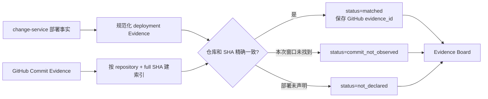

# 部署版本与 GitHub Commit 确定性关联

## 1. 目标与业务价值

GitHub 中“最近有提交”只能说明代码发生变化，不能证明某个提交已经部署到 `order-service`。如果 Agent 把任意 Commit 自动当成线上发布，会产生错误时间线和误判根因。本切片让部署事实显式保存代码仓库与完整 Commit SHA，并在本地部署记录和 GitHub Commit Evidence 精确一致时建立可审计关联。

这一步不增加 Agent 工具、不调用模型、不读取 diff，也不让 GitHub 令牌获得写权限。模型仍只看到三个只读工具返回的规范化 Evidence；关联结论完全由本地确定性代码生成。

## 2. 部署代码引用契约

发布记录新增可选的结构化字段：

```json
{
  "change_type": "deployment",
  "external_change_id": "release-main-001",
  "from_version": "stable",
  "to_version": "2026.01.01-rc1",
  "code_reference": {
    "repository": "kill-t/ops-swarm",
    "commit_sha": "完整的小写十六进制 Commit SHA"
  },
  "completed": true
}
```

约束如下：

- `repository` 必须是有限的 `owner/repo`，不能是 URL、相对路径、查询或动态仓库表达式；
- `commit_sha` 必须是 40～64 位完整小写十六进制值，不接受容易碰撞的短 SHA；
- 仓库和 SHA 被封装为同一个 `code_reference`，不能只提交其中一个；
- 来源、服务、时间和完成状态仍由变更服务固定，调用方不能回填；
- 非部署类型不能携带 `code_reference`。

字段对历史记录保持可选，因为已经持久化的演练发布发生在建立代码来源契约之前，不能伪造 SHA 回填。新部署系统应始终提交该字段；没有声明的旧记录会明确标记为 `not_declared`。

## 3. 持久化与向后兼容

`change_records.details` 已经是不可变 JSONB，并由规范内容 SHA-256、外部编号唯一约束和只追加仓储保护，因此不再创建一张与部署记录重复的新表。服务名来自行级 `service_name`，版本和代码引用位于同一份部署详情中，已经形成：

```text
service_name + from_version + to_version + repository + commit_sha
```

Alembic `0024_deployment_code_reference` 为现有表增加数据库 CHECK：只要 `code_reference` 出现，就必须是包含合法仓库和完整 SHA 的 JSON 对象；非部署记录禁止携带。迁移不改写旧数据，降级只移除额外约束，不删除任何业务事实。

Pydantic 模型新增可选字段后，内容摘要对空值使用 `exclude_none`。这保证没有代码引用的历史部署继续得到升级前完全相同的摘要，仓储读取不会把合法旧记录误报为篡改；带代码引用的新记录则得到不同摘要，相同外部编号不能偷偷更换 Commit。

## 4. 确定性关联流程



部署 Evidence 使用四种明确状态：

| 状态 | 含义 |
| --- | --- |
| `not_declared` | 历史部署没有代码引用，不能猜测 Commit |
| `declared` | 模拟器已返回合法引用，但尚未与 GitHub 组合 |
| `matched` | 同一调查时间窗内存在仓库和完整 SHA 都相同的 GitHub Commit Evidence |
| `commit_not_observed` | 部署声明了引用，但当前 GitHub 时间窗没有观察到该 Commit |

`commit_not_observed` 不等于 Commit 不存在，可能只是提交早于回看窗口；因此系统不会把它标成伪造或自动否定部署。相同仓库与 SHA 如果对应多条 GitHub Evidence，则组合器失败关闭，拒绝建立有歧义的关系。

匹配成功后只在部署 Evidence 中增加 `github_commit_evidence_id`，不修改原始 GitHub Evidence，也不创建新的模型事实。确定性根因质疑仍把已经完成的部署记录作为发布事实；普通 GitHub Commit 仍只是上下文，避免“代码提交”等同于“线上发布”。

## 5. 安全与架构边界

- `POST /__admin/changes` 仍是本地故障演练管理接口，不暴露给 Agent；
- GitHub 适配器仍只有固定仓库的两个 GET，不调用部署、Actions 或写接口；
- Commit 标题等文本继续视为不可信数据，匹配只使用经过格式校验的仓库和 SHA；
- 模型不能声明 `matched`，状态由组合器重新计算；
- Evidence Board 保存关联后的有限属性，原始响应和令牌不入库；
- 真实生产接入时，`code_reference` 应由 CI/CD 或部署平台身份写入，而不是由 LLM 生成。

## 6. 测试边界

自动测试覆盖：

1. 老部署摘要在模型升级后保持不变；
2. 仓库、完整 SHA 和嵌套字段的 Pydantic 拒绝路径；
3. API 与 PostgreSQL 往返保存代码引用，幂等内容漂移仍返回冲突；
4. 绕过应用写入非法 SHA 时数据库 CHECK 拒绝；
5. 同仓库同 SHA 精确匹配，仓库不同或提交缺失不匹配；
6. 重复 GitHub 代码引用失败关闭；
7. Alembic 元数据一致、全量降级和重新升级。

## 7. 限制与下一步

- 当前只有固定 `order-service` 和一个配置仓库，还没有服务目录或多环境部署目录。
- 代码引用由本地管理接口显式写入，尚未由 CI/CD webhook 自动生成。
- 当前关联 Commit，不读取构建产物 digest、容器镜像 digest 或软件物料清单。
- `commit_not_observed` 不会额外扩大 GitHub 时间窗，避免模型或输入触发无界查询。
- 下一步可以在作战室 Evidence Board 展示部署来源状态，或先建立受限的部署事件摄取接口；两者都不应增加模型写权限。

## 8. 面试表达

我把“代码提交”和“实际部署”建模为两个独立事实，只有部署记录声明的仓库与完整 Commit SHA 和 GitHub Evidence 精确相等时才建立关联。映射保存在既有不可变 JSONB 中，避免重复表；数据库 CHECK、内容摘要和并发幂等共同保护。旧部署没有 SHA 时明确保持 `not_declared`，不伪造回填。这样 Agent 得到的是可审计的软件来源证据，而不是根据提交时间猜测部署。
