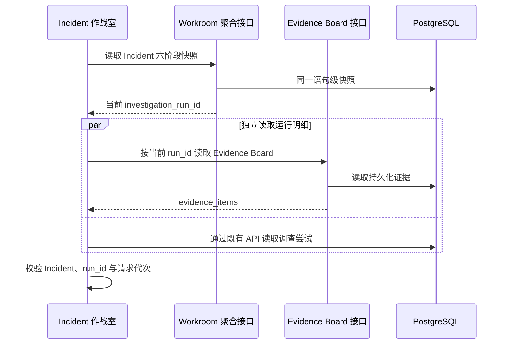

# 作战室部署代码来源展示

## 1. 目标与业务价值

第 46 步已经让部署事实与 GitHub Commit Evidence 建立确定性关系，但这些字段只存在于 API 和数据库中。第 47 步把版本迁移、代码仓库、完整 Commit SHA 和匹配状态展示到 Incident 作战室，让值班工程师可以直接回答：

- 哪个版本被部署；
- 部署声明来自哪个固定仓库；
- 对应哪个不可变提交；
- 当前调查是否真的观察到同一条 GitHub Commit Evidence；
- 没有匹配时是历史未声明、尚未关联，还是仅仅超出查询时间窗。

页面保持只读，不增加审批、执行、GitHub 写入或模型工具权限。

## 2. 复用现有 Evidence Board 接口

后端已有 `GET /api/v1/investigations/{run_id}/evidence-board`，它返回一次调查持久化后的证据、专业报告和假设关系。本切片不把可增长的证据数组塞进 `GET /api/v1/incidents/{id}/workroom`，也不修改数据库：

这样核心作战室快照继续保持轻量，证据明细仍以调查运行作为一致性边界。刷新时调查尝试与 Evidence Board 并行读取，避免串行增加页面延迟。

## 3. 前端状态与迟到响应护栏

Pinia 保存独立的 `evidenceBoard`、`evidenceBoardLoading` 和 `evidenceBoardError`。明细响应只有同时满足以下条件才可以进入当前页面：

1. 返回的 `investigation_run_id` 与请求的 run ID 一致；
2. Incident 选择代次没有变化；
3. 作战室请求代次没有变化；
4. 当前选中的 Incident ID 没有变化；
5. 当前作战室调查 ID 仍是该 run ID。

切换 Incident 或调查运行时先清空旧 Evidence Board。较早请求即使稍后成功返回，也不能覆盖新运行的数据；失败只写入仍然有效的当前请求状态。

## 4. 部署来源展示状态

组件只选择 `kind=change`、`source=change-simulator` 且 `change_type=deployment` 的持久化证据，不把普通 GitHub Commit 当成部署。

| 页面状态 | 来源状态 | 页面含义 |
| --- | --- | --- |
| `已精确匹配` | `matched` | 部署引用的仓库和完整 SHA 与指定 GitHub Commit Evidence 再次核对一致 |
| `时间窗未观察到` | `commit_not_observed` | 当前调查窗口未取得该提交，不代表提交不存在 |
| `等待 GitHub 关联` | `declared` | 部署已经声明仓库和 SHA，但本次数据源没有执行 GitHub 组合 |
| `未声明代码来源` | `not_declared` | 历史部署没有代码引用，系统不推测 Commit |
| `关联数据异常` | 非法或矛盾组合 | 缺少必要字段、状态未知或引用的 GitHub Evidence 不一致，页面拒绝宣称匹配 |

第 46 步之前持久化的 Evidence 没有 `code_reference_status`。当仓库、SHA 和状态同时缺省时，页面按历史 `not_declared` 处理，而不是误报数据损坏；如果只出现部分引用字段，则仍显示异常。

## 5. GitHub 外链的纵深校验

`matched` 不直接等于可以渲染外链。页面先按 `github_commit_evidence_id` 找到同一 Evidence Board 内的证据，并再次确认：

- `source=github-rest`；
- `change_type=source_commit`；
- 仓库大小写归一化后与部署仓库相同；
- 完整 Commit SHA 与部署 SHA 相同。

引用证据不一致时，页面把状态降为 `关联数据异常`。只有关联证据一致后，页面才进一步检查 URL 必须使用 HTTPS、主机固定为 `github.com`、路径严格等于 `/{owner}/{repo}/commit/{full_sha}`，且没有账号信息、端口、查询参数或片段。URL 不符合白名单时只隐藏链接，不改变已经由业务证据确认的匹配状态。

外链使用 `target=_blank` 与 `rel="noopener noreferrer"`。Commit 标题和摘要继续由 Vue 文本插值转义，不能注入 HTML。

## 6. 页面布局

每条部署事实显示：

- 目标版本和状态徽标；
- 部署 Evidence 摘要；
- 前后版本、代码仓库与完整 Commit SHA；
- 可用时的只读 GitHub Evidence 链接；
- 对当前状态的诚实解释和观察时间。

完整 SHA 使用等宽字体和强制换行。窄屏下事实表切换为单列，说明与时间纵向排列，避免产生页面横向滚动。

## 7. 测试边界

自动测试覆盖：

1. API 客户端对 run ID 进行 URL 编码；
2. Store 只接收当前 Incident 和当前调查运行的 Evidence Board；
3. 调查运行切换后丢弃迟到响应；
4. 精确匹配时展示仓库、完整 SHA 与白名单链接；
5. 区分未观察到提交和历史未声明来源；
6. 引用 Evidence 不一致时拒绝显示匹配；
7. 非白名单 URL 不渲染为链接；
8. 真实浏览器验证桌面和 390px 窄屏布局、页面无横向溢出和控制台错误。

## 8. 限制与下一步

- 当前展示的是一次调查已经持久化的证据快照，不会在页面中重新查询 GitHub。
- 当前只支持固定 `order-service`、一个代码仓库和一个镜像仓库，没有多服务部署目录。
- 页面不提供复制、审批或执行按钮，仍是只读审查界面。
- 第 48 步已交付受限 CI/CD 部署事件摄取；第 49 步进一步展示镜像仓库、完整 digest 与构建产物声明状态。页面仍只读取调查时持久化的证据快照。

## 9. 面试表达

> 我复用了按调查运行持久化的 Evidence Board 明细，没有扩大核心作战室聚合响应。前端用 Incident、run ID 和两级 generation 丢弃迟到请求；展示 `matched` 前还会复核关联 Evidence 的仓库和完整 SHA，外链再做 GitHub 精确路径白名单。旧证据没有新字段时保持 `not_declared`，不把历史数据误报为损坏。这让软件来源既可见又不会由 UI 夸大可信度。
