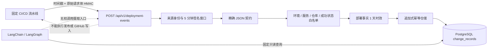

# 受限 CI/CD 部署事件摄取

## 1. 目标与业务价值

过去的部署代码引用只能通过本地管理接口手工写入。它适合确定性演练，却不能证明“哪个流水线身份在什么时候声明了哪个 Commit 已成功部署”。本切片新增默认关闭的部署事件入口，让受信任 CI/CD 流水线自动追加完整部署事实，后续调查才能把实际部署与 GitHub Commit 做确定性关联。

这不是通用 webhook 平台，也不是部署执行器。入口只接收 `order-service` 在 `fault-lab` 的成功部署事实，不能触发构建、发布、回滚、Shell、SQL、GitHub 写入或模型调用。

## 2. 信任边界



认证只证明请求持有本项目配置的共享密钥，业务校验继续决定该请求能否写入。即使签名正确，未知仓库、未知环境、未知服务、失败或进行中的部署、过旧或未来事件、短 SHA 和额外字段仍会被拒绝。

## 3. HTTP 与签名契约

入口为 `POST /api/v1/deployment-events`，只接受 `application/json`，请求体最大 16 KiB。调用方必须发送：

- `X-OpsSwarm-Key-Id`：服务端配置的单一安全来源身份；
- `X-OpsSwarm-Timestamp`：当前 Unix 秒级时间戳；
- `X-OpsSwarm-Signature`：`sha256=<64 位小写十六进制摘要>`。

签名内容严格为：

```text
HMAC-SHA256(secret, unix_timestamp + "." + raw_request_body)
```

签名覆盖原始请求字节，因此流水线必须对最终发送的完全相同字节计算摘要。签名时间默认只允许前后 5 分钟，使用常量时间比较验证 key ID、签名摘要，认证失败不返回已配置身份、仓库或密钥细节。

请求体固定为：

```json
{
  "delivery_id": "github-run-12345",
  "environment": "fault-lab",
  "service_name": "order-service",
  "repository": "kill-t/ops-swarm",
  "commit_sha": "0123456789abcdef0123456789abcdef01234567",
  "from_version": "stable",
  "to_version": "2026.08.31-rc1",
  "deployment_status": "succeeded",
  "deployed_at": "2026-08-31T12:00:00Z"
}
```

`repository` 必须与服务端固定白名单完全一致；服务端使用白名单值构造持久记录，不能由请求绕过。`deployed_at` 必须带时区，不能晚于服务端接收时间，默认不能早于接收时间 1 天。

## 4. 幂等与审计

CI/CD 记录使用独立来源 `ci-deployment-ingestion`，不会伪装成本地 `fault-lab-change-simulator`。新增 `source_identity` 保存经过认证的 key ID：本地管理入口固定为 `local-admin`，CI/CD 来源禁止使用该保留身份。

幂等键仍为 `(source, external_change_id)`，其中 CI/CD 的 `external_change_id` 来自 `delivery_id`：

- 第一次合法投递返回 `201`；
- 相同部署内容和相同 `deployed_at` 精确重放返回原记录及 `200`；
- 相同投递号更换认证来源身份、版本、仓库、Commit 或部署发生时间返回 `409`；
- 本地模拟器与 CI/CD 可以使用相同外部编号，因为它们是两个独立事实来源。

记录的 `occurred_at` 使用流水线声明且经过时效校验的 `deployed_at`；`recorded_at` 使用服务端 UTC 时钟。数据库 CHECK 进一步保证来源身份配对，且 CI/CD 来源只能写入包含合法代码引用的部署事实。迁移为历史记录回填 `source_identity=local-admin`，不修改历史内容摘要。

## 5. 调查证据边界

Agent 的工具和证据来源名继续保持 `change-simulator`，因为这是规范化调查适配器的稳定标识，不代表所有上游行都由模拟器产生。每条 Change Evidence 新增：

- `record_source`：持久事实来源；
- `source_identity`：已认证来源身份。

适配器的重复键改为 `(record_source, external_change_id)`，避免把两个来源的合法同号记录误判为响应损坏。Agent 仍只能通过有界只读接口读取规范化证据，不能访问签名密钥或部署摄取接口。

## 6. 配置与运行

功能默认关闭。Compose 只把以下显式环境变量传给 `change-service`：

```ini
OPSSWARM_DEPLOYMENT_INGESTION_ENABLED=true
OPSSWARM_DEPLOYMENT_INGESTION_KEY_ID=github-actions-production
OPSSWARM_DEPLOYMENT_INGESTION_SECRET=至少32字节的随机密钥
OPSSWARM_DEPLOYMENT_INGESTION_REPOSITORY=kill-t/ops-swarm
OPSSWARM_DEPLOYMENT_INGESTION_IMAGE_REPOSITORY=ghcr.io/kill-t/ops-swarm-order-service
OPSSWARM_DEPLOYMENT_INGESTION_MAX_SIGNATURE_AGE_SECONDS=300
OPSSWARM_DEPLOYMENT_INGESTION_MAX_EVENT_AGE_SECONDS=86400
```

第 49 步起，新投递还必须携带与镜像仓库白名单一致的 `image_repository` 和不可变 `image_digest`；历史 v1 记录不受影响。

密钥只放在未提交的 `.env` 或 CI/CD Secret 中。配置未完成时服务启动失败；关闭时入口稳定返回 `503`。这使部署事实写入成为显式启用能力，不会因为升级容器而意外开放。

## 7. 状态码

| 状态码 | 含义 |
| --- | --- |
| `200` | 精确重放，返回原记录 |
| `201` | 首次追加成功 |
| `400` | 请求长度声明不合法 |
| `401` | 身份、签名格式、签名值或签名时间无效 |
| `403` | 代码仓库或镜像仓库不在固定白名单 |
| `409` | 投递号已对应不同不可变事实 |
| `413` | 请求体超过 16 KiB |
| `415` | 非 `application/json` |
| `422` | JSON 契约、部署状态或事件时间无效 |
| `503` | 摄取能力未启用 |

## 8. 限制与下一步

- 当前只支持一个 key ID 和一条共享 HMAC 密钥，没有密钥轮换重叠窗口。
- 当前只支持固定服务、固定演练环境和固定仓库，没有服务部署目录。
- 第 49 步已用显式来源契约 v2 增加镜像仓库与 digest；镜像签名、运行实例核对和软件物料清单仍未实现。
- 当前没有仓库内 GitHub Actions 示例；接入真实流水线时应只给读取 Secret 和调用本地入口的最小权限。
- 下一步应独立核对运行实例元数据，不能把部署身份声明的 digest 直接当成已验证运行事实。

## 9. 面试表达

> 我没有直接开放一个通用 webhook，而是建立默认关闭的部署事实入口。流水线对时间戳和原始请求体做 HMAC，服务端再限制签名窗口、请求大小、固定环境、固定服务、固定仓库、成功状态和事件时效。PostgreSQL 用来源加投递号做并发幂等，并持久化已认证来源身份；同一投递号的内容或部署时间漂移会返回冲突。Agent 只读取规范化证据，完全拿不到密钥和写接口，因此自动化部署事实与 LLM 权限是分离的。
