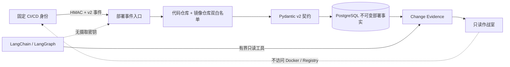

# 部署构建产物摘要

## 1. 目标与业务价值

Commit SHA 只能回答“部署声明对应哪份源码”，不能回答“这份源码构建出了哪个容器镜像”。如果事故发生后镜像 tag 被覆盖，单凭 `release:latest` 无法复现或审计实际构建产物。本切片在部署事实中增加不带 tag 的镜像仓库与 SHA-256 digest，让一条新部署记录同时保存：

```text
服务 + 版本 + 代码仓库 + Commit SHA + 镜像仓库 + 镜像 digest
```

本步建立的是部署系统声明的 Commit—构建产物映射，不宣称已经独立验证运行实例。系统不会获得 Docker Socket、镜像仓库写权限、Kubernetes 权限或任意 Shell。

## 2. v2 部署事件契约

第 48 步已经持久化的 CI/CD 记录保持 `source_contract_version=1`。新入口固定写入 v2，并在原有字段上增加：

```json
{
  "delivery_id": "github-run-12345",
  "environment": "fault-lab",
  "service_name": "order-service",
  "repository": "kill-t/ops-swarm",
  "commit_sha": "0123456789abcdef0123456789abcdef01234567",
  "image_repository": "ghcr.io/kill-t/ops-swarm-order-service",
  "image_digest": "sha256:0123456789abcdef0123456789abcdef0123456789abcdef0123456789abcdef",
  "from_version": "stable",
  "to_version": "2026.08.31-rc1",
  "deployment_status": "succeeded",
  "deployed_at": "2026-08-31T12:00:00Z"
}
```

镜像契约只接受：

- 小写镜像仓库，可包含 `1～65535` 的固定 registry 端口和多级路径；
- 不包含 tag、`@digest`、协议、用户信息、查询参数或片段；
- digest 固定为 `sha256:` 加 64 位小写十六进制；
- 请求仓库必须与服务端 `OPSSWARM_DEPLOYMENT_INGESTION_IMAGE_REPOSITORY` 完全一致。

代码仓库和镜像仓库使用两条独立白名单。签名正确但任一仓库越权仍返回 `403`。服务端使用自己的白名单值构造持久记录，避免请求字段在校验后被替换。

## 3. 向后兼容与显式契约版本

直接让所有 CI 记录强制包含 digest 会使第 48 步已经保存的合法记录无法读取；给历史记录伪造 digest 又会破坏不可变审计。因此 `change_records` 新增 `source_contract_version`：

| 来源 | 契约版本 | 规则 |
| --- | --- | --- |
| 本地模拟器 | v1 | 保持原有三种固定变更契约 |
| CI/CD 历史记录 | v1 | 必须有完整代码引用，禁止构建产物引用 |
| CI/CD 新记录 | v2 | 必须同时有完整代码引用与构建产物引用 |

迁移只把现有行回填为 v1，不修改 `details` 或内容摘要。新 HTTP 入口不接受客户端选择版本，而是由服务端固定写 v2。相同来源和投递号若切换契约版本会返回 `409`，不能利用升级重写旧事实。

## 4. 持久化与数据库护栏

构建产物继续保存在部署详情的不可变 `artifact_reference` 对象中：

```json
{
  "image_repository": "ghcr.io/kill-t/ops-swarm-order-service",
  "image_digest": "sha256:..."
}
```

这样版本、代码和构建产物处于同一份内容哈希保护的部署事实中，不创建重复关联表。Alembic `0026_deployment_artifact_digest` 增加：

- 非空的小整数 `source_contract_version`；
- 来源与契约版本配对 CHECK；
- v1 禁止构建产物引用，避免历史契约被赋予新语义；
- CI/CD v2 必须包含代码和构建产物引用的 CHECK；
- 构建产物对象必须恰好两个字段，并满足镜像仓库和 SHA-256 digest 形状 CHECK；
- 非部署记录禁止携带构建产物引用。

存在 v2 记录时迁移拒绝降级到 v1 schema，避免删除契约版本后无法区分历史兼容记录与新强制记录。

## 5. Evidence Board 与作战室

变更调查 Evidence 新增：

- `source_contract_version`；
- `artifact_reference_status=declared|not_declared`；
- `image_repository`；
- `image_digest`。

历史 v1 记录明确显示“历史记录未声明”，不会猜测镜像。作战室在浏览器中再次校验镜像仓库和完整 digest：两者齐全且格式正确才显示“已声明不可变摘要”，缺字段或格式异常显示“镜像来源异常”。页面只展示业务库中当前调查的 Evidence 快照，不访问 Docker 或镜像仓库。

## 6. 信任边界



HMAC 证明固定身份声明了这组字段，内容摘要和幂等规则防止同号漂移，但它们不是镜像签名或构建证明。值班工程师可以审查声明，不能把它解释成 OpsSwarm 已经独立拉取并验证镜像。

## 7. 测试重点

- 旧部署内容摘要在增加可选字段后保持不变；
- tag、大小写仓库、错误端口和非 SHA-256 摘要被拒绝；
- 镜像仓库白名单越权返回 `403`；
- v2 写入、查询和精确重放保留完整 artifact reference；
- 内容、发生时间、身份或契约版本漂移返回 `409`；
- 绕过 Pydantic 写入缺失或损坏的 v2 artifact 时 PostgreSQL 拒绝；
- 空库可以完整降级升级，存在 v2 审计事实时拒绝有损降级；
- Agent Evidence 和作战室正确区分已声明、历史未声明与异常字段。

## 8. 限制与下一步

- 当前不验证镜像仓库中该 digest 是否仍可拉取，也不验证 Cosign/Notary 签名或 SBOM。
- 当前没有构建证明，CI/CD 身份仍可能错误声明 Commit 与镜像的对应关系。
- 第 50 步已增加不依赖 Docker Socket 的只读运行身份和确定性比较；它证明部署环境注入身份与最新部署事实的一致性，不是 Docker Engine 独立证明。
- 当前仍没有镜像签名、构建证明、多实例滚动发布判定或 Registry 可拉取性验证。

## 9. 面试表达

> 我把部署来源从 Commit 扩展到不可变容器镜像摘要，同时没有破坏历史审计。现有 CI 记录显式回填为来源契约 v1，新入口由服务端固定写 v2，v2 必须同时有代码引用和镜像引用。镜像 tag、未知仓库和非 SHA-256 摘要都会被拒绝，PostgreSQL CHECK 防止绕过应用；相同投递号切换版本或 digest 会冲突。Agent 和前端只读这些事实，不拥有 Docker Socket 或镜像仓库权限。我也明确区分“部署系统声明”与“运行实例已验证”，把后者留给独立的确定性核对切片。
