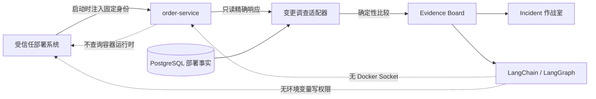

# 运行实例构建产物核对

## 1. 目标与业务价值

第 49 步保存了 CI/CD 身份声明的 Commit 与镜像 digest，但尚不能回答“当前运行进程携带的镜像身份是否与最新部署事实一致”。本切片让 `order-service` 暴露默认关闭的只读运行元数据，并由调查适配器确定性比较：

```text
最新部署声明的 image_repository + image_digest
                        对比
当前进程启动时注入的 image_repository + image_digest
```

结果进入 Evidence Board 和 Incident 作战室。比较逻辑是普通 Python 等值判断，不交给 LLM；Agent 只能读取结果，不能访问 Docker Socket、主机文件、容器运行时 API 或部署写接口。

## 2. 运行元数据契约

订单服务新增 `GET /api/v1/runtime-metadata`。功能默认关闭，关闭时稳定返回 `503 runtime_metadata_unavailable`；启用时必须由部署系统完整注入：

```ini
OPSSWARM_RUNTIME_METADATA_ENABLED=true
OPSSWARM_RUNTIME_INSTANCE_ID=aaaaaaaa-aaaa-4aaa-8aaa-aaaaaaaaaaaa
OPSSWARM_RUNTIME_IMAGE_REPOSITORY=ghcr.io/kill-t/ops-swarm-order-service
OPSSWARM_RUNTIME_IMAGE_DIGEST=sha256:0123456789abcdef0123456789abcdef0123456789abcdef0123456789abcdef
```

成功响应固定为：

```json
{
  "schema_version": 1,
  "service_name": "order-service",
  "identity_source": "deployment-environment",
  "instance_id": "aaaaaaaa-aaaa-4aaa-8aaa-aaaaaaaaaaaa",
  "image_repository": "ghcr.io/kill-t/ops-swarm-order-service",
  "image_digest": "sha256:0123456789abcdef0123456789abcdef0123456789abcdef0123456789abcdef",
  "started_at": "2026-09-01T08:00:00Z",
  "reported_at": "2026-09-01T08:01:00Z"
}
```

实例 ID 必须是 UUID；镜像仓库沿用不带 tag、协议和用户信息的精确格式；digest 只接受 `sha256:` 加 64 位小写十六进制。启用但字段缺失或非法时服务启动失败，防止部分配置被误认为可信身份。时间必须带时区，且启动时间不能晚于报告时间。

## 3. 确定性核对规则

调查窗口可能包含多次部署，旧版本与当前实例不同是正常历史，不能全部报成漂移。因此适配器先按 `(occurred_at, recorded_at, record_id)` 选出最新部署事实：

| 部署事实 | 构建产物 | 运行身份 | `runtime_artifact_status` |
| --- | --- | --- | --- |
| 最新 | 已声明 | 仓库和 digest 都相等 | `matched` |
| 最新 | 已声明 | 任一字段不相等 | `mismatched` |
| 最新 | 已声明 | 端点明确返回 503 | `unavailable` |
| 历史 | 已声明 | 不查询、不比较 | `historical` |
| 任意 | 未声明 | 无法比较 | `not_declared` |

只有最新部署带 artifact 时才发起一次运行元数据查询。只有符合精确错误契约的 `503` 才表示功能明确关闭；响应超过 16 KiB、非预期状态、普通代理 503、超时、字段损坏或报告时间超过新鲜度窗口时，调查失败并重试，不能降级成“没有漂移”。

Evidence 同时保存当前运行仓库、digest、实例 ID、启动时间和身份来源。作战室不会盲信状态字符串：浏览器再次校验字段格式，并重新计算 `matched` 是否真的等于两组仓库与 digest 完全相同；结论和字段矛盾时显示“运行核对数据异常”。

## 4. 调用与权限边界



调查 Worker 的运行元数据地址只允许：

- 本机 `http://127.0.0.1:18001` 或 `http://localhost:18001`；
- Compose 网络内 `http://order-service:8000`。

协议、主机、端口、路径、用户信息、查询参数或片段任一越界都会在启动配置阶段被拒绝。Compose 只给现场调查 Worker 增加固定地址和对订单服务健康状态的依赖，冻结评测不读取运行元数据。

## 5. 信任声明

这个结果证明的是“当前运行进程收到的部署身份”与“部署事件身份声明”是否一致，不是 Docker Engine 级独立证明：

- 应用没有能力从容器内部自行获得 OCI manifest digest，最终 digest 必须由部署系统在创建进程时注入；
- 能控制容器环境变量的主体也可能伪造运行身份；
- HMAC 部署事件与运行身份若来自同一部署平台，匹配证明平台内部一致性，不等同于第三方供应链证明；
- 当前不验证 Registry 可拉取性、Cosign/Notary 签名、SBOM、构建证明或 Kubernetes 实际状态。

这种边界比给 Agent 或业务容器挂载 Docker Socket 更安全，也比把环境变量声明包装成“已经验证实际镜像”更诚实。后续可由独立、最小权限的部署控制器生成签名运行证明，但不能扩大 LLM 权限。

## 6. 测试重点

- 默认关闭、完整启用、部分配置、非法 UUID、带 tag 仓库和非法 digest；
- 运行响应时间线、大小、新鲜度、白名单 URL 和精确 JSON 契约；
- 最新部署的匹配、不匹配、不可用，以及历史部署不参与当前比较；
- 没有 v2 artifact 时不产生额外网络调用；
- 前端重新计算匹配结果，拒绝字段和结论矛盾、非法 UUID 或非法镜像字段；
- Compose 中订单服务不挂载 Docker Socket，现场 Worker 只有固定只读 HTTP 地址。

## 7. 限制与下一步

- 当前只有单实例 `order-service`，没有副本集合、滚动发布或部分实例漂移聚合。
- 运行身份由部署环境注入，没有独立签名和过期轮换机制。
- 当前运行元数据只进入新调查生成的 Evidence 快照，历史 Evidence 不会被后台改写。
- 下一步可增加多实例运行清单与滚动发布判定，或先增加签名运行证明；两者都应由确定性控制面完成，而不是交给模型推测。

## 8. 面试表达

> 我把“CI 声明了某个镜像”和“当前进程携带该镜像身份”拆成两个独立只读事实，再由确定性代码比较。为了避免误报，只核对时间线上最新部署，旧部署标记为 historical。运行元数据默认关闭，启用时必须完整注入实例 UUID、无 tag 仓库和 SHA-256 digest；响应异常或过期会失败关闭。Agent 和业务容器都没有 Docker Socket，前端还会重新计算 matched 是否与字段一致。我也明确说明这是部署平台内部一致性证明，不冒充镜像签名或 Docker Engine 独立证明。
