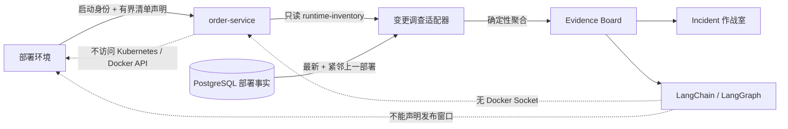

# 多实例运行清单与滚动发布判定

## 1. 目标与业务价值

第 50 步只比较一个运行实例。真实服务滚动发布时，新旧镜像会短暂并存；把所有旧 digest 都判为漂移会制造误报，但仅凭“存在两个版本”就放行又会掩盖异常实例。

本切片增加有界多实例运行清单，并把滚动发布判定固化为确定性规则。LLM 只能读取已经形成的 Evidence，不能决定发布窗口、修改实例清单或访问容器运行时。

## 2. 运行清单契约

保留 `GET /api/v1/runtime-metadata` 兼容单实例调用，新增 `GET /api/v1/runtime-inventory`。运行身份关闭时，新端点精确返回：

```json
{
  "error_code": "runtime_inventory_unavailable",
  "message": "运行清单未启用"
}
```

启用时，当前进程仍由四个原有环境变量声明。可选的 `OPSSWARM_RUNTIME_INVENTORY_DECLARATION` 是一段严格 JSON，只声明其他实例与发布窗口；留空表示单实例稳定状态。成功响应示例：

```json
{
  "schema_version": 1,
  "service_name": "order-service",
  "identity_source": "deployment-environment",
  "instances": [
    {
      "instance_id": "aaaaaaaa-aaaa-4aaa-8aaa-aaaaaaaaaaaa",
      "image_repository": "ghcr.io/kill-t/ops-swarm-order-service",
      "image_digest": "sha256:bbbbbbbbbbbbbbbbbbbbbbbbbbbbbbbbbbbbbbbbbbbbbbbbbbbbbbbbbbbbbbbb",
      "started_at": "2026-09-01T08:00:00Z"
    },
    {
      "instance_id": "cccccccc-cccc-4ccc-8ccc-cccccccccccc",
      "image_repository": "ghcr.io/kill-t/ops-swarm-order-service",
      "image_digest": "sha256:dddddddddddddddddddddddddddddddddddddddddddddddddddddddddddddddd",
      "started_at": "2026-09-01T07:30:00Z"
    }
  ],
  "rollout": {
    "phase": "progressing",
    "rollout_id": "eeeeeeee-eeee-4eee-8eee-eeeeeeeeeeee",
    "started_at": "2026-09-01T07:55:00Z",
    "deadline_at": "2026-09-01T08:05:00Z",
    "target_image_repository": "ghcr.io/kill-t/ops-swarm-order-service",
    "target_image_digest": "sha256:bbbbbbbbbbbbbbbbbbbbbbbbbbbbbbbbbbbbbbbbbbbbbbbbbbbbbbbbbbbbbbbb"
  },
  "reported_at": "2026-09-01T08:01:00Z"
}
```

清单至少 1 个、最多 64 个实例，实例 ID 必须唯一，注入 JSON 最长 64 KiB。所有时间必须带时区，实例和发布开始时间不能晚于报告时间。`stable` 不允许携带发布字段；`progressing` 必须完整携带发布 ID、目标 artifact 和严格递增且不超过 30 分钟的开始/截止时间。当前进程与其他实例重复、未知字段、非法仓库、tag、非法 digest 或未来启动时间都会失败关闭。

## 3. 确定性聚合规则

调查适配器仍只核对时间线中的最新部署，并把紧邻的上一条部署作为唯一允许的旧版本。更早版本即使曾经合法部署，也不能混入当前滚动窗口。

| 运行实例分布 | 发布声明 | 结果 |
| --- | --- | --- |
| 所有实例都等于最新 artifact | 任意合法阶段 | `matched` |
| 同时存在最新和紧邻上一 artifact，无其他版本 | `progressing`、目标等于最新 artifact、报告时间在窗口内 | `rolling_update` |
| 至少一个实例等于最新 artifact，但不满足完整滚动条件 | 稳定期、窗口过期、目标错误或存在未知版本 | `partial_mismatch` |
| 没有任何实例等于最新 artifact | 任意阶段 | `mismatched` |
| 清单明确关闭 | 精确 `503` 契约 | `unavailable` |
| 历史部署或未声明 artifact | 不查询清单 | `historical` / `not_declared` |

Evidence 保存实例总数、目标/上一版本/非预期计数、每个实例的 UUID、仓库、digest、启动时间和确定性分类，同时保存发布窗口和上一 artifact。比较是普通 Python 等值判断，不调用模型。

## 4. 失败关闭与前端复核

- 调查 Worker 仍只允许访问本机 `18001` 或 Compose 内 `order-service:8000`。
- 清单响应上限为 64 KiB；超时、非预期状态、重复 UUID、损坏字段、未来时间或超过新鲜度窗口都会让调查任务失败重试。
- 普通代理 `503` 不能伪装成“功能关闭”，只有精确错误模型才返回 `unavailable`。
- 浏览器重新校验实例字段、唯一性、计数、分类、上一 artifact、发布目标和时间窗口，并重新计算最终状态；Evidence 字符串与原始字段矛盾时显示“运行核对数据异常”。
- 历史 Evidence 保持原快照，页面继续兼容第 50 步的单实例字段，不后台改写审计事实。

## 5. 架构与权限边界



本地故障实验室由环境变量模拟部署控制面清单。`reported_at` 表示订单进程返回该固定声明的时间，不证明其他实例仍存活。应用和 Agent 都没有 Docker Socket、Kubernetes 凭据或服务发现权限，因此这个切片验证的是“部署平台声明内部是否一致”，不是生产副本的独立实时证明。

## 6. 数据与兼容性

本切片不增加数据库表或迁移。运行清单只写入新调查产生的 Evidence JSONB；Incident、调查运行和部署事实仍是业务事实来源。原 `runtime-metadata` 端点和旧 Evidence 字段继续可读，新调查改用 `runtime-inventory`，避免同一次调查分别读取两个可能漂移的快照。

## 7. 测试重点

- 默认关闭、单实例稳定、多实例发布、重复 UUID、未来启动时间、超长发布窗口和非法声明；
- 全匹配、合法滚动、稳定期混跑、窗口过期、目标错误、未知 digest 和全部不匹配；
- 只接受紧邻上一部署，不接受更早历史 artifact；
- 响应大小、新鲜度、URL 白名单和精确 `503` 契约；
- 前端重新计算计数、分类和发布窗口，拒绝矛盾 Evidence；
- Compose 不增加 Docker Socket，现场 Worker 仍只有固定只读 HTTP 地址。

## 8. 限制与下一步

- 清单由故障实验室进程从启动环境读取，不是 Kubernetes Endpoint、ReplicaSet 或 Docker Engine 的实时发现结果。
- 环境变量声明未签名，能修改部署环境的主体仍可伪造清单和发布窗口。
- 当前只判断镜像身份分布，不判断实例 Ready、请求流量权重、可用区或健康探针。
- 下一步应选择一个最小权限的独立部署控制器，提供签名、带时效的运行证明；接入 Kubernetes 时只授予固定 namespace 和 workload 的读取权限。

## 9. 面试表达

> 我没有把滚动发布简单处理成“允许两个版本”。系统只接受最新部署和紧邻上一部署同时存在，并要求部署控制面明确声明 progressing、目标 digest 一致且未超过截止时间；否则就是部分漂移或完全不一致。实例清单有 64 个上限、UUID 唯一、时间线和响应新鲜度校验，前端还会重算分类与计数。Agent 只读 Evidence，没有 Docker Socket。当前清单是本地部署环境声明，不冒充 Kubernetes 实时证明，下一步才会接最小权限、带签名的部署控制器。
